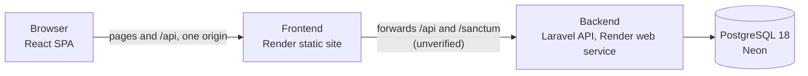

# WorkFlow

A multi-tenant project and workflow management application for organisations that need to plan projects, assign tasks, track deadlines and see progress, with each organisation's data kept strictly private.

> **Status: under development.** The planning phase is complete. No application code exists yet, and nothing is deployed. See [current status](#current-status).

**📓 [Development journal](docs/00-development-journal.md)**: the dated record of how WorkFlow is being designed, built and tested, including the decisions I changed, the experiments that are still open, and why.

---

## The problem

Small and mid-sized teams often manage projects across spreadsheets, chat threads and general-purpose tools, which makes it hard to see who owns what, what's late, and how a project is really progressing. Hosted tools solve this, but a tool serving many organisations has to guarantee that one organisation can never see another's data.

I'm building WorkFlow to do both: give each organisation a private **workspace** for its members, projects and tasks, and enforce the boundary between workspaces at every layer of the system, not just in the user interface.

## Goals

- Each organisation works in its own isolated workspace. Cross-workspace access is prevented by middleware, query scoping, authorisation policies **and** database constraints, and proven by automated tests.
- Clear roles: Administrators run the workspace, Project Managers run their projects, and Team Members work on their tasks.
- A focused first version, built carefully, rather than a broad one.
- Hosting that costs nothing at this stage, with a public demonstration that only ever holds fictional data.

## Planned functionality (version 1)

| Area | What it covers |
|---|---|
| Accounts | Registration with email verification, login, password reset, profile |
| Workspaces | Create workspaces, invite members by email, assign roles, switch between workspaces |
| Projects | Create, edit and archive projects, with project members and managers |
| Tasks | Tasks with priority, due date and one assignee, a Kanban board with an accessible keyboard alternative, filters and search |
| Collaboration | Comments, activity history, in-app notifications |
| Reporting | Workspace dashboard and per-project reports |

The full scope, including what's postponed, is in the [product requirements](docs/01-product-requirements.md). **None of it is implemented yet.**

## Technology

| Layer | Choice | Status |
|---|---|---|
| Backend | Laravel 13, PHP 8.3, REST API | Approved, not started |
| Authentication | Laravel Sanctum, cookie-based SPA sessions | Approved, not started |
| Frontend | React, Vite, JavaScript, Tailwind CSS | Approved, not started |
| Database | PostgreSQL 18, hosted on Neon | Approved, not started |
| Hosting | Render: a static site for the frontend and a Docker web service for the API | **Unverified.** Under investigation |
| Version control | Git and GitHub, one repository | In use |

## Architecture



The frontend and backend are separate applications in one repository, intended to be deployed as separate services. Every organisation's data lives in one shared PostgreSQL database. Each tenant-owned row carries a `workspace_id`, and composite foreign keys make cross-workspace references impossible at the database level.

**One part of this is still an open question.** Render's free domains are treated by browsers as separate sites, which would break Sanctum's cookie authentication if the frontend called the API directly. The plan is for the frontend's static site to forward API requests to the backend, so the browser only sees one origin. Render doesn't document whether its forwarding preserves cookies and headers, so I'm testing that in the [Render forwarding experiment](https://github.com/Martins-Code/workflow/tree/spike/render-proxy-test/experiments/render-proxy) before building on it. If it fails, the documented fallbacks are in [architecture, section 10](docs/02-system-architecture.md#if-the-forwarding-fails-validation).

## Documentation

| Document | Contents |
|---|---|
| [00 Development journal](docs/00-development-journal.md) | Dated record of decisions, experiments and progress. **Start here for the history** |
| [01 Product requirements](docs/01-product-requirements.md) | Users, functional requirements, scope, decisions D1–D13, acceptance criteria |
| [02 System architecture](docs/02-system-architecture.md) | Architecture decision records, multi-tenancy, security, frontend, hosting |
| [03 Database design](docs/03-database-design.md) | Schema, constraints, indexes, PostgreSQL design notes |
| [04 Permissions matrix](docs/04-permissions-matrix.md) | Workspace and project roles, and what each can do |
| [05 API specification](docs/05-api-specification.md) | The planned REST contract |
| [06 Testing strategy](docs/06-testing-strategy.md) | Test plan, tenant isolation suite, execution status |
| [07 Development roadmap](docs/07-development-roadmap.md) | Phases, current status, Git workflow, next steps |
| [Documentation guide](docs/documentation-guide.md) | How documentation is written and kept accurate |

## Engineering investigations

Experiments that answer a specific question live on their own `spike/` branches and are never merged into `main`. Their conclusions are copied into `docs/`.

| Investigation | Question | Status |
|---|---|---|
| [Render forwarding](https://github.com/Martins-Code/workflow/tree/spike/render-proxy-test/experiments/render-proxy) (`spike/render-proxy-test`) | Can a Render static site forward requests to a separate Render service while preserving what Sanctum's cookie authentication needs? | Built and checked locally against a stand-in. **Not yet run on Render. Docker image not yet built** |

## Repository structure

```
workflow/
├── README.md     This file
└── docs/         Requirements, architecture and planning documents, and the development journal
```

These are planned for the next phase and **don't exist yet**:

```
├── backend/      Laravel API, with its own Dockerfile
├── frontend/     React SPA
└── .github/      CI and deployment workflows
```

## Current status

| Phase | Status |
|---|---|
| 1. Planning | Complete. Approved on 2026-11-10 |
| 2. Foundation and hosting validation | In progress. The Render forwarding experiment is built and checked locally. Render deployment and application scaffolding haven't started |
| 3–12 | Not started |

The full plan is in the [roadmap](docs/07-development-roadmap.md), and the history is in the [development journal](docs/00-development-journal.md).

## Running WorkFlow locally

There's nothing to run yet. Setup instructions will be added here when the Laravel and React applications are scaffolded in Phase 2. The local environment is planned in [architecture, section 10](docs/02-system-architecture.md#local-development-on-windows).
