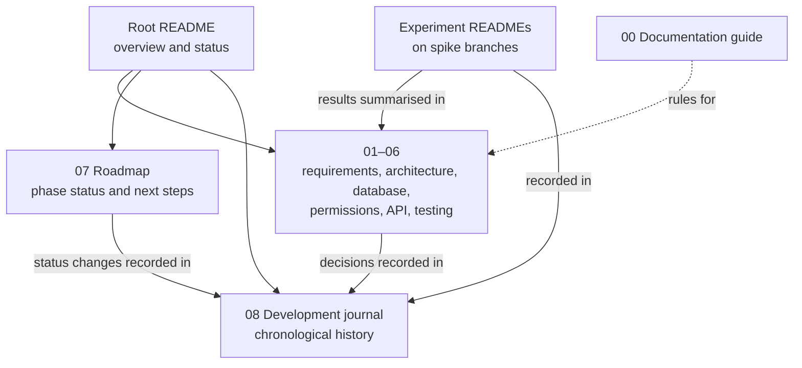

# 00 — Documentation Guide

**Status:** In use since 2026-11-10 · **Last reviewed:** 2026-11-10

This guide is the standard for every document in the WorkFlow repository: the root README, the numbered documents in `docs/`, experiment READMEs, and the development journal. I wrote it so the documentation stays accurate as the project changes, and so nobody, including me in six months, has to guess which document to trust.

---

## 1. What each document is for

Each kind of fact has exactly one home. Other documents link to it rather than repeating it.

| Document | Purpose | Single source of truth for |
|---|---|---|
| [`README.md`](../README.md) (repository root) | Introduces the project: what it is, current status, how to find everything else | Nothing in depth. It summarises and links |
| [`00-documentation-guide.md`](00-documentation-guide.md) | How documentation is written and maintained | These rules |
| [`01-product-requirements.md`](01-product-requirements.md) | What WorkFlow must do, for whom, and the product-level decisions (D1–D13) | Requirements, scope, metric definitions, release acceptance criteria |
| [`02-system-architecture.md`](02-system-architecture.md) | How WorkFlow is built and why: architecture decision records (ADRs), tenancy design, frontend, security, hosting | Architecture decisions, risks, hosting strategy |
| [`03-database-design.md`](03-database-design.md) | Tables, constraints, indexes and PostgreSQL-specific rules | The schema |
| [`04-permissions-matrix.md`](04-permissions-matrix.md) | Who can do what, at workspace and project level | Roles and access rules |
| [`05-api-specification.md`](05-api-specification.md) | The REST contract: endpoints, request and response shapes, errors | API contracts |
| [`06-testing-strategy.md`](06-testing-strategy.md) | How WorkFlow is tested, and what has actually been executed | Test plan and execution status |
| [`07-development-roadmap.md`](07-development-roadmap.md) | The order of work, phase status, Git workflow, definition of done | Current project status and next steps |
| [`08-development-journal.md`](08-development-journal.md) | The chronological record of what happened and why | History |
| `experiments/<name>/README.md` | One investigation: question, method, results and conclusion | That experiment's details and raw results |

---

## 2. Voice and style

- **First-person engineering voice.** These documents describe my product, my decisions and my implementation. I write "I chose PostgreSQL because…", not "we recommend" or "you should". Not every sentence starts with "I": specifications stay in plain descriptive language ("The backend rejects…"), and decisions and history are first person.
- **No reader-directed instructions** such as "you must" or "tell me". Setup steps can use the imperative ("Run `npm install`"), as in any README.
- **The product isn't a showcase.** Requirements describe users' needs and system behaviour. Statements about impressing anyone, or about demonstrating skills, don't belong in engineering documents.
- **Tools aren't authors.** I use an AI assistant for drafting and review. The documents record my decisions and don't present a tool as the developer or owner.
- **Never overstate.** Nothing is described as implemented, tested, validated or deployed until it is (section 3).
- **Plain, precise language.** UK English. Short sentences. Exact names for files, settings and commands. Each fact stated once.
- **Structure for scanning.** Headings, tables for comparisons, numbered steps for procedures, and Mermaid diagrams where a picture explains a flow better than text.
- **Dates** use `YYYY-MM-DD`. Every document has a status line with a "Last reviewed" date.

---

## 3. Status vocabulary

Every feature, decision, endpoint, test or deployment is described with exactly one of these words:

| Status | Meaning |
|---|---|
| **Proposed** | Written down, not yet agreed |
| **Approved** | Agreed as the plan. Nothing is built |
| **Unverified** | Approved, but depends on an assumption still being tested. Always name the assumption and the check |
| **Implemented** | Code exists and is merged into `main` |
| **Tested** | Implemented, with automated tests that pass in CI. Say which tests |
| **Deployed** | Running on the hosted environment. Give the date |
| **Validated** | An assumption has been checked in the real environment. Link the evidence |
| **Superseded** | Replaced by a later decision. Link the replacement |
| **Rejected** | Considered and not adopted. Keep the reason |

**Rules:**

- A local test against a stand-in isn't validation of the real environment. Record it as "checked locally against X", and say what it doesn't establish.
- Specification documents (01–05) describe the planned system. Their status line says whether anything is implemented yet.
- [The testing strategy](06-testing-strategy.md#execution-status) keeps a table of what has actually been executed, separate from the plan.

---

## 4. Recording decisions

| Kind of decision | Where it lives | Identifier |
|---|---|---|
| Product behaviour or scope | [Requirements, section 2](01-product-requirements.md#2-confirmed-decisions) | `D<number>` |
| Architecture or technology | [Architecture, section 2](02-system-architecture.md#2-architecture-decisions), as an ADR | `ADR-<number>` |

**An ADR records:**

1. What it is.
2. The problem it solves.
3. Why I chose it.
4. Alternatives and their trade-offs.
5. How it works in WorkFlow.
6. Its status.
7. A short summary of the reasoning.

**Changing a decision:**

- I never edit a past decision to make it look as though it was always right.
- The old decision is marked **Superseded by ADR-x** (or **Superseded by Dx**), and the new one explains what changed and why.
- Every decision, and every change to one, gets a journal entry with the date and the evidence that prompted it.

Numbers are never reused.

---

## 5. Updating documentation when something changes

**Every implementation task ends with a documentation review.** Before the work is finished:

1. **Requirements:** did any requirement change? Update [01](01-product-requirements.md).
2. **Architecture:** did an architectural decision change? Add or supersede an ADR in [02](02-system-architecture.md).
3. **Database:** did the schema, constraints or indexes change? Update [03](03-database-design.md).
4. **API and permissions:** did an endpoint contract or access rule change? Update [05](05-api-specification.md) or [04](04-permissions-matrix.md), and mark endpoints as implemented when they are.
5. **Testing:** did the test approach change, or did tests run for the first time? Update [06](06-testing-strategy.md), including its execution status.
6. **Status:** update the phase status in [07](07-development-roadmap.md).
7. **Root README:** only if the overall description, setup or status changed.
8. **Journal:** append an entry for any meaningful milestone, decision, failure or finding.
9. **Experiments:** update the experiment's README when the experiment changes or produces results.

**Only affected documents are changed.** Touching every file "for consistency" creates noise and hides real changes.

---

## 6. Experiments and investigations

An experiment answers one question that would be expensive to get wrong later, such as "does Render's forwarding preserve cookies?"

- It lives on a `spike/<name>` branch, in `experiments/<name>/`, and **is never merged into `main`**. Its code is disposable. Its findings aren't.
- Its README records: the question, why it matters, the architecture under test, each check with what it does and **doesn't** establish, how to run it, actual results with dates and environment, limitations, and the decision criteria.
- Results are recorded as they happened, including failures and inconclusive results. **A failed experiment is a useful result** and stays documented.
- Findings are copied into the relevant specification document and the journal on `main`, so the conclusion survives after the spike branch is deleted.
- Because the experiment folder doesn't exist on `main`, documents on `main` link to it with its GitHub branch URL, for example `https://github.com/Martins-Code/workflow/tree/spike/render-proxy-test/experiments/render-proxy`.

---

## 7. Unresolved questions and conflicts

- When something isn't known, it's marked **Unresolved** where it's relevant, with what would resolve it. I don't guess an answer to make a document look complete.
- If two documents disagree, I find the evidence (code, test results, commit history, an earlier decision) and fix the wrong one. If the evidence doesn't settle it, both documents mark the point as **Unresolved** and the journal records the conflict.
- Risks and open technical questions live in [architecture, section 9](02-system-architecture.md#9-technical-risks). Product gaps and their defaults live in [requirements, section 2](01-product-requirements.md#other-gaps-identified).

---

## 8. The development journal

The [journal](08-development-journal.md) is append-only:

- Entries are dated and in chronological order. New entries go at the end.
- **Past entries aren't rewritten** to make the history look cleaner. If something in an earlier entry turns out to be wrong, a new entry says so and explains why.
- Entries cover real work only: decisions, investigations, implementation, tests, deployments, failures and lessons. Every claim is backed by evidence in the repository, its history, or a recorded test result.

---

## 9. Before committing documentation

- Mermaid diagrams parse without errors.
- Internal links and anchors resolve.
- Status lines and "Last reviewed" dates are current.
- No unimplemented feature is described as done, and nothing unverified is described as validated.
- No section addresses the reader as "you", except setup instructions, and none frames the project as a showcase.
