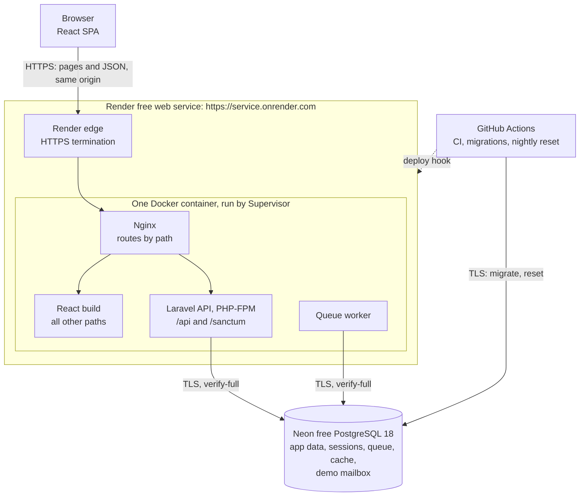
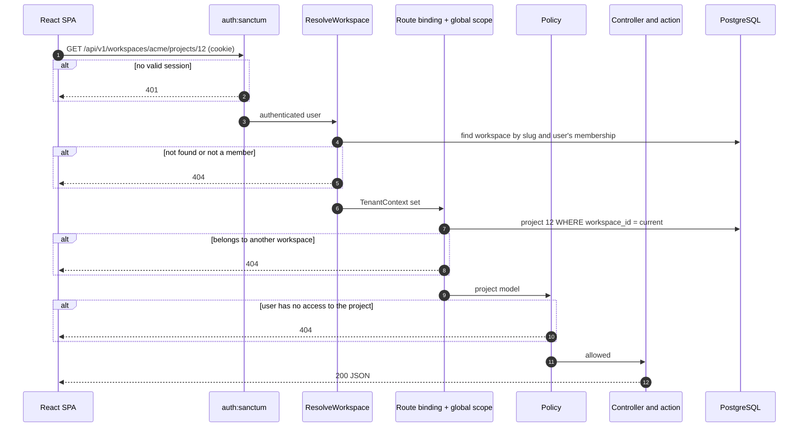

# 02 — System Architecture

**Status:** Revised, awaiting final approval · **Date:** 2026-11-08

Decision references such as **D5** point to [01 — Product Requirements](01-product-requirements.md#2-confirmed-decisions).

---

## 1. System overview

WorkFlow is two separate applications: a React single-page app (SPA) and a Laravel REST API backed by PostgreSQL. They have separate code, dependencies, configuration, tests and CI jobs, and they communicate only through the HTTP API. For the free portfolio demo, their build outputs are packaged into **one container on one origin**, so the browser sees a single site. This is the D7 demo deployment, and section 10 explains why.



### Versions

| Component | Version | Note |
|---|---|---|
| Laravel | 13 | Latest major confirmed. Security fixes until Q1 2028. Check for a newer release when scaffolding in Phase 2 |
| PHP | 8.3 | Laravel 13's minimum. Already installed in your Laragon |
| PostgreSQL | 18 | Latest major release, supported until November 2030. Used locally, in CI and on Neon (D12). Laravel 13 supports PostgreSQL 10 and later. Your Laragon MySQL is no longer used by WorkFlow |
| Node | 22 | Already installed. Used only to build the frontend |

---

## 2. Architecture decisions

### ADR-01: Shared database with `workspace_id` — approved, with one strengthening

| Option | Isolation | Operating cost | Verdict |
|---|---|---|---|
| Shared tables with `workspace_id` | Logical; a bug can leak data | One schema, one migration run | **Chosen** |
| One schema per tenant | Stronger | Migrations per tenant, connection switching | Too heavy for this scale |
| One database per tenant | Strongest | Provisioning, backups and costs per tenant | Justified only by contractual requirements |

Your proposal is the right choice for this project. Its weakness is that **a single forgotten `WHERE` clause becomes a data breach.** The design therefore doesn't depend on developers remembering. It adds layers that fail safely (section 3) and uses composite foreign keys, so the database itself refuses cross-tenant links ([database design, section 2](03-database-design.md#2-how-workspace-identifiers-work)).

**Trade-offs accepted:**

- You cannot restore a single tenant from a backup without extra tooling.
- One heavy tenant can affect the others.
- Extracting a tenant later requires a data export.

### ADR-02: Sanctum SPA cookie authentication, not bearer tokens

Sanctum supports both. Bearer tokens must be stored where JavaScript can read them, normally `localStorage`, so any XSS bug can steal them. Sanctum's SPA mode uses Laravel's normal session in an `HttpOnly` cookie that JavaScript cannot read.

**What this costs:** the two apps must share a registrable domain, which the free demo achieves by sharing one origin (Risk R1). CSRF protection is mandatory. Public API tokens can be added later if third-party integrations are ever needed.

**This decision doesn't change for hosting convenience.** Free hosting is chosen to fit this authentication design, not the other way round.

### ADR-03: Workspace identified in the URL path (D5)

| Option | Multi-tab safe | Visible and testable | Verdict |
|---|---|---|---|
| Server session "active workspace" | **No** | No | Rejected |
| `X-Workspace-Id` header | Yes | Moderately | Acceptable |
| URL path `/workspaces/{slug}/...` | Yes | Yes | **Chosen** |
| Subdomain per tenant | Yes | Yes | Rejected: needs wildcard TLS and a more complex cookie and CORS setup |

**Why the session option is dangerous:** a user opens Workspace A in one tab and switches to Workspace B in another. The first tab still *displays* A, but its next request would act on B. That is a silent wrong-tenant write by a legitimate user, and no authorisation check can detect it.

The URL approach also gives shareable frontend links such as `/w/acme/projects/12`, and makes the tenant boundary obvious in logs and tests.

### ADR-04: Fixed roles in code (D11)

Roles are PHP enums, and rules live in Laravel policies. No permissions package or `roles` table is used. There are only three workspace roles and two project roles, and a reader can follow the policies directly, which is better for a project you must explain.

### ADR-05: Action classes for business operations

Controllers stay thin. Operations with several steps, such as `AssignTask` or `RemoveWorkspaceMember`, live in single-purpose action classes that own the transaction. Activity logging is called explicitly from these actions, not from model observers. Observers cannot see intent ("removed by admin" versus "left voluntarily") and fire during seeding and maintenance.

### ADR-06: Database for sessions, queue and cache

No Redis in V1. PostgreSQL handles all three, so there is one less service to run and back up. The database session driver also makes "end all of this user's other sessions" a simple delete. Laravel can switch to Redis later through configuration.

### ADR-07: Polling, not WebSockets

Notification counts poll every 60 seconds, and boards refetch on window focus. WebSockets add a server process, connection authorisation and a new tenant-isolation surface, which is not justified for V1.

### ADR-08: Monorepo (D8)

```
workflow/
├── backend/        Laravel API
├── frontend/       React SPA
├── deploy/         Dockerfile and Nginx and Supervisor configuration
├── docs/           These documents
└── .github/        CI workflows, using path filters so each app has its own job
```

### ADR-09: Portfolio-first hosting on a single origin (D7)

One Docker web service serves both applications from a free platform URL, with PostgreSQL hosted separately. Sanctum cookie authentication and all tenant safeguards stay exactly as designed. See section 10 for the evaluation, limitations and upgrade path.

### ADR-10: PostgreSQL instead of MySQL (D12, proposed)

1. **What it is:** PostgreSQL is an open-source relational database, like MySQL. Both store tables, enforce foreign keys and run SQL, but they differ in details that matter to this design.
2. **What problem it solves:** free managed MySQL is no longer available to new users, and the remaining MySQL option costs $5 a month. Free PostgreSQL hosting is still available.
3. **Why we're choosing it:** every database-level tenant safeguard still works: composite foreign keys, `CHECK` constraints and row locks. Two parts become simpler. Partial unique indexes replace the MySQL generated-column workaround for invitations, and schema changes run inside transactions, so a failed migration rolls back cleanly. Laravel supports PostgreSQL as a first-class database, so no extra abstraction layer is needed.
4. **Alternatives and trade-offs:** paying for Aiven's MySQL Developer plan keeps MySQL, but adds a recurring cost. Free MySQL-compatible services were rejected because they behave differently from real MySQL. SQLite has no network server, and its locking and constraint behaviour don't represent a hosted multi-user app. PostgreSQL's costs are its learning curve: case-sensitive text comparison, foreign keys that don't create their own indexes, and transactions that stop working after an error until rolled back.
5. **How it works in WorkFlow:** the same PostgreSQL 18 runs locally on Windows, in CI and on Neon. Migrations use Laravel's schema builder, with a few short raw SQL statements for features the builder doesn't document, such as the partial index. See [database design, section 7](03-database-design.md#7-postgresql-design-notes).
6. **How to explain it in an interview:**

> "The design depends on database-enforced tenant constraints, so the engine had to support composite foreign keys, check constraints and row locking. When free MySQL hosting ended, I evaluated PostgreSQL against those requirements before switching. It met all of them, and partial unique indexes and transactional migrations made parts of the design simpler. I run the same major version locally, in CI and in production, so tests exercise the real behaviour."

### Not recommended: changing the approved stack

I reviewed the stack and recommend **no replacements**. The one trade-off worth knowing: a JavaScript frontend has no compile-time checking of API response shapes. JSDoc on the API layer and tests against realistic mock responses reduce this risk.

---

## 3. Multi-tenancy design

### The nine questions from the brief

| # | Question | Answer |
|---|---|---|
| 1 | How are workspaces created? | A verified user calls `POST /workspaces`. One transaction creates the workspace and an Administrator membership for that user |
| 2 | How do users join? | By invitation only in V1. An Administrator invites an email address, and the recipient accepts through an emailed link |
| 3 | Can one user belong to several? | Yes. `workspace_members` is a many-to-many table, and the **role lives on the membership, not on the user** |
| 4 | How is the active workspace selected? | By the URL. The switcher navigates to `/w/{slug}/...`. On login the app opens the workspace with the latest `last_accessed_at` |
| 5 | How is context established per request? | `ResolveWorkspace` middleware reads the slug from the route, confirms membership, and stores both in a request-scoped `TenantContext` |
| 6 | How are records queried? | Tenant models use a `BelongsToWorkspace` trait with a global scope that adds `workspace_id = ?` automatically |
| 7 | How is isolation enforced? | Seven layers, described next |
| 8 | How is cross-workspace access prevented? | Layers 2, 3, 5 and 6 each stop it independently. The response is 404, so existence isn't revealed |
| 9 | How is it tested? | A route-driven isolation suite plus database constraint tests ([testing strategy, section 4](06-testing-strategy.md#4-multi-tenant-isolation-suite)) |

### Defence in depth: how the layers work together

Each layer answers a different question, so one layer's bug doesn't automatically become a breach.

| # | Layer | Question it answers | On failure |
|---|---|---|---|
| 1 | `auth:sanctum` middleware | Who is this user? | 401 |
| 2 | `ResolveWorkspace` middleware | Does this workspace exist, and does the user belong to it? | 404 |
| 3 | Global scope and scoped route binding | Does this record belong to the current workspace? | 404 |
| 4 | Policies | May this role do this to this record? | 403, or 404 if the user may not know it exists |
| 5 | Form request validation | Do the IDs in the *request body* belong to this workspace? | 422 |
| 6 | Composite foreign keys | Is this row internally consistent? | Database error, logged as an incident |
| 7 | Automated tests | Do layers 1–6 still work after this change? | CI fails |



### Implementation details that are easy to get wrong

**1. Middleware order is the critical detail.** Laravel normally resolves route models in `SubstituteBindings`. If that runs before the tenant is known, `{project}` is looked up with no tenant filter. So `ResolveWorkspace` must be placed **after authentication but before `SubstituteBindings`** through Laravel's middleware priority list. It loads the workspace itself and sets the route parameter to the model. Phase 4 starts by proving this order with a test before anything depends on it.

**2. The global scope fails closed.** If a tenant model is queried with no `TenantContext` set, it **throws an exception** and does not return every tenant's rows. The usual implementation quietly skips the filter when there is no tenant, which is how leaks occur in background jobs and commands. Code that legitimately runs outside a request must state its tenant explicitly (`TenantContext::run($workspace, fn () => ...)`).

**3. Global scopes do not cover everything.** Known bypasses, and how each is handled:

| Bypass | Control |
|---|---|
| `DB::table('tasks')` skips Eloquent | Architecture test bans query-builder access to tenant tables outside one reporting namespace, which must filter explicitly and has its own isolation tests |
| `Rule::exists('users', 'id')` searches every tenant | Assignees are validated against `project_members` for the current project, through a shared rule |
| `workspace_id` supplied in a request | Never fillable from input. The `creating` hook sets it from `TenantContext` |
| `withoutGlobalScopes()` | Banned by architecture test, except in the tenancy module |
| Queue jobs | Jobs carry `workspace_id`, and a job middleware restores context |
| Cache keys | Must include the workspace ID, through one helper |
| Reused process state | `TenantContext` is registered with `scoped()`, so it resets for each request or job |

**4. A policy must not use a blanket admin bypass.** `Gate::before` is the common way to give admins everything, but it would also bypass "archived projects are read-only". Each ability states its rule explicitly, and admin access goes through one helper, `ProjectAccess`.

**5. Non-tenant models.** `User` and `Workspace` are global by nature. `WorkspaceMember` must also be queried across workspaces to list a user's own memberships, so that query lives in a single named method.

### Illustration

This shows the shape of the rule. It is not final code.

```php
// Added automatically to every query on a tenant model
$builder->where(
    $model->qualifyColumn('workspace_id'),
    app(TenantContext::class)->requireWorkspaceId() // throws if unset
);
```

---

## 4. Backend structure

```
backend/app/
├── Actions/          One class per business operation, grouped by module
├── Enums/            WorkspaceRole, ProjectRole, TaskStatus, ProjectStatus, Priority
├── Http/
│   ├── Controllers/Api/V1/
│   ├── Middleware/   ResolveWorkspace
│   ├── Requests/     Validation and input whitelisting
│   └── Resources/    Response shapes, the only way data leaves the API
├── Models/
├── Notifications/
├── Policies/
└── Support/Tenancy/  TenantContext, BelongsToWorkspace, WorkspaceScope
```

**Request flow:** Route → middleware → Form Request → Policy → Controller → Action → Models → API Resource.

Authentication uses small hand-written controllers around Laravel's password and session features, so you can understand each step. Fortify would save time but hides the flows you want to learn.

---

## 5. Frontend architecture

### Libraries

| Concern | Choice | Reason |
|---|---|---|
| Routing | React Router | The standard choice for nested layouts and protected routes |
| Server data | TanStack Query | Caching, loading and error states, and refetching without hand-written effects |
| Auth state | The `['me']` query | The server is the source of truth, with no token in browser storage |
| Forms | React Hook Form | Accessible, minimal re-rendering, and easy mapping of API errors to fields |
| HTTP | Axios | Interceptors for 401, 419 and error normalising |
| Drag and drop | dnd-kit | Has built-in keyboard support |
| Dialogs and menus | Headless UI | Accessible behaviour, styled with Tailwind |

No Redux or Zustand: nearly all shared state is server data.

### Folder structure

```
frontend/src/
├── app/            Router, providers, layouts
├── features/       auth, workspaces, members, projects, tasks,
│                   notifications, dashboard, activity
│   └── tasks/      api.js, hooks.js, components/, pages/
├── shared/
│   ├── api/        Axios client, error normalising
│   ├── ui/         Button, Input, Modal, Table, EmptyState, ErrorState, Skeleton
│   └── lib/        Dates and formatting
└── main.jsx
```

### Pages and navigation

| Route | Page | Access |
|---|---|---|
| `/login`, `/register`, `/forgot-password`, `/reset-password` | Authentication | Guests |
| `/verify-email` | Verification prompt | Unverified users |
| `/invitations/accept` | Invitation landing page | Token holder |
| `/onboarding` | Create the first workspace | Users with no workspace |
| `/account` | Profile and password | Authenticated |
| `/w/:slug/dashboard` | Workspace dashboard | Member |
| `/w/:slug/projects` | Project list | Member |
| `/w/:slug/projects/:id/board` | Kanban (default project tab) | Project access |
| `/w/:slug/projects/:id/list`, `/members`, `/activity` | Other project tabs | Project access |
| `/w/:slug/projects/:id/report` | Project report | Manager or Administrator |
| `/w/:slug/my-tasks` | My assigned tasks | Member |
| `/w/:slug/tasks/:id` | Task detail, also opened as a side panel from the board | Project access |
| `/w/:slug/team` | Members, plus invitations for Administrators | Member |
| `/w/:slug/notifications` | Notifications | Member |
| `/w/:slug/settings` | Workspace settings | Administrator |

**Layout:** a left sidebar with the workspace switcher at the top, then Dashboard, Projects, My Tasks, Team and Settings. The top bar holds the notification bell and user menu. Below 768 px the sidebar becomes a slide-out menu.

### Key frontend rules

- **Authentication:** `/sanctum/csrf-cookie`, then login, then fetch `/me`. The Axios client uses a relative base URL (`/api/v1`) and sets `withCredentials: true` and `withXSRFToken: true`. On one origin those two settings aren't strictly needed, but keeping them means a later split onto subdomains won't break CSRF.
- **Local development:** the Vite dev server proxies `/api` and `/sanctum` to Laravel, so local development is same-origin, like the demo.
- **Waking up:** a sleeping service can return a slow response or a non-JSON loading page. The API client treats that as "waking up", shows a message, and retries, rather than showing a failure.
- **Protected routes:** `RequireAuth` wraps app routes, and `RequireWorkspace` loads the workspace from the slug and shows "not found" on a 404. These control user experience only. They are not security controls.
- **Workspace state:** `slug` always comes from the URL. Every workspace query key starts with it, for example `['w', slug, 'projects']`, so data **can't appear in the wrong workspace from the cache**. Logout clears the whole cache.
- **Role-based interface:** the frontend does not reimplement permission rules. API resources include a `can` object, such as `{ "update": true, "archive": false }`, generated from the same policies the server enforces. The UI hides or shows actions using `can`, so rules cannot drift apart.
- **Forms and validation:** client validation gives fast feedback for required fields and formats. **Server validation is authoritative**, and 422 errors map onto form fields.
- **Error handling:** 401 redirects to login and preserves the return URL. 419 refreshes the CSRF cookie and retries once. 403 shows a message. 404 shows a not-found page. 429 and 5xx show a retry message with the `request_id`. A root error boundary catches rendering failures.
- **Loading and empty states:** skeletons for lists, and specific empty states with a next action, such as "No tasks yet. Create the first one." The board updates optimistically when dragging and reverts with a message on failure.
- **Styling:** Tailwind with a small set of design tokens. Mobile-first, with accessible focus states and semantic HTML.

---

## 6. Authentication and cookie setup

All values come from environment variables, so changing profile doesn't change application code.

| Setting | Demo: one origin | Later: `app.` and `api.` on a custom domain | Purpose |
|---|---|---|---|
| `SESSION_DRIVER` | `database` | `database` | Allows sessions to be revoked |
| `SESSION_DOMAIN` | Empty (host-only) | `.example.com` | Which hosts receive the cookies |
| `SESSION_SECURE_COOKIE` | `true` | `true` | HTTPS only |
| `SESSION_HTTP_ONLY` | `true` | `true` | JavaScript can't read the session cookie |
| `SESSION_SAME_SITE` | `lax` | `lax` | Blocks cross-site POST requests from carrying the cookie |
| `SANCTUM_STATEFUL_DOMAINS` | `service.onrender.com` | `app.example.com` | Treats requests from the SPA as session-authenticated |
| `VITE_API_BASE_URL` | `/api/v1` | `https://api.example.com/api/v1` | Where the SPA sends requests. Public, not a secret |
| CORS `allowed_origins` | None needed | `https://app.example.com` | Exact origin. **Never `*` with credentials** |
| CORS `supports_credentials` | Not used | `true` | Allows cookies on cross-origin requests |

**Other required settings**

- **Trusted proxies:** Render terminates HTTPS, so Laravel must trust its forwarded headers to recognise HTTPS and set secure cookies. Trusting all proxies with `*` is the usual option on a cloud platform, but it also means forwarded client IP values need checking. Phase 2 validation confirms the IP Laravel sees is correct and can't be spoofed, because rate limits use it.
- **Trusted hosts:** Laravel responds to any `Host` header by default, so `trustHosts` restricts it to the demo's URL.
- **`Referrer-Policy: same-origin`:** Sanctum identifies first-party requests using the `Origin` or `Referer` header, and a same-origin GET has no `Origin`. **Setting `no-referrer` would break session authentication on those requests.**

**Concepts worth understanding**

- **Origin versus site.** An origin is scheme + host + port. A site is broader: roughly the registrable domain. `onrender.com` is on the Public Suffix List, so browsers treat `a.onrender.com` and `b.onrender.com` as *different sites*. That prevents other customers' apps from setting cookies for ours, but also means two separately hosted WorkFlow services could not share a cookie.
- **Why one origin solves it.** The SPA and API have the same origin, so every API call is first-party. No cross-site cookie rules apply, and the API needs no CORS configuration, which removes a whole class of misconfiguration.
- **CORS is not access control.** It only tells browsers which sites may read responses. Tools such as `curl` ignore it completely.
- **`SameSite` is not a complete CSRF defence.** It is an extra layer, and in a later subdomain setup `app.` and `api.` would count as the same site. That's why the CSRF token is always required.
- **Authentication is not authorisation.** A valid session shows who the user is. Layers 2–6 decide what they may access.

---

## 7. Security requirements

| Requirement | How it is addressed | Verified by |
|---|---|---|
| **Authentication** | Session cookies through Sanctum. Session ID regenerated at login and invalidated at logout. Other sessions ended on password change or reset. Email verification required | Feature tests |
| **Authorisation** | Policies on every endpoint. An architecture test requires workspace controllers to authorise | Matrix tests |
| **Workspace isolation** | Seven layers in section 3 | Isolation suite |
| **API protection** | Default-deny route groups, versioned API, capped pagination, whitelisted filters and sorts | Feature tests |
| **Input validation** | Form Requests on all writes, with length limits and enums. Only validated data reaches models, never `$request->all()` | Validation tests |
| **SQL injection** | Eloquent and bound parameters. Sort columns come from a whitelist, as bindings can't protect column names. Search uses case-insensitive `ILIKE` with `%` and `_` escaped | Tests with malicious input |
| **XSS** | React escapes output by default. `dangerouslySetInnerHTML` is banned by a lint rule. Plain text only (D10). Content-Security-Policy on the frontend, no third-party scripts | Lint rule and tests with script payloads |
| **CSRF** | Sanctum CSRF middleware on stateful requests and `SameSite=Lax` | One real cookie-flow test, since `Sanctum::actingAs` skips CSRF |
| **Secure cookies** | Section 6, with an HSTS header from Nginx | Live demo checklist |
| **Password handling** | Laravel `Hash` (bcrypt or Argon2id). Minimum 10 characters plus a breached-password check. Current password required to change it. Never logged or returned | Feature tests |
| **Invitation security** | 256-bit random token; **only its SHA-256 hash is stored**; expires in 7 days; single use; revocable; bound to one email; accepted in a transaction | Feature tests |
| **Rate limiting** | Login 5/min per email + IP. Registration 5/hour per IP. Reset 3/hour per email + IP. Invitations 20/hour per workspace. Workspace creation 5/hour per user. General API 120/min per user | Feature tests |
| **Sensitive configuration** | `.env` is ignored by Git, and `.env.example` holds names only. **Anything named `VITE_*` is compiled into public JavaScript, so it must never hold a secret.** `APP_DEBUG=false` on any deployment. Secrets stored only in Render and GitHub Actions secret settings. TLS required for database connections. Least-privilege database user where the free plan allows. GitHub secret scanning enabled | CI and checklist |
| **Dependencies** | `composer audit` and `npm audit` in CI, with Dependabot alerts | CI |
| **Security headers** | `X-Content-Type-Options`, `Referrer-Policy: same-origin`, CSP, HSTS | Checklist |

### Remaining risks that will be accepted in V1

Having authentication doesn't make the system secure, and these controls don't either. These are the known weaknesses:

- **Registration reveals whether an email exists** through its validation error. It's rate limited but not eliminated. Fixing it fully requires a different sign-up flow.
- **No two-factor authentication**, so a stolen password gives full access to an account.
- **No independent penetration test.** Review is self-performed.
- **Invitation links sit in email inboxes** until they expire. Tokens are in the URL fragment to keep them out of server logs, and they work only for the matching account.
- **Sequential IDs** reveal approximate platform-wide record counts. They grant no access, as checks don't depend on IDs being secret. ULIDs could replace them at the cost of larger indexes.
- **No platform-wide audit or anomaly detection.**
- **One free container**, so failure or a provider restart means downtime, with no availability promise.
- **The demo database accepts connections from the internet.** Render's free plan has no static IP to allow-list, so protection relies on a strong password and TLS. This is another reason it must hold no real data.
- **Free-plan providers can change or end their terms**, and offer limited support.
- **Demo accounts are shared by anyone using them.** They can see and alter each other's demo data until the nightly reset. Isolation between workspaces still applies.

---

## 8. Non-functional design

| Area | Approach |
|---|---|
| Maintainability | Standard Laravel conventions, Laravel Pint and ESLint in CI, one location for each rule |
| Scalability | Composite indexes on real query patterns. If needed, move to paid hosting, then add Redis, then add more app servers. All of this is possible because the API is stateless. On the free plan, the PHP-FPM worker count stays low, around 3, to fit 512 MB of memory and the 20-connection limit of the Aiven fallback |
| Performance | Eager loading, with `Model::preventLazyLoading()` outside production so N+1 issues raise errors. Reports calculated live with indexes; caching only if measurement shows a need. Pagination capped at 100 |
| Reliability | Transactions in actions. Notifications and email dispatched after commit. Failed jobs retained and retried |
| Logging | JSON logs written to `stderr` with `request_id`, `user_id` and `workspace_id`, as the container's disk is temporary. Security events logged: failed logins, role changes, invitation use, denied access |
| Backup | Demo data is disposable. Recovery is a rebuild from migrations and seeders, rehearsed before release. Real backups are required before commercial use |
| Deployment | See section 10. Migrations stay backward compatible for one release, so application code and schema need not change at the same moment |

**Recommended first deployment timing:** a small validation deployment in Phase 2, then the first real deployment right after authentication in Phase 3. Cookie and proxy problems appear only on real hosting, and they are far cheaper to find early.

---

## 9. Technical risks

| ID | Risk | Impact | Likelihood | Mitigation |
|---|---|---|---|---|
| **R1** | Cookies fail on hosting. `onrender.com` and similar platform domains are on the Public Suffix List, so separately hosted apps are different sites | High | Avoided by design | One origin (D7). Validate in Phase 2 and deploy early in Phase 3 |
| **R2** | A tenant query bypasses the global scope | Critical | Medium | Fail-closed scope, architecture tests, composite foreign keys, isolation suite |
| **R3** | A new route lacks tenant middleware or a policy | Critical | Medium | Route guard test fails on any uncovered route |
| **R4** | Middleware order breaks silently after an upgrade | Critical | Low | An explicit test proves a cross-tenant ID returns 404 |
| **R5** | Tests pass on another engine or version but behave differently on the hosted database | High | High if SQLite used | PostgreSQL 18 locally, in CI and on Neon. Constraint tests also run against the hosted database |
| **R6** | Member removal leaves orphaned data, or fails on restricted foreign keys | Medium | Medium | One tested action. Includes soft-deleted tasks when clearing assignees |
| **R7** | Race conditions: two Administrators demote each other, or an invitation is accepted twice | Medium | Low | Row locks in transactions, plus unique constraints as a backstop |
| **R8** | Kanban positions become disordered or run out of gaps | Low | Medium | Gapped integer positions calculated by the server, with a rebalance for the column |
| **R9** | Activity table grows quickly | Low | Low | Indexed by workspace and date. Archiving can be added later |
| **R10** | Scope creep delays completion | High | High | Section 4 of the requirements controls scope. New ideas go to the postponed list |
| **R11** | Public demo abused for spam or offensive content | Medium | Medium | Mail disabled for demo accounts, rate limits, nightly reset |
| **R12** | AI-generated code that you cannot explain | High for interviews | Medium | Small pull requests that you review, with key concepts explained at each phase |
| **R13** | A recruiter meets the one-minute wake-up, or a slow free-tier response, and leaves | Medium | High | README warning, clear waking message, video and screenshots as backup. No dependence on keep-alive tricks |
| **R14** | Render free plan rejects something the design needs, such as the Docker image's memory use | High | Medium | Phase 2 validation before anything depends on it, with fallbacks in section 10 |
| **R15** | Neon's 100 compute-hours a month run out, suspending the database until the next month | Medium | Medium | Cap compute at 0.25 units (about 400 awake hours). `robots.txt` blocks crawlers. Usage reviewed during validation. Aiven fallback |
| **R16** | GitHub disables scheduled workflows after 60 days without repository activity, stopping resets | Medium | High after active development | Runbook to re-enable. Reset is also manually triggerable. Delayed runs are acceptable |
| **R17** | The public demo mailbox is mistaken for safe storage, or demo mode is enabled with real users | High | Low | Reserved `workflow.test` addresses only. Mailbox routes exist only in demo mode, with tests proving it. Banner warning |
| **R18** | Wrong client IP behind the platform proxy breaks or weakens IP rate limits | Medium | Medium | Verify in Phase 2. Sensitive limits also key on email or user, not IP alone |
| **R19** | Provider changes or ends a free tier, as Aiven did for MySQL | Medium | Medium | Standard Docker and PostgreSQL, no provider-specific code, seeders recreate data, named fallbacks |
| **R20** | PostgreSQL differences cause bugs: case-sensitive email matching, unindexed foreign keys, transactions stuck after an error | Medium | Medium | Tests for each behaviour in [the testing strategy](06-testing-strategy.md#postgresql-specific-tests), and a guard test for unindexed foreign keys |

---

## 10. Hosting strategy

**Goal:** a public live URL that recruiters and developers can test, at no cost, with no purchased domain or paid VPS, and **with Sanctum cookie authentication and every tenant safeguard unchanged.** Provider terms below were checked against vendor documentation on 2026-11-08. Free plans change, as Aiven's free MySQL did, so Phase 2 validates them on real accounts before anything depends on them.

### Can both apps run under one origin on a platform domain?

**Yes, and this is the recommendation.** Nginx in one container routes by path on one URL:

| Path | Served by |
|---|---|
| `/api/*`, `/sanctum/*` | Laravel through PHP-FPM |
| `/up` | Laravel health check |
| `/demo/mailbox*` | Laravel, demo mode only (D13) |
| Everything else | The React build, falling back to `index.html` for client-side routes |

The browser sees one origin, so cookies are first-party and the login flow matches Sanctum's documented SPA flow. Sanctum's stated requirement, that the SPA and API share the same top-level domain, is met because they share the same host.

### Why the platform constraint leads here

`onrender.com`, `vercel.app`, `netlify.app`, `up.railway.app`, `fly.dev`, `alwaysdata.net` and `duckdns.org` are all on the Public Suffix List. Browsers refuse a cookie set for the whole of such a domain. So the usual `app.` plus `api.` setup is unavailable without a custom domain, whichever of these providers is chosen. The realistic free choice is therefore one origin.

### How WorkFlow actually uses the container

Supporting Docker doesn't by itself make a platform suitable. This is the specific path our application takes:

1. **Build.** Render builds `deploy/Dockerfile` from the repository, using its Dockerfile path setting.
   - Stage one uses Node 22 to build `frontend/` into static files.
   - Stage two installs `backend/` PHP dependencies without development packages.
   - The final image contains PHP 8.3-FPM with `pdo_pgsql` and OPcache, Nginx, Supervisor and the system CA certificates, plus both builds.
   - **No secrets enter the image.** Render passes every environment variable to Docker as a build argument, and its docs warn against referencing sensitive ones in a Dockerfile, so the Dockerfile declares none.
2. **Start.** A start script:
   - writes the Nginx configuration to listen on `0.0.0.0:$PORT` (Render's default is 10000),
   - caches Laravel's configuration and routes using the *runtime* environment, so secrets exist only in memory and in Render's settings,
   - starts Supervisor, which runs Nginx, about three PHP-FPM workers, and the queue worker.
3. **Health check.** Render calls `/up`. A deployment that doesn't become healthy within 15 minutes is cancelled, and the previous version keeps running.
4. **Request.**
   - Render's load balancer terminates HTTPS and forwards plain HTTP to Nginx.
   - Laravel trusts that proxy, so it knows the original request was HTTPS.
   - Nginx sends API paths to PHP-FPM, serves hashed asset files with long caching, and serves `index.html` uncached.
   - Nginx adds the security headers: CSP, HSTS, `Referrer-Policy: same-origin` and `nosniff`.
5. **Sleep.**
   - After 15 minutes without inbound traffic, Render stops the container and **its filesystem is discarded.**
   - The next browser request sees Render's loading page for about a minute while a fresh container starts.
   - Nothing is lost, because nothing lives on the disk: sessions, cache, queue and demo mailbox are in PostgreSQL, logs go to `stderr`, and V1 stores no uploaded files.

### Compatibility review

| Area | How WorkFlow uses it | Evidence | Status |
|---|---|---|---|
| Docker on the free plan | A Docker web service on the Free instance: 512 MB RAM, 0.1 CPU | Render's free plan covers web services, and Docker is a web-service runtime. **Not stated in one sentence** | Validate (check 1) |
| Nginx routing | Our own configuration, above | Not provider-dependent | Tested by the container CI job |
| Sanctum session authentication | First-party requests on one host. The stateful domain is the service's own hostname. `Referer` is sent on same-origin requests | Sanctum docs: same top-level domain required | Compatible by design. Proven live in check 5 |
| CSRF | Laravel sets the `XSRF-TOKEN` cookie. The SPA reads it on the same host and returns it as the `X-XSRF-TOKEN` header | Sanctum docs | Compatible |
| Session configuration | Database sessions. Host-only, `Secure`, `HttpOnly`, `SameSite=Lax` cookie. Trusted-proxy settings for HTTPS detection | Render docs: the load balancer terminates TLS and forwards HTTP. **Forwarded headers are not documented** | Compatible. Header handling checked in check 6 |
| Same-origin requests | Relative `/api/v1` base URL | Not provider-dependent | Compatible, and no CORS needed |
| Database TLS | `sslmode=verify-full` against the system CA bundle. Laravel passes `sslmode` and `sslrootcert` into the PostgreSQL connection string | Neon requires TLS and uses the public Let's Encrypt root. Laravel's connector source confirms the options | Compatible. IPv4 reachability checked in check 2 |
| Environment variables and secrets | Runtime environment variables in Render, and GitHub Actions secrets for migrations and resets | Render docs | Compatible |
| Ephemeral filesystem | Nothing persistent is stored on disk | Render docs | Compatible |
| Sleeping | SPA "waking up" message. The worker stops while asleep, and its jobs stay in the database | Render docs | Compatible, with limitations below |
| Migrations | GitHub Actions migrates over a direct database connection, then calls Render's deploy hook | Render docs: pre-deploy commands are paid only. Deploy hooks state no plan restriction | Validate (check 4) |
| Build minutes | Auto-deploy off. Deploy only after a merge to `main` | Render docs: without a payment method, builds stop for the month once the allowance is used | Limitation |
| Blueprint file | If a `render.yaml` is used, it must say `plan: free` | Render docs: omitting `plan` creates a paid instance | Note |

### Database provider (D12, proposed)

| Option | Free terms on 2026-11-08 | Assessment | Verdict |
|---|---|---|---|
| **Neon Free, PostgreSQL** | Permanent and no card. 1 GB storage and 100 compute-hours a month per project. Scales to zero after 5 minutes idle and wakes in a few hundred milliseconds. PostgreSQL 14–18. Region chosen at creation (US East, US West, Frankfurt, London, Singapore, Sydney, São Paulo). TLS required, with a public CA. 6-hour restore window | Best fit. Needs care with compute hours, explained below | **Recommended** |
| Aiven Free, PostgreSQL | No card and no time limit. 1 CPU, 1 GB RAM, 1 GB disk. **20 connections**, no pooling. Region not selectable. `verify-full` needs Aiven's private CA file, which Aiven rotates. Can be powered off when idle | Workable within these limits | Fallback |
| Supabase Free | 500 MB, paused after a week without activity, no backups. Direct connections are IPv6 only, so IPv4 goes through its shared pooler. `verify-full` needs a downloaded certificate. **Its automatic data API must be disabled** so tables aren't reachable outside our application | More moving parts and more attack surface | Second fallback |
| Render Free, PostgreSQL | Expires 30 days after creation | Not suitable for a lasting demo | Rejected |
| Aiven Developer, MySQL | $5 a month, always on | The way to stay on MySQL | Rejected on cost |
| Aiven Free, MySQL | No new services since 6 November 2026, and existing ones are deleted on 21 December 2026 | Unavailable | Not possible |

**Direct connection, not the pooler.** Neon's pooled endpoint uses PgBouncer in *transaction mode*, which shares one database connection between clients transaction by transaction. That makes session-level features such as `SET` statements and session advisory locks unsafe. Laravel applies settings like `search_path` with `SET` after connecting. With only a few PHP-FPM workers, WorkFlow doesn't need pooling, so it uses Neon's direct endpoint and avoids those caveats. Laravel 13 documents pooled PostgreSQL connections if they're ever needed.

**Compute hours.** The queue worker checks the jobs table every few seconds, so the database stays awake whenever the container is awake: at least 15 minutes after each visit. Capping Neon's compute at its smallest size of 0.25 units turns 100 compute-hours into about **400 awake hours a month**, roughly 13 hours a day. A portfolio demo should use far less. `robots.txt` blocks crawlers, and validation measures real usage. Neon's exact behaviour when the allowance runs out isn't documented in what I read, so it must be assumed that the database becomes unavailable until the next month.

### Other hosting options evaluated

| Option | Cookie auth | Security and architecture trade-off | Verdict |
|---|---|---|---|
| **One Docker service on Render free + Neon free PostgreSQL** | Works by design: one origin | No CORS surface and every part of routing is under our control. Both apps deploy together on this profile. Sleeps when idle | **Recommended** |
| Render static site with a rewrite to a Render web service | Unverified | Keeps deployment separate, and the SPA loads while the API sleeps. **Render's docs allow a rewrite to a full URL but don't describe cookie, header or method handling** | Optional experiment only |
| Vercel or Netlify frontend with a proxy rewrite to the API | Probably works, needs vendor check | Separate deployment, but adds a third provider, and the proxy changes `Host` and forwarded IP handling | Fallback |
| Oracle Cloud Always Free VM with self-managed PostgreSQL | Works: one origin on a free DNS name | No sleep, with a persistent worker. **You run and patch the server yourself.** Idle instances can be reclaimed, capacity can be unavailable, and the card requirement is unconfirmed | Fallback if sleeping is unacceptable |
| Railway | Works: one origin | The free plan's $1 monthly credit is too small for this always-running container. Its $5 Hobby plan is the simplest paid step | Best low-cost upgrade |
| Separate services, `SameSite=None` cookies | Unreliable | Conflicts with Sanctum's documented domain requirement, and browsers increasingly restrict third-party cookies | Rejected |
| Replace Sanctum cookies with bearer tokens | Changes the design | Tokens readable by JavaScript can be stolen through XSS, which is a security downgrade for hosting convenience | Rejected |
| alwaysdata free | Works: one origin | Long-running services are paid only, and disk is 1 GB | Rejected |
| InfinityFree | Unsuitable | Mandatory browser check affects non-browser clients. No queue workers or scheduled tasks are reported | Rejected |
| Koyeb, Fly.io | Not applicable | Pricing pages show no free compute for new users | Rejected on cost |

### Components and limitations

| Need | Solution | Limitation |
|---|---|---|
| Web app | Render free web service, Docker | 512 MB RAM and 0.1 CPU, so responses are noticeably slower than locally. Sleeps after 15 minutes without traffic and wakes in about a minute. 750 free hours a month, enough for one service. May restart at any time. Render's docs say not to use free instances for production |
| Database | Neon free PostgreSQL 18, direct connection, `verify-full` TLS | 1 GB storage, 100 compute-hours a month, no uptime guarantee, community support only. Region must match Render's, for example both in Frankfurt or both in Ohio |
| Queue worker | A second process in the same container | Runs only while awake, which is acceptable: jobs are created by requests, which wake the service. Unfinished jobs stay in the database and resume. Keeps the database awake while running |
| Scheduler and reset | GitHub Actions scheduled workflow, connecting to the database directly | Can be delayed. Disabled after 60 days without repository activity on a public repository |
| Migrations | GitHub Actions job before deployment | No pre-deploy command or shell on the free plan. Workflow secrets aren't exposed to pull requests from forks |
| Email | Demo mailbox on the live demo (D13) | Render's free plan blocks SMTP ports 25, 465 and 587. Resend requires an owned domain. Brevo's free sender rules couldn't be confirmed. Real delivery stays built, for use with a domain later |
| Files | None stored in V1 | The disk is wiped on restart, spin-down and redeploy |
| Logs | `stderr` to Render logs | Limited retention |

### Environment variables and secrets

| Setting | Where it's stored | Note |
|---|---|---|
| `APP_KEY`, `DB_PASSWORD` | Render environment and GitHub Actions secrets | Never in the repository or the image |
| `DB_CONNECTION=pgsql`, `DB_HOST`, `DB_PORT`, `DB_DATABASE`, `DB_USERNAME` | Render environment and GitHub Actions secrets | Neon's direct, non-pooled endpoint |
| `DB_SSLMODE=verify-full`, `DB_SSLROOTCERT=/etc/ssl/certs/ca-certificates.crt` | Render environment | Mapped into the `pgsql` connection configuration. With the Aiven fallback, its CA is uploaded as a Render secret file under `/etc/secrets/` |
| `APP_URL`, `SANCTUM_STATEFUL_DOMAINS`, `SESSION_*` | Render environment | See section 6 |
| `DEMO_MODE=true`, demo mail driver | Render environment | Off everywhere except the demo |
| `VITE_API_BASE_URL=/api/v1` | Frontend build setting | Compiled into public JavaScript. Never a secret |

### Environment parity

**One rule: PostgreSQL 18 everywhere.** When the major version changes, local, CI and the hosted database move together in one pull request. WorkFlow never uses SQLite, even for quick tests, and Laragon's MySQL is no longer used for this project.

| | Local, Windows | CI | Live demo |
|---|---|---|---|
| PostgreSQL | 18, EDB installer, running as a Windows service | `postgres:18` service container | Neon, version 18 chosen at project creation |
| PHP | 8.3 from Laragon with `pdo_pgsql` and `pgsql` enabled | 8.3 | 8.3-FPM in the image |
| Database TLS | Not used on `localhost` | Not used | `verify-full` |
| Mail | Local mail catcher, or demo-mailbox mode to rehearse the demo | Laravel's mail fake | Demo mailbox |
| Origin | Vite proxy gives one origin | Not applicable | One origin |

**Setting up PostgreSQL on Windows (Phase 2):**

1. Install PostgreSQL 18 with the EDB installer from postgresql.org, which includes pgAdmin and the `psql` command-line tool. Keep port 5432 and record the `postgres` password in a password manager.
2. Create a `workflow` login role and two databases, `workflow` and `workflow_test`, owned by it. The application never connects as `postgres`.
3. Enable `pdo_pgsql` and `pgsql` in Laragon's PHP settings, and confirm with `php -m`. They normally ship with Windows PHP builds, but this hasn't been confirmed for your installation.
4. Set `DB_CONNECTION=pgsql` and the matching values in `backend/.env`.

Running the production container locally with Docker Desktop is optional. CI builds and checks it either way.

### Phase 2 hosting validation

These are unverified until tried on real accounts. Each is a gate before later work relies on it.

| # | Check | If it fails |
|---|---|---|
| 1 | The Docker image deploys on the Free plan and fits in 512 MB with about three PHP-FPM workers and the queue worker. Response times at 0.1 CPU are tolerable | Fewer workers. Then Railway Hobby or Oracle |
| 2 | Laravel connects to Neon's direct endpoint over IPv4 with `verify-full`, with acceptable latency in a shared region | Aiven PostgreSQL fallback |
| 3 | Tenant constraint and locking tests pass against Neon: composite foreign keys, partial and expression unique indexes, `CHECK`, `FOR UPDATE` | Aiven PostgreSQL fallback. **The database safeguards are not weakened** |
| 4 | GitHub Actions migrates the database, then triggers Render's deploy hook, with auto-deploy off | Manual deployment from the Render dashboard after migrating |
| 5 | The real Sanctum cookie flow works on the live URL (Phase 3) | Diagnose proxy settings. The authentication method isn't changed without your approval |
| 6 | Logged request headers show which forwarded headers Render sends. Laravel sees the real client IP, and a spoofed `X-Forwarded-For` is ignored | Key limits on email or user, and adjust the trusted proxy settings |
| 7 | Registration, verification and invitation work through the demo mailbox on the live URL (Phase 3) | Fix the demo mode. No external provider is involved |
| 8 | After a week of normal use, Neon's compute-hour usage is within the allowance | Increase the worker's sleep interval or move to the fallback |
| 9 | The scheduled reset reaches Neon from GitHub Actions | Trigger it manually |

### Demo safety

| Requirement | How the demo meets it |
|---|---|
| Demonstration data only | Seeded fictional organisations and people. A banner and the sign-up page warn against entering real information, and say data is deleted nightly |
| No real customer information | In demo mode, registration and invitations accept only `@workflow.test` addresses. `.test` is reserved by internet standards, so these addresses can never receive mail, and no real address is ever collected |
| Wake-up delays explained | README notice, plus the SPA's "waking up" message |
| Safe public registration | Allowed only for reserved addresses, rate limited, and switchable off in configuration if abused |
| Safe demo accounts | One seeded account per role, plus a second workspace to show isolation. Logins appear on the login page. Demo accounts can't change their email or password, or send invitations |
| Email-based features still demonstrable | The demo mailbox shows verification and invitation emails, so visitors can complete those flows |
| Reset strategy | Nightly GitHub Actions job rebuilds the database from migrations and seeders, clearing all data, the mailbox and sessions. It refuses to run unless demo mode is on, and can be triggered manually |
| Real application unchanged | Outside demo mode: any email domain, real mail delivery, and no mailbox routes |

### Moving to a custom domain or VPS later

| Step | Change required | Application code changed? |
|---|---|---|
| Add a custom domain to the same service | DNS and `APP_URL`, stateful domains, trusted hosts. Turn off demo mode and configure a real mail provider | No |
| Change database provider or plan | Connection environment values and, for a private CA, its certificate file | No |
| Move to a paid plan | Remove sleep. Split the worker into its own service | No |
| Move to a VPS or split `app.` and `api.` | Environment values in section 6, Nginx and deployment scripts. CORS enabled through configuration, with a CORS test added | No |
| Prepare for commercial SaaS | Real backups, monitoring, managed database plan, deletion features, legal review | Yes: V1.1 features |

To keep this true, these rules apply from Phase 2:

- no hard-coded hostnames,
- all origin, cookie and database settings come from the environment,
- the frontend talks to Laravel only through the HTTP API,
- no provider-specific code enters `app/`.

### How to explain this in an interview

> "Sanctum's session cookies need the SPA and API on the same site. Free hosting domains are on the Public Suffix List, so two separately hosted services can't share a cookie. Rather than downgrade to bearer tokens in JavaScript-readable storage, I served both from one origin through Nginx path routing in a single container. The apps stay separate in code and CI, and all origin, cookie and database settings come from the environment. When the free MySQL tier I'd planned on was retired, I evaluated PostgreSQL against the design's database constraints before switching, and I run the same version locally, in CI and in the demo. For email without a domain, the demo uses reserved test addresses and an in-app mailbox, so it never collects real personal data. The trade-offs are cold starts and no uptime guarantee: fine for a demo, not for customers."
