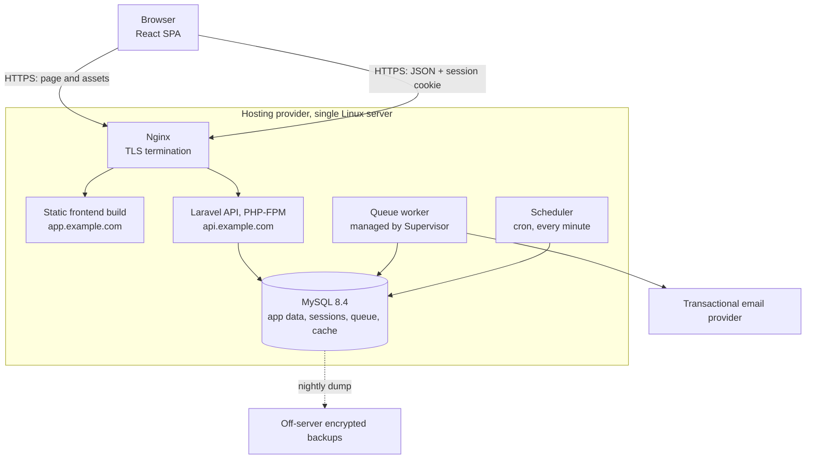
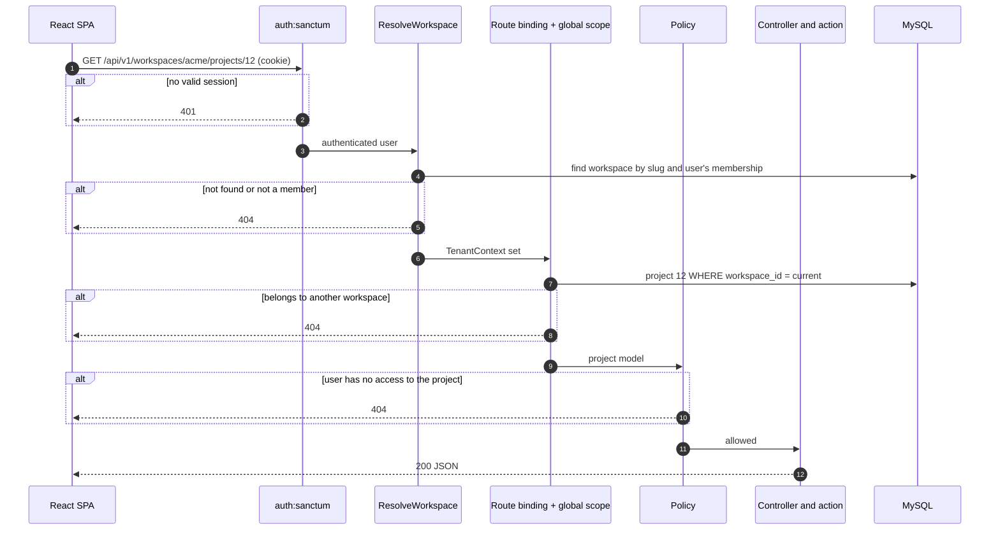

# 02 — System Architecture

**Status:** Draft for review · **Date:** 2026-11-05

Decision references such as **D5** point to [01 — Product Requirements](01-product-requirements.md#2-decisions-that-need-your-confirmation).

---

## 1. System overview

WorkFlow is two independently deployed applications on one hosting provider: a React single-page app (SPA) served as static files, and a Laravel REST API backed by MySQL.



### Versions

| Component | Version | Note |
|---|---|---|
| Laravel | 13 | Latest major confirmed. Security fixes until Q1 2028. Check for a newer release when scaffolding in Phase 2 |
| PHP | 8.3 | Laravel 13's minimum. Already installed in your Laragon |
| MySQL | 8.4 LTS | Already installed locally (8.4.3). **MySQL 8.0 reached end of life in April 2026, so avoid hosts offering only 8.0** |
| Node | 22 | Already installed. Used only to build the frontend |

---

## 2. Architecture decisions

### ADR-01: Shared database with `workspace_id` — approved, with one strengthening

| Option | Isolation | Operating cost | Verdict |
|---|---|---|---|
| Shared tables with `workspace_id` | Logical; a bug can leak data | One schema, one migration run | **Chosen** |
| One schema per tenant | Stronger | Migrations per tenant, connection switching | Too heavy for this scale |
| One database per tenant | Strongest | Provisioning, backups and costs per tenant | Justified only by contractual requirements |

Your proposal is the right choice for this project. Its weakness is that **a single forgotten `WHERE` clause becomes a data breach.** The design therefore doesn't depend on developers remembering. It adds layers that fail safely (section 3) and uses composite foreign keys, so the database itself refuses cross-tenant links ([database design, section 2](03-database-design.md#2-how-workspace-identifiers-work)).

**Trade-offs accepted:**

- You cannot restore a single tenant from a backup without extra tooling.
- One heavy tenant can affect the others.
- Extracting a tenant later requires a data export.

### ADR-02: Sanctum SPA cookie authentication, not bearer tokens

Sanctum supports both. Bearer tokens must be stored where JavaScript can read them, normally `localStorage`, so any XSS bug can steal them. Sanctum's SPA mode uses Laravel's normal session in an `HttpOnly` cookie that JavaScript cannot read.

**What this costs:** the two apps must share a registrable domain, CSRF protection is mandatory, and CORS needs exact configuration (Risk R1). Public API tokens can be added later if third-party integrations are ever needed.

### ADR-03: Workspace identified in the URL path (D5)

| Option | Multi-tab safe | Visible and testable | Verdict |
|---|---|---|---|
| Server session "active workspace" | **No** | No | Rejected |
| `X-Workspace-Id` header | Yes | Moderately | Acceptable |
| URL path `/workspaces/{slug}/...` | Yes | Yes | **Chosen** |
| Subdomain per tenant | Yes | Yes | Rejected: needs wildcard TLS and a more complex cookie and CORS setup |

**Why the session option is dangerous:** a user opens Workspace A in one tab and switches to Workspace B in another. The first tab still *displays* A, but its next request would act on B. That is a silent wrong-tenant write by a legitimate user, and no authorisation check can detect it.

The URL approach also gives shareable frontend links such as `/w/acme/projects/12`, and makes the tenant boundary obvious in logs and tests.

### ADR-04: Fixed roles in code (D11)

Roles are PHP enums, and rules live in Laravel policies. No permissions package or `roles` table is used. There are only three workspace roles and two project roles, and a reader can follow the policies directly, which is better for a project you must explain.

### ADR-05: Action classes for business operations

Controllers stay thin. Operations with several steps, such as `AssignTask` or `RemoveWorkspaceMember`, live in single-purpose action classes that own the transaction. Activity logging is called explicitly from these actions, not from model observers. Observers cannot see intent ("removed by admin" versus "left voluntarily") and fire during seeding and maintenance.

### ADR-06: Database for sessions, queue and cache

No Redis in V1. MySQL handles all three, so there is one less service to run and back up. The database session driver also makes "end all of this user's other sessions" a simple delete. Laravel can switch to Redis later through configuration.

### ADR-07: Polling, not WebSockets

Notification counts poll every 60 seconds, and boards refetch on window focus. WebSockets add a server process, connection authorisation and a new tenant-isolation surface, which is not justified for V1.

### ADR-08: Monorepo (D8)

```
workflow/
├── backend/        Laravel API
├── frontend/       React SPA
├── docs/           These documents
└── .github/        CI workflows, using path filters so each app has its own job
```

### Not recommended: changing the approved stack

I reviewed the stack and recommend **no replacements**. The one trade-off worth knowing: a JavaScript frontend has no compile-time checking of API response shapes. JSDoc on the API layer and tests against realistic mock responses reduce this risk.

---

## 3. Multi-tenancy design

### The nine questions from the brief

| # | Question | Answer |
|---|---|---|
| 1 | How are workspaces created? | A verified user calls `POST /workspaces`. One transaction creates the workspace and an Administrator membership for that user |
| 2 | How do users join? | By invitation only in V1. An Administrator invites an email address, and the recipient accepts through an emailed link |
| 3 | Can one user belong to several? | Yes. `workspace_members` is a many-to-many table, and the **role lives on the membership, not on the user** |
| 4 | How is the active workspace selected? | By the URL. The switcher navigates to `/w/{slug}/...`. On login the app opens the workspace with the latest `last_accessed_at` |
| 5 | How is context established per request? | `ResolveWorkspace` middleware reads the slug from the route, confirms membership, and stores both in a request-scoped `TenantContext` |
| 6 | How are records queried? | Tenant models use a `BelongsToWorkspace` trait with a global scope that adds `workspace_id = ?` automatically |
| 7 | How is isolation enforced? | Seven layers, described next |
| 8 | How is cross-workspace access prevented? | Layers 2, 3, 5 and 6 each stop it independently. The response is 404, so existence isn't revealed |
| 9 | How is it tested? | A route-driven isolation suite plus database constraint tests ([testing strategy, section 4](06-testing-strategy.md#4-multi-tenant-isolation-suite)) |

### Defence in depth: how the layers work together

Each layer answers a different question, so one layer's bug doesn't automatically become a breach.

| # | Layer | Question it answers | On failure |
|---|---|---|---|
| 1 | `auth:sanctum` middleware | Who is this user? | 401 |
| 2 | `ResolveWorkspace` middleware | Does this workspace exist, and does the user belong to it? | 404 |
| 3 | Global scope and scoped route binding | Does this record belong to the current workspace? | 404 |
| 4 | Policies | May this role do this to this record? | 403, or 404 if the user may not know it exists |
| 5 | Form request validation | Do the IDs in the *request body* belong to this workspace? | 422 |
| 6 | Composite foreign keys | Is this row internally consistent? | Database error, logged as an incident |
| 7 | Automated tests | Do layers 1–6 still work after this change? | CI fails |



### Implementation details that are easy to get wrong

**1. Middleware order is the critical detail.** Laravel normally resolves route models in `SubstituteBindings`. If that runs before the tenant is known, `{project}` is looked up with no tenant filter. So `ResolveWorkspace` must be placed **after authentication but before `SubstituteBindings`** through Laravel's middleware priority list. It loads the workspace itself and sets the route parameter to the model. Phase 4 starts by proving this order with a test before anything depends on it.

**2. The global scope fails closed.** If a tenant model is queried with no `TenantContext` set, it **throws an exception** and does not return every tenant's rows. The usual implementation quietly skips the filter when there is no tenant, which is how leaks occur in background jobs and commands. Code that legitimately runs outside a request must state its tenant explicitly (`TenantContext::run($workspace, fn () => ...)`).

**3. Global scopes do not cover everything.** Known bypasses, and how each is handled:

| Bypass | Control |
|---|---|
| `DB::table('tasks')` skips Eloquent | Architecture test bans query-builder access to tenant tables outside one reporting namespace, which must filter explicitly and has its own isolation tests |
| `Rule::exists('users', 'id')` searches every tenant | Assignees are validated against `project_members` for the current project, through a shared rule |
| `workspace_id` supplied in a request | Never fillable from input. The `creating` hook sets it from `TenantContext` |
| `withoutGlobalScopes()` | Banned by architecture test, except in the tenancy module |
| Queue jobs | Jobs carry `workspace_id`, and a job middleware restores context |
| Cache keys | Must include the workspace ID, through one helper |
| Reused process state | `TenantContext` is registered with `scoped()`, so it resets for each request or job |

**4. A policy must not use a blanket admin bypass.** `Gate::before` is the common way to give admins everything, but it would also bypass "archived projects are read-only". Each ability states its rule explicitly, and admin access goes through one helper, `ProjectAccess`.

**5. Non-tenant models.** `User` and `Workspace` are global by nature. `WorkspaceMember` must also be queried across workspaces to list a user's own memberships, so that query lives in a single named method.

### Illustration

This shows the shape of the rule. It is not final code.

```php
// Added automatically to every query on a tenant model
$builder->where(
    $model->qualifyColumn('workspace_id'),
    app(TenantContext::class)->requireWorkspaceId() // throws if unset
);
```

---

## 4. Backend structure

```
backend/app/
├── Actions/          One class per business operation, grouped by module
├── Enums/            WorkspaceRole, ProjectRole, TaskStatus, ProjectStatus, Priority
├── Http/
│   ├── Controllers/Api/V1/
│   ├── Middleware/   ResolveWorkspace
│   ├── Requests/     Validation and input whitelisting
│   └── Resources/    Response shapes, the only way data leaves the API
├── Models/
├── Notifications/
├── Policies/
└── Support/Tenancy/  TenantContext, BelongsToWorkspace, WorkspaceScope
```

**Request flow:** Route → middleware → Form Request → Policy → Controller → Action → Models → API Resource.

Authentication uses small hand-written controllers around Laravel's password and session features, so you can understand each step. Fortify would save time but hides the flows you want to learn.

---

## 5. Frontend architecture

### Libraries

| Concern | Choice | Reason |
|---|---|---|
| Routing | React Router | The standard choice for nested layouts and protected routes |
| Server data | TanStack Query | Caching, loading and error states, and refetching without hand-written effects |
| Auth state | The `['me']` query | The server is the source of truth, with no token in browser storage |
| Forms | React Hook Form | Accessible, minimal re-rendering, and easy mapping of API errors to fields |
| HTTP | Axios | Interceptors for 401, 419 and error normalising |
| Drag and drop | dnd-kit | Has built-in keyboard support |
| Dialogs and menus | Headless UI | Accessible behaviour, styled with Tailwind |

No Redux or Zustand: nearly all shared state is server data.

### Folder structure

```
frontend/src/
├── app/            Router, providers, layouts
├── features/       auth, workspaces, members, projects, tasks,
│                   notifications, dashboard, activity
│   └── tasks/      api.js, hooks.js, components/, pages/
├── shared/
│   ├── api/        Axios client, error normalising
│   ├── ui/         Button, Input, Modal, Table, EmptyState, ErrorState, Skeleton
│   └── lib/        Dates and formatting
└── main.jsx
```

### Pages and navigation

| Route | Page | Access |
|---|---|---|
| `/login`, `/register`, `/forgot-password`, `/reset-password` | Authentication | Guests |
| `/verify-email` | Verification prompt | Unverified users |
| `/invitations/accept` | Invitation landing page | Token holder |
| `/onboarding` | Create the first workspace | Users with no workspace |
| `/account` | Profile and password | Authenticated |
| `/w/:slug/dashboard` | Workspace dashboard | Member |
| `/w/:slug/projects` | Project list | Member |
| `/w/:slug/projects/:id/board` | Kanban (default project tab) | Project access |
| `/w/:slug/projects/:id/list`, `/members`, `/activity` | Other project tabs | Project access |
| `/w/:slug/projects/:id/report` | Project report | Manager or Administrator |
| `/w/:slug/my-tasks` | My assigned tasks | Member |
| `/w/:slug/tasks/:id` | Task detail, also opened as a side panel from the board | Project access |
| `/w/:slug/team` | Members, plus invitations for Administrators | Member |
| `/w/:slug/notifications` | Notifications | Member |
| `/w/:slug/settings` | Workspace settings | Administrator |

**Layout:** a left sidebar with the workspace switcher at the top, then Dashboard, Projects, My Tasks, Team and Settings. The top bar holds the notification bell and user menu. Below 768 px the sidebar becomes a slide-out menu.

### Key frontend rules

- **Authentication:** `/sanctum/csrf-cookie`, then login, then fetch `/me`. The Axios client must set `withCredentials: true` and `withXSRFToken: true`. Without the second setting, Axios will not send the CSRF header across subdomains, and every write fails with 419.
- **Protected routes:** `RequireAuth` wraps app routes, and `RequireWorkspace` loads the workspace from the slug and shows "not found" on a 404. These control user experience only. They are not security controls.
- **Workspace state:** `slug` always comes from the URL. Every workspace query key starts with it, for example `['w', slug, 'projects']`, so data **can't appear in the wrong workspace from the cache**. Logout clears the whole cache.
- **Role-based interface:** the frontend does not reimplement permission rules. API resources include a `can` object, such as `{ "update": true, "archive": false }`, generated from the same policies the server enforces. The UI hides or shows actions using `can`, so rules cannot drift apart.
- **Forms and validation:** client validation gives fast feedback for required fields and formats. **Server validation is authoritative**, and 422 errors map onto form fields.
- **Error handling:** 401 redirects to login and preserves the return URL. 419 refreshes the CSRF cookie and retries once. 403 shows a message. 404 shows a not-found page. 429 and 5xx show a retry message with the `request_id`. A root error boundary catches rendering failures.
- **Loading and empty states:** skeletons for lists, and specific empty states with a next action, such as "No tasks yet. Create the first one." The board updates optimistically when dragging and reverts with a message on failure.
- **Styling:** Tailwind with a small set of design tokens. Mobile-first, with accessible focus states and semantic HTML.

---

## 6. Authentication and cookie setup

| Setting | Production value | Purpose |
|---|---|---|
| `SESSION_DRIVER` | `database` | Allows sessions to be revoked |
| `SESSION_DOMAIN` | `.example.com` | Shares the cookie with the API, and the readable XSRF cookie with the SPA |
| `SESSION_SECURE_COOKIE` | `true` | HTTPS only |
| `SESSION_HTTP_ONLY` | `true` | JavaScript can't read the session cookie |
| `SESSION_SAME_SITE` | `lax` | Blocks cross-site POST requests from carrying the cookie |
| `SANCTUM_STATEFUL_DOMAINS` | `app.example.com` | Treats requests from the SPA as session-authenticated |
| CORS `allowed_origins` | `https://app.example.com` | Exact origin. **Never `*` with credentials** |
| CORS `supports_credentials` | `true` | Allows cookies on cross-origin requests |

**Concepts worth understanding**

- **CORS is not access control.** It only tells browsers which sites may read responses. Tools such as `curl` ignore it completely.
- **`SameSite` is not a complete CSRF defence.** `app.` and `api.` count as the same site, so a compromised sibling subdomain could still send requests. That's why the CSRF token is also required.
- **Authentication is not authorisation.** A valid session shows who the user is. Layers 2–6 decide what they may access.

---

## 7. Security requirements

| Requirement | How it is addressed | Verified by |
|---|---|---|
| **Authentication** | Session cookies through Sanctum. Session ID regenerated at login and invalidated at logout. Other sessions ended on password change or reset. Email verification required | Feature tests |
| **Authorisation** | Policies on every endpoint. An architecture test requires workspace controllers to authorise | Matrix tests |
| **Workspace isolation** | Seven layers in section 3 | Isolation suite |
| **API protection** | Default-deny route groups, versioned API, capped pagination, whitelisted filters and sorts | Feature tests |
| **Input validation** | Form Requests on all writes, with length limits and enums. Only validated data reaches models, never `$request->all()` | Validation tests |
| **SQL injection** | Eloquent and bound parameters. Sort columns come from a whitelist, as bindings can't protect column names. `LIKE` wildcards are escaped in search | Tests with malicious input |
| **XSS** | React escapes output by default. `dangerouslySetInnerHTML` is banned by a lint rule. Plain text only (D10). Content-Security-Policy on the frontend, no third-party scripts | Lint rule and tests with script payloads |
| **CSRF** | Sanctum CSRF middleware on stateful requests and `SameSite=Lax` | One real cookie-flow test, since `Sanctum::actingAs` skips CSRF |
| **Secure cookies** | Section 6, with HSTS at Nginx | Production checklist |
| **Password handling** | Laravel `Hash` (bcrypt or Argon2id). Minimum 10 characters plus a breached-password check. Current password required to change it. Never logged or returned | Feature tests |
| **Invitation security** | 256-bit random token; **only its SHA-256 hash is stored**; expires in 7 days; single use; revocable; bound to one email; accepted in a transaction | Feature tests |
| **Rate limiting** | Login 5/min per email + IP. Registration 5/hour per IP. Reset 3/hour per email + IP. Invitations 20/hour per workspace. Workspace creation 5/hour per user. General API 120/min per user | Feature tests |
| **Sensitive configuration** | `.env` is ignored by Git, and `.env.example` holds names only. **Anything named `VITE_*` is compiled into public JavaScript, so it must never hold a secret.** `APP_DEBUG=false` in production. Least-privilege database user. GitHub secret scanning enabled | CI and checklist |
| **Dependencies** | `composer audit` and `npm audit` in CI, with Dependabot alerts | CI |
| **Security headers** | `X-Content-Type-Options`, `Referrer-Policy: same-origin`, CSP, HSTS | Checklist |

### Remaining risks that will be accepted in V1

Having authentication doesn't make the system secure, and these controls don't either. These are the known weaknesses:

- **Registration reveals whether an email exists** through its validation error. It's rate limited but not eliminated. Fixing it fully requires a different sign-up flow.
- **No two-factor authentication**, so a stolen password gives full access to an account.
- **No independent penetration test.** Review is self-performed.
- **Invitation links sit in email inboxes** until they expire. Tokens are in the URL fragment to keep them out of server logs, and they work only for the matching account.
- **Sequential IDs** reveal approximate platform-wide record counts. They grant no access, as checks don't depend on IDs being secret. ULIDs could replace them at the cost of larger indexes.
- **No platform-wide audit or anomaly detection.**
- **Single server**, so a server failure means downtime until restore.

---

## 8. Non-functional design

| Area | Approach |
|---|---|
| Maintainability | Standard Laravel conventions, Laravel Pint and ESLint in CI, one location for each rule |
| Scalability | Composite indexes on real query patterns. If needed, move to a separate database server, then add Redis, then add more app servers. All of this is possible because the API is stateless |
| Performance | Eager loading, with `Model::preventLazyLoading()` outside production so N+1 issues raise errors. Reports calculated live with indexes; caching only if measurement shows a need. Pagination capped at 100 |
| Reliability | Transactions in actions. Notifications and email dispatched after commit. Failed jobs retained and retried |
| Logging | JSON logs with `request_id`, `user_id` and `workspace_id`. Security events logged: failed logins, role changes, invitation use, denied access |
| Backup | Nightly `mysqldump --single-transaction`, encrypted and copied off-server. 14-day retention. Rehearsed restore |
| Deployment | Nginx serves the static build and PHP-FPM. Backend: install, migrate, cache configuration, restart workers. Frontend: build and atomically replace the files. Migrations stay backward compatible for one release, so the two apps need not deploy at the same moment |

**Recommended first deployment timing:** right after authentication (Phase 3). Cookie and domain problems appear only on real domains, and they are far cheaper to find early.

---

## 9. Technical risks

| ID | Risk | Impact | Likelihood | Mitigation |
|---|---|---|---|---|
| **R1** | Cookies fail in production. Platform subdomains such as `*.onrender.com` are typically on the Public Suffix List, so browsers treat each app as a separate site | High | High if unplanned | Use a custom domain (D7). Deploy early (Phase 3) |
| **R2** | A tenant query bypasses the global scope | Critical | Medium | Fail-closed scope, architecture tests, composite foreign keys, isolation suite |
| **R3** | A new route lacks tenant middleware or a policy | Critical | Medium | Route guard test fails on any uncovered route |
| **R4** | Middleware order breaks silently after an upgrade | Critical | Low | An explicit test proves a cross-tenant ID returns 404 |
| **R5** | Tests pass on SQLite but behaviour differs on MySQL | High | High if SQLite used | Run all backend tests on MySQL, locally and in CI |
| **R6** | Member removal leaves orphaned data, or fails on restricted foreign keys | Medium | Medium | One tested action. Includes soft-deleted tasks when clearing assignees |
| **R7** | Race conditions: two Administrators demote each other, or an invitation is accepted twice | Medium | Low | Row locks in transactions, plus unique constraints as a backstop |
| **R8** | Kanban positions become disordered or run out of gaps | Low | Medium | Gapped integer positions calculated by the server, with a rebalance for the column |
| **R9** | Activity table grows quickly | Low | Low | Indexed by workspace and date. Archiving can be added later |
| **R10** | Scope creep delays completion | High | High | Section 4 of the requirements controls scope. New ideas go to the postponed list |
| **R11** | Public demo abused for spam or offensive content | Medium | Medium | Mail disabled for demo accounts, rate limits, nightly reset |
| **R12** | AI-generated code that you cannot explain | High for interviews | Medium | Small pull requests that you review, with key concepts explained at each phase |
