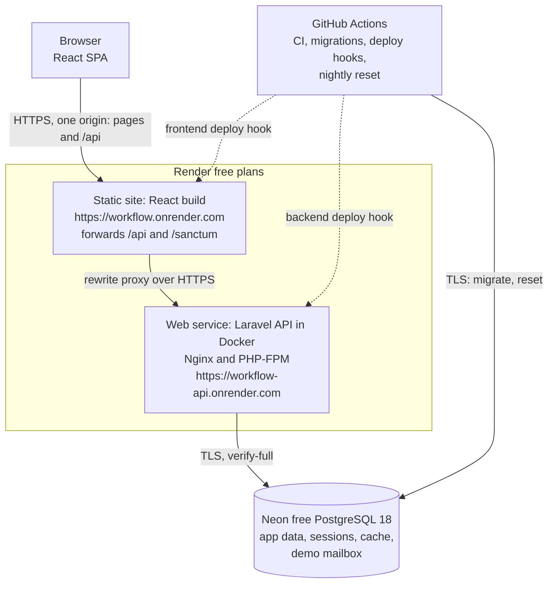
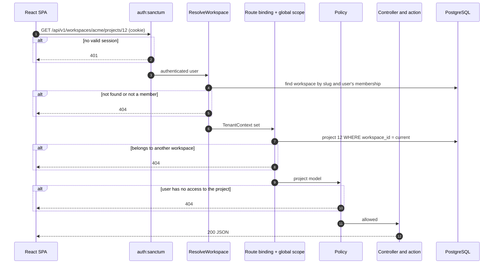

# 02 — System Architecture

**Status:** Approved design (Phase 1, 2026-11-10). Nothing here is implemented yet. **The hosting arrangement in section 10 is unverified**: it depends on the Render forwarding experiment · **Last reviewed:** 2026-11-10

Decision references such as **D5** point to [01 — Product Requirements](01-product-requirements.md#2-confirmed-decisions).

---

## 1. System overview

WorkFlow is two separate applications: a React single-page app (SPA) and a Laravel REST API backed by PostgreSQL. They have separate code, dependencies, configuration, tests and CI jobs, communicate only through the HTTP API, and are **deployed as separate Render services** (D7). The frontend's static site forwards API paths to the backend, so the browser sees one origin, which keeps Sanctum's cookies first-party. Section 10 explains why.



### Versions

| Component | Version | Note |
|---|---|---|
| Laravel | 13 | Latest major confirmed. Security fixes until Q1 2028. Check for a newer release when scaffolding in Phase 2 |
| PHP | 8.3 | Laravel 13's minimum. Installed locally through Laragon |
| PostgreSQL | 18 | Latest major release, supported until November 2030. Used locally, in CI and on Neon (D12). Laravel 13 supports PostgreSQL 10 and later. Laragon's MySQL is no longer used by WorkFlow |
| Node | 22 | Already installed. Used only to build the frontend |

---

## 2. Architecture decisions

### ADR-01: Shared database with `workspace_id` — approved, with one strengthening

| Option | Isolation | Operating cost | Verdict |
|---|---|---|---|
| Shared tables with `workspace_id` | Logical; a bug can leak data | One schema, one migration run | **Chosen** |
| One schema per tenant | Stronger | Migrations per tenant, connection switching | Too heavy for this scale |
| One database per tenant | Strongest | Provisioning, backups and costs per tenant | Justified only by contractual requirements |

A shared database is the right choice for this project. Its weakness is that **a single forgotten `WHERE` clause becomes a data breach.** The design therefore doesn't depend on developers remembering. It adds layers that fail safely (section 3) and uses composite foreign keys, so the database itself refuses cross-tenant links ([database design, section 2](03-database-design.md#2-how-workspace-identifiers-work)).

**Trade-offs accepted:**

- A single tenant can't be restored from a backup without extra tooling.
- One heavy tenant can affect the others.
- Extracting a tenant later requires a data export.

### ADR-02: Sanctum SPA cookie authentication, not bearer tokens

Sanctum supports both. Bearer tokens must be stored where JavaScript can read them, normally `localStorage`, so any XSS bug can steal them. Sanctum's SPA mode uses Laravel's normal session in an `HttpOnly` cookie that JavaScript cannot read.

**What this costs:** the two apps must appear to the browser as one site. The free demo achieves this by having the frontend forward API paths (Risk R1). CSRF protection is mandatory. Public API tokens can be added later if third-party integrations are ever needed.

**This decision doesn't change for hosting convenience.** Free hosting is chosen to fit this authentication design, not the other way round.

### ADR-03: Workspace identified in the URL path (D5)

| Option | Multi-tab safe | Visible and testable | Verdict |
|---|---|---|---|
| Server session "active workspace" | **No** | No | Rejected |
| `X-Workspace-Id` header | Yes | Moderately | Acceptable |
| URL path `/workspaces/{slug}/...` | Yes | Yes | **Chosen** |
| Subdomain per tenant | Yes | Yes | Rejected: needs wildcard TLS and a more complex cookie and CORS setup |

**Why the session option is dangerous:** a user opens Workspace A in one tab and switches to Workspace B in another. The first tab still *displays* A, but its next request would act on B. That is a silent wrong-tenant write by a legitimate user, and no authorisation check can detect it.

The URL approach also gives shareable frontend links such as `/w/acme/projects/12`, and makes the tenant boundary obvious in logs and tests.

### ADR-04: Fixed roles in code (D11)

Roles are PHP enums, and rules live in Laravel policies. No permissions package or `roles` table is used. There are only three workspace roles and two project roles, and a reader can follow the policies directly, which keeps every rule easy to trace.

### ADR-05: Action classes for business operations

Controllers stay thin. Operations with several steps, such as `AssignTask` or `RemoveWorkspaceMember`, live in single-purpose action classes that own the transaction. Activity logging is called explicitly from these actions, not from model observers. Observers cannot see intent ("removed by admin" versus "left voluntarily") and fire during seeding and maintenance.

### ADR-06: Database for sessions, queue and cache

No Redis in V1. PostgreSQL handles all three, so there is one less service to run and back up. The database session driver also makes "end all of this user's other sessions" a simple delete. Laravel can switch to Redis later through configuration.

### ADR-07: Polling, not WebSockets

Notification counts poll every 60 seconds, and boards refetch on window focus. WebSockets add a server process, connection authorisation and a new tenant-isolation surface, which is not justified for V1.

### ADR-08: Monorepo (D8)

```
workflow/
├── backend/        Laravel API, with its own Dockerfile
├── frontend/       React SPA
├── docs/           These documents
└── .github/        CI workflows, using path filters so each app has its own job
```

### ADR-09: Separate free Render services, one origin to the browser (D7)

1. **What it is:** the React build runs as a Render static site, and Laravel runs as a separate Render web service. The static site forwards `/api` and `/sanctum` requests to the backend through Render's rewrite rules.
2. **What problem it solves:** Render's free domains are on the Public Suffix List, so a browser treats the two services as different sites. Calling the API directly would make Sanctum's session cookie a blocked third-party cookie, and leave the CSRF cookie unreadable.
3. **Why I chose it:** it keeps my requirement of separately deployed services, costs nothing, and keeps cookie authentication first-party and secure. As a bonus, the frontend never sleeps.
4. **Alternatives and trade-offs:**
   - One combined container: free and certain, but one deployment.
   - A purchased domain with subdomains: Sanctum's standard setup, but it costs money.
   - Bearer tokens: free, but weaker against XSS.
   - Cross-site cookies: unreliable across browsers.

   Render doesn't document how the forwarding handles cookies and headers, so I'm validating it first in Phase 2, with the alternatives as explicit fallbacks.
5. **How it works in WorkFlow:** section 10 covers the rewrite rules, cookie settings, deployments and resources.
6. **Status:** approved, **not yet validated**. Validation is in progress in the [Render forwarding experiment](https://github.com/Martins-Code/workflow/tree/spike/render-proxy-test/experiments/render-proxy). The rationale is summarised at the end of section 10.

### ADR-10: PostgreSQL instead of MySQL (D12)

1. **What it is:** PostgreSQL is an open-source relational database, like MySQL. Both store tables, enforce foreign keys and run SQL, but they differ in details that matter to this design.
2. **What problem it solves:** free managed MySQL is no longer available to new users, and the remaining MySQL option costs $5 a month. Free PostgreSQL hosting is still available.
3. **Why I chose it:** every database-level tenant safeguard still works: composite foreign keys, `CHECK` constraints and row locks. Two parts become simpler. Partial unique indexes replace the MySQL generated-column workaround for invitations, and schema changes run inside transactions, so a failed migration rolls back cleanly. Laravel supports PostgreSQL as a first-class database, so no extra abstraction layer is needed.
4. **Alternatives and trade-offs:** paying for Aiven's MySQL Developer plan keeps MySQL, but adds a recurring cost. Free MySQL-compatible services were rejected because they behave differently from real MySQL. SQLite has no network server, and its locking and constraint behaviour don't represent a hosted multi-user app. PostgreSQL's costs are its learning curve: case-sensitive text comparison, foreign keys that don't create their own indexes, and transactions that stop working after an error until rolled back.
5. **How it works in WorkFlow:** the same PostgreSQL 18 runs locally on Windows, in CI and on Neon. Migrations use Laravel's schema builder, with a few short raw SQL statements for features the builder doesn't document, such as the partial index. See [database design, section 7](03-database-design.md#7-postgresql-design-notes).
6. **In short:**

> The design depends on database-enforced tenant constraints, so the engine had to support composite foreign keys, check constraints and row locking. When free MySQL hosting ended, I evaluated PostgreSQL against those requirements before switching. It met all of them, and partial unique indexes and transactional migrations made parts of the design simpler. The plan is to run the same major version locally, in CI and in the hosted database, so tests exercise the real behaviour.

### ADR-11: No permanent queue worker in V1

1. **What it is:** a queue worker is a long-running process that picks up background jobs from a queue, so slow work happens outside the web request.
2. **What problem it solves:** it keeps responses fast and retries failed work, such as sending an email to an external provider.
3. **Why V1 doesn't run one:**
   - V1's background work is small and stays inside our own database: creating notification rows, and writing demo mailbox rows.
   - On Render's free plan, a worker would compete for 512 MB of memory, or need a paid background-worker service.
   - A worker polling the jobs table every few seconds would also stop Neon from scaling to zero, using up compute hours.
4. **Alternatives and trade-offs:**
   - A worker process in the same container: uses memory, and keeps the database awake.
   - A paid Render background worker: costs money.
   - Running queued jobs from a scheduled job: adds delay and complexity.

   The cost of running jobs synchronously is that this work adds a little time to the request, and a failure isn't retried automatically. It's logged instead.
5. **How it works in WorkFlow:** notifications are created after the database transaction commits, within the same request. Code that could later be queued is still written as queueable job classes, with `QUEUE_CONNECTION=sync`. Switching to a real queue and worker, for example when real email is enabled on paid hosting, is a configuration change.
6. **In short:**

> I sized background processing to the actual workload. V1's side effects are cheap database writes, so they run synchronously after commit. That avoids a permanent worker on a 512 MB free instance and lets the serverless database sleep. The jobs are still queueable classes, so adding a worker later is a configuration change, not a rewrite.

### Stack review

I reviewed the stack and kept it unchanged. The one trade-off worth noting is that a JavaScript frontend has no compile-time checking of API response shapes. JSDoc on the API layer, and tests against realistic mock responses, reduce this risk.

---

## 3. Multi-tenancy design

### Nine questions the tenancy design must answer

| # | Question | Answer |
|---|---|---|
| 1 | How are workspaces created? | A verified user calls `POST /workspaces`. One transaction creates the workspace and an Administrator membership for that user |
| 2 | How do users join? | By invitation only in V1. An Administrator invites an email address, and the recipient accepts through an emailed link |
| 3 | Can one user belong to several? | Yes. `workspace_members` is a many-to-many table, and the **role lives on the membership, not on the user** |
| 4 | How is the active workspace selected? | By the URL. The switcher navigates to `/w/{slug}/...`. On login the app opens the workspace with the latest `last_accessed_at` |
| 5 | How is context established per request? | `ResolveWorkspace` middleware reads the slug from the route, confirms membership, and stores both in a request-scoped `TenantContext` |
| 6 | How are records queried? | Tenant models use a `BelongsToWorkspace` trait with a global scope that adds `workspace_id = ?` automatically |
| 7 | How is isolation enforced? | Seven layers, described next |
| 8 | How is cross-workspace access prevented? | Layers 2, 3, 5 and 6 each stop it independently. The response is 404, so existence isn't revealed |
| 9 | How is it tested? | A route-driven isolation suite plus database constraint tests ([testing strategy, section 4](06-testing-strategy.md#4-multi-tenant-isolation-suite)) |

### Defence in depth: how the layers work together

Each layer answers a different question, so one layer's bug doesn't automatically become a breach.

| # | Layer | Question it answers | On failure |
|---|---|---|---|
| 1 | `auth:sanctum` middleware | Who is this user? | 401 |
| 2 | `ResolveWorkspace` middleware | Does this workspace exist, and does the user belong to it? | 404 |
| 3 | Global scope and scoped route binding | Does this record belong to the current workspace? | 404 |
| 4 | Policies | May this role do this to this record? | 403, or 404 if the user may not know it exists |
| 5 | Form request validation | Do the IDs in the *request body* belong to this workspace? | 422 |
| 6 | Composite foreign keys | Is this row internally consistent? | Database error, logged as an incident |
| 7 | Automated tests | Do layers 1–6 still work after this change? | CI fails |



### Implementation details that are easy to get wrong

**1. Middleware order is the critical detail.** Laravel normally resolves route models in `SubstituteBindings`. If that runs before the tenant is known, `{project}` is looked up with no tenant filter. So `ResolveWorkspace` must be placed **after authentication but before `SubstituteBindings`** through Laravel's middleware priority list. It loads the workspace itself and sets the route parameter to the model. Phase 4 starts by proving this order with a test before anything depends on it.

**2. The global scope fails closed.** If a tenant model is queried with no `TenantContext` set, it **throws an exception** and does not return every tenant's rows. The usual implementation quietly skips the filter when there is no tenant, which is how leaks occur in background jobs and commands. Code that legitimately runs outside a request must state its tenant explicitly (`TenantContext::run($workspace, fn () => ...)`).

**3. Global scopes do not cover everything.** Known bypasses, and how each is handled:

| Bypass | Control |
|---|---|
| `DB::table('tasks')` skips Eloquent | Architecture test bans query-builder access to tenant tables outside one reporting namespace, which must filter explicitly and has its own isolation tests |
| `Rule::exists('users', 'id')` searches every tenant | Assignees are validated against `project_members` for the current project, through a shared rule |
| `workspace_id` supplied in a request | Never fillable from input. The `creating` hook sets it from `TenantContext` |
| `withoutGlobalScopes()` | Banned by architecture test, except in the tenancy module |
| Queue jobs | Jobs carry `workspace_id`, and a job middleware restores context |
| Cache keys | Must include the workspace ID, through one helper |
| Reused process state | `TenantContext` is registered with `scoped()`, so it resets for each request or job |

**4. A policy must not use a blanket admin bypass.** `Gate::before` is the common way to give admins everything, but it would also bypass "archived projects are read-only". Each ability states its rule explicitly, and admin access goes through one helper, `ProjectAccess`.

**5. Non-tenant models.** `User` and `Workspace` are global by nature. `WorkspaceMember` must also be queried across workspaces to list a user's own memberships, so that query lives in a single named method.

### Illustration

This shows the shape of the rule. It is not final code.

```php
// Added automatically to every query on a tenant model
$builder->where(
    $model->qualifyColumn('workspace_id'),
    app(TenantContext::class)->requireWorkspaceId() // throws if unset
);
```

---

## 4. Backend structure

```
backend/app/
├── Actions/          One class per business operation, grouped by module
├── Enums/            WorkspaceRole, ProjectRole, TaskStatus, ProjectStatus, Priority
├── Http/
│   ├── Controllers/Api/V1/
│   ├── Middleware/   ResolveWorkspace
│   ├── Requests/     Validation and input whitelisting
│   └── Resources/    Response shapes, the only way data leaves the API
├── Models/
├── Notifications/
├── Policies/
└── Support/Tenancy/  TenantContext, BelongsToWorkspace, WorkspaceScope
```

**Request flow:** Route → middleware → Form Request → Policy → Controller → Action → Models → API Resource.

Authentication uses small hand-written controllers around Laravel's password and session features, so every step is visible in the codebase. Fortify would save time, but hides flows I want to own and understand.

---

## 5. Frontend architecture

### Libraries

| Concern | Choice | Reason |
|---|---|---|
| Routing | React Router | The standard choice for nested layouts and protected routes |
| Server data | TanStack Query | Caching, loading and error states, and refetching without hand-written effects |
| Auth state | The `['me']` query | The server is the source of truth, with no token in browser storage |
| Forms | React Hook Form | Accessible, minimal re-rendering, and easy mapping of API errors to fields |
| HTTP | Axios | Interceptors for 401, 419 and error normalising |
| Drag and drop | dnd-kit | Has built-in keyboard support |
| Dialogs and menus | Headless UI | Accessible behaviour, styled with Tailwind |

No Redux or Zustand: nearly all shared state is server data.

### Folder structure

```
frontend/src/
├── app/            Router, providers, layouts
├── features/       auth, workspaces, members, projects, tasks,
│                   notifications, dashboard, activity
│   └── tasks/      api.js, hooks.js, components/, pages/
├── shared/
│   ├── api/        Axios client, error normalising
│   ├── ui/         Button, Input, Modal, Table, EmptyState, ErrorState, Skeleton
│   └── lib/        Dates and formatting
└── main.jsx
```

### Pages and navigation

| Route | Page | Access |
|---|---|---|
| `/login`, `/register`, `/forgot-password`, `/reset-password` | Authentication | Guests |
| `/verify-email` | Verification prompt | Unverified users |
| `/invitations/accept` | Invitation landing page | Token holder |
| `/onboarding` | Create the first workspace | Users with no workspace |
| `/account` | Profile and password | Authenticated |
| `/w/:slug/dashboard` | Workspace dashboard | Member |
| `/w/:slug/projects` | Project list | Member |
| `/w/:slug/projects/:id/board` | Kanban (default project tab) | Project access |
| `/w/:slug/projects/:id/list`, `/members`, `/activity` | Other project tabs | Project access |
| `/w/:slug/projects/:id/report` | Project report | Manager or Administrator |
| `/w/:slug/my-tasks` | My assigned tasks | Member |
| `/w/:slug/tasks/:id` | Task detail, also opened as a side panel from the board | Project access |
| `/w/:slug/team` | Members, plus invitations for Administrators | Member |
| `/w/:slug/notifications` | Notifications | Member |
| `/w/:slug/settings` | Workspace settings | Administrator |

**Layout:** a left sidebar with the workspace switcher at the top, then Dashboard, Projects, My Tasks, Team and Settings. The top bar holds the notification bell and user menu. Below 768 px the sidebar becomes a slide-out menu.

### Key frontend rules

- **Authentication:** `/sanctum/csrf-cookie`, then login, then fetch `/me`. The Axios client uses a relative base URL (`/api/v1`) and sets `withCredentials: true` and `withXSRFToken: true`. While the browser sees one origin, those two settings aren't strictly needed, but keeping them means calling an `api.` subdomain directly later won't break CSRF.
- **Local development:** the Vite dev server proxies `/api` and `/sanctum` to Laravel, so local development is same-origin, like the demo.
- **Waking up:** a sleeping service can return a slow response or a non-JSON loading page. The API client treats that as "waking up", shows a message, and retries, rather than showing a failure.
- **Protected routes:** `RequireAuth` wraps app routes, and `RequireWorkspace` loads the workspace from the slug and shows "not found" on a 404. These control user experience only. They are not security controls.
- **Workspace state:** `slug` always comes from the URL. Every workspace query key starts with it, for example `['w', slug, 'projects']`, so data **can't appear in the wrong workspace from the cache**. Logout clears the whole cache.
- **Role-based interface:** the frontend does not reimplement permission rules. API resources include a `can` object, such as `{ "update": true, "archive": false }`, generated from the same policies the server enforces. The UI hides or shows actions using `can`, so rules cannot drift apart.
- **Forms and validation:** client validation gives fast feedback for required fields and formats. **Server validation is authoritative**, and 422 errors map onto form fields.
- **Error handling:** 401 redirects to login and preserves the return URL. 419 refreshes the CSRF cookie and retries once. 403 shows a message. 404 shows a not-found page. 429 and 5xx show a retry message with the `request_id`. A root error boundary catches rendering failures.
- **Loading and empty states:** skeletons for lists, and specific empty states with a next action, such as "No tasks yet. Create the first one." The board updates optimistically when dragging and reverts with a message on failure.
- **Styling:** Tailwind with a small set of design tokens. Mobile-first, with accessible focus states and semantic HTML.

---

## 6. Authentication and cookie setup

All values come from environment variables, so changing profile doesn't change application code.

| Setting | Demo: frontend forwards API paths | Later: SPA calls `api.` on a custom domain directly | Purpose |
|---|---|---|---|
| `SESSION_DRIVER` | `database` | `database` | Allows sessions to be revoked |
| `SESSION_DOMAIN` | Empty (host-only) | `.example.com` | Which hosts receive the cookies |
| `SESSION_SECURE_COOKIE` | `true` | `true` | HTTPS only |
| `SESSION_HTTP_ONLY` | `true` | `true` | JavaScript can't read the session cookie |
| `SESSION_SAME_SITE` | `lax` | `lax` | Blocks cross-site POST requests from carrying the cookie |
| `SANCTUM_STATEFUL_DOMAINS` | The frontend's host, for example `workflow.onrender.com` | `app.example.com` | Treats requests from the SPA as session-authenticated |
| `VITE_API_BASE_URL` | `/api/v1` | `https://api.example.com/api/v1` | Where the SPA sends requests. Public, not a secret |
| CORS `allowed_origins` | None needed | `https://app.example.com` | Exact origin. **Never `*` with credentials** |
| CORS `supports_credentials` | Not used | `true` | Allows cookies on cross-origin requests |

**Other required settings**

- **Trusted proxies:** Render terminates HTTPS, so Laravel must trust its forwarded headers to recognise HTTPS and set secure cookies. Trusting all proxies with `*` is the usual option on a cloud platform, but it also means forwarded client IP values need checking. Phase 2 validation confirms the IP Laravel sees is correct and can't be spoofed, because rate limits use it.
- **Trusted hosts:** Laravel responds to any `Host` header by default, so `trustHosts` restricts it to the demo's URL.
- **`Referrer-Policy: same-origin`:** Sanctum identifies first-party requests using the `Origin` or `Referer` header, and a same-origin GET has no `Origin`. **Setting `no-referrer` would break session authentication on those requests.**

**Concepts worth understanding**

- **Origin versus site.** An origin is scheme + host + port. A site is broader: roughly the registrable domain. `onrender.com` is on the Public Suffix List, so browsers treat `a.onrender.com` and `b.onrender.com` as *different sites*. That prevents other customers' apps from setting cookies for ours, but also means two separately hosted WorkFlow services could not share a cookie.
- **Why forwarding solves it.** The browser sends every API call to the frontend's own origin, and Render forwards it to the separate backend. Every call is first-party, so no cross-site cookie rules apply, and the API needs no CORS configuration, which removes a whole class of misconfiguration.
- **CORS is not access control.** It only tells browsers which sites may read responses. Tools such as `curl` ignore it completely.
- **`SameSite` is not a complete CSRF defence.** It is an extra layer, and in a later subdomain setup `app.` and `api.` would count as the same site. That's why the CSRF token is always required.
- **Authentication is not authorisation.** A valid session shows who the user is. Layers 2–6 decide what they may access.

---

## 7. Security requirements

| Requirement | How it is addressed | Verified by |
|---|---|---|
| **Authentication** | Session cookies through Sanctum. Session ID regenerated at login and invalidated at logout. Other sessions ended on password change or reset. Email verification required | Feature tests |
| **Authorisation** | Policies on every endpoint. An architecture test requires workspace controllers to authorise | Matrix tests |
| **Workspace isolation** | Seven layers in section 3 | Isolation suite |
| **API protection** | Default-deny route groups, versioned API, capped pagination, whitelisted filters and sorts | Feature tests |
| **Input validation** | Form Requests on all writes, with length limits and enums. Only validated data reaches models, never `$request->all()` | Validation tests |
| **SQL injection** | Eloquent and bound parameters. Sort columns come from a whitelist, as bindings can't protect column names. Search uses case-insensitive `ILIKE` with `%` and `_` escaped | Tests with malicious input |
| **XSS** | React escapes output by default. `dangerouslySetInnerHTML` is banned by a lint rule. Plain text only (D10). Content-Security-Policy on the frontend, no third-party scripts | Lint rule and tests with script payloads |
| **CSRF** | Sanctum CSRF middleware on stateful requests and `SameSite=Lax` | One real cookie-flow test, since `Sanctum::actingAs` skips CSRF |
| **Secure cookies** | Section 6, with an HSTS header from Nginx | Live demo checklist |
| **Password handling** | Laravel `Hash` (bcrypt or Argon2id). Minimum 10 characters plus a breached-password check. Current password required to change it. Never logged or returned | Feature tests |
| **Invitation security** | 256-bit random token; **only its SHA-256 hash is stored**; expires in 7 days; single use; revocable; bound to one email; accepted in a transaction | Feature tests |
| **Rate limiting** | Login 5/min per email + IP. Registration 5/hour per IP. Reset 3/hour per email + IP. Invitations 20/hour per workspace. Workspace creation 5/hour per user. General API 120/min per user | Feature tests |
| **Sensitive configuration** | `.env` is ignored by Git, and `.env.example` holds names only. **Anything named `VITE_*` is compiled into public JavaScript, so it must never hold a secret.** `APP_DEBUG=false` on any deployment. Secrets stored only in Render and GitHub Actions secret settings. TLS required for database connections. Least-privilege database user where the free plan allows. GitHub secret scanning enabled | CI and checklist |
| **Dependencies** | `composer audit` and `npm audit` in CI, with Dependabot alerts | CI |
| **Security headers** | `X-Content-Type-Options`, `Referrer-Policy: same-origin`, CSP, HSTS | Checklist |

### Remaining risks that will be accepted in V1

Having authentication doesn't make the system secure, and these controls don't either. These are the known weaknesses:

- **Registration reveals whether an email exists** through its validation error. It's rate limited but not eliminated. Fixing it fully requires a different sign-up flow.
- **No two-factor authentication**, so a stolen password gives full access to an account.
- **No independent penetration test.** Review is self-performed.
- **Invitation links sit in email inboxes** until they expire. Tokens are in the URL fragment to keep them out of server logs, and they work only for the matching account.
- **Sequential IDs** reveal approximate platform-wide record counts. They grant no access, as checks don't depend on IDs being secret. ULIDs could replace them at the cost of larger indexes.
- **No platform-wide audit or anomaly detection.**
- **Free services with no availability promise.** The backend sleeps and may restart at any time, and API calls take an extra hop through the frontend's proxy.
- **The demo database accepts connections from the internet.** Render's free plan has no static IP to allow-list, so protection relies on a strong password and TLS. This is another reason it must hold no real data.
- **Free-plan providers can change or end their terms**, and offer limited support.
- **Demo accounts are shared by anyone using them.** They can see and alter each other's demo data until the nightly reset. Isolation between workspaces still applies.

---

## 8. Non-functional design

| Area | Approach |
|---|---|
| Maintainability | Standard Laravel conventions, Laravel Pint and ESLint in CI, one location for each rule |
| Scalability | Composite indexes on real query patterns. If needed, move to paid hosting, then add Redis, then add more app servers. All of this is possible because the API is stateless. On the free plan, the PHP-FPM worker count stays low, around 3, to fit 512 MB of memory and the 20-connection limit of the Aiven fallback |
| Performance | Eager loading, with `Model::preventLazyLoading()` outside production so N+1 issues raise errors. Reports calculated live with indexes; caching only if measurement shows a need. Pagination capped at 100 |
| Reliability | Transactions in actions. Notifications and demo emails are created after commit, synchronously, with failures logged (ADR-11). A queue with retries is added when real email delivery is enabled |
| Logging | JSON logs written to `stderr` with `request_id`, `user_id` and `workspace_id`, as the container's disk is temporary. Security events logged: failed logins, role changes, invitation use, denied access |
| Backup | Demo data is disposable. Recovery is a rebuild from migrations and seeders, rehearsed before release. Real backups are required before commercial use |
| Deployment | See section 10. Migrations stay backward compatible for one release, so application code and schema need not change at the same moment |

**Recommended first deployment timing:** a small validation deployment in Phase 2, then the first real deployment right after authentication in Phase 3. Cookie and proxy problems appear only on real hosting, and they are far cheaper to find early.

---

## 9. Technical risks

| ID | Risk | Impact | Likelihood | Mitigation |
|---|---|---|---|---|
| **R1** | Cookies fail on hosting. `onrender.com` and similar platform domains are on the Public Suffix List, so separately hosted apps are different sites | High | Avoided by design | The frontend forwards API paths, so the browser sees one origin (D7). Validated first in Phase 2 |
| **R2** | A tenant query bypasses the global scope | Critical | Medium | Fail-closed scope, architecture tests, composite foreign keys, isolation suite |
| **R3** | A new route lacks tenant middleware or a policy | Critical | Medium | Route guard test fails on any uncovered route |
| **R4** | Middleware order breaks silently after an upgrade | Critical | Low | An explicit test proves a cross-tenant ID returns 404 |
| **R5** | Tests pass on another engine or version but behave differently on the hosted database | High | High if SQLite used | PostgreSQL 18 locally, in CI and on Neon. Constraint tests also run against the hosted database |
| **R6** | Member removal leaves orphaned data, or fails on restricted foreign keys | Medium | Medium | One tested action. Includes soft-deleted tasks when clearing assignees |
| **R7** | Race conditions: two Administrators demote each other, or an invitation is accepted twice | Medium | Low | Row locks in transactions, plus unique constraints as a backstop |
| **R8** | Kanban positions become disordered or run out of gaps | Low | Medium | Gapped integer positions calculated by the server, with a rebalance for the column |
| **R9** | Activity table grows quickly | Low | Low | Indexed by workspace and date. Archiving can be added later |
| **R10** | Scope creep delays completion | High | High | Section 4 of the requirements controls scope. New ideas go to the postponed list |
| **R11** | Public demo abused for spam or offensive content | Medium | Medium | Mail disabled for demo accounts, rate limits, nightly reset |
| **R12** | Generated or copied code is merged without being fully understood | High | Medium | Small pull requests that I review line by line. Key concepts documented as they're introduced |
| **R13** | A demo visitor meets the one-minute wake-up, or a slow free-tier response, and leaves | Medium | High | The frontend loads instantly because it never sleeps. Clear waking message, README warning, video and screenshots as backup. No keep-alive tricks |
| **R14** | Render free plan rejects something the design needs, such as the Docker image's memory use | High | Medium | Phase 2 validation before anything depends on it, with fallbacks in section 10 |
| **R15** | Neon's 100 compute-hours a month run out, suspending the database until the next month | Medium | Low | No queue worker polling the database (ADR-11). Compute capped at 0.25 units. `robots.txt` blocks crawlers. Aiven fallback |
| **R16** | GitHub disables scheduled workflows after 60 days without repository activity, stopping resets | Medium | High after active development | Runbook to re-enable. Reset is also manually triggerable. Delayed runs are acceptable |
| **R17** | The public demo mailbox is mistaken for safe storage, or demo mode is enabled with real users | High | Low | Reserved `workflow.test` addresses only. Mailbox routes exist only in demo mode, with tests proving it. Banner warning |
| **R18** | Wrong client IP behind the platform proxy breaks or weakens IP rate limits | Medium | Medium | Verify in Phase 2. Sensitive limits also key on email or user, not IP alone |
| **R19** | Provider changes or ends a free tier, as Aiven did for MySQL | Medium | Medium | Standard Docker and PostgreSQL, no provider-specific code, seeders recreate data, named fallbacks |
| **R20** | PostgreSQL differences cause bugs: case-sensitive email matching, unindexed foreign keys, transactions stuck after an error | Medium | Medium | Tests for each behaviour in [the testing strategy](06-testing-strategy.md#postgresql-specific-tests), and a guard test for unindexed foreign keys |
| **R21** | Render's rewrite forwarding drops cookies or headers, or adds too much latency (about 400 ms reported) | High | Medium | Proxy validation is the first Phase 2 task. If it fails, choosing between options A–C in section 10 is a new, recorded decision |
| **R22** | Signed email links fail because the backend sees a different hostname behind the proxy | Medium | Medium | Relative signed URLs, with a test |

---

## 10. Hosting strategy

**Goal:** a public demo of separately deployed frontend and backend services on Render's free plans, with no purchased domain, **with Sanctum cookie authentication and every tenant safeguard unchanged.** Provider terms were checked against vendor documentation on 2026-11-08 and 2026-11-10. Anything not confirmed there is validated in Phase 2 before other work depends on it.

### Services

| Part | Render service | Plan | Source | Behaviour |
|---|---|---|---|---|
| Frontend | Static site, for example `https://workflow.onrender.com` | Free | `frontend/`, built with `npm ci && npm run build`, publishing `dist/` | Served from Render's CDN. **Doesn't sleep** |
| Backend | Web service running Docker, for example `https://workflow-api.onrender.com` | Free | `backend/Dockerfile` | Nginx and PHP-FPM. Sleeps after 15 minutes without traffic |
| Database | Neon PostgreSQL 18 (D12) | Free | — | Scales to zero when idle |
| Scheduled and deployment jobs | GitHub Actions | Free for public repositories | `.github/workflows/` | Migrations, deploy hooks, nightly reset |

### The authentication problem with two default domains

Both default hostnames end in `onrender.com`, which is on the **Public Suffix List**. Browsers therefore treat `workflow.onrender.com` and `workflow-api.onrender.com` as two unrelated sites, just as they treat two different companies' domains. If the React app called the API's domain directly, Sanctum's cookie authentication would break in four ways:

1. **Sanctum's documented requirement isn't met.** It requires the SPA and API to "share the same top-level domain".
2. **The session cookie becomes a third-party cookie.** It would need `SameSite=None`. Safari blocks third-party cookies by default, Firefox isolates them, and users can block them in Chrome. Login would work in some browsers and silently fail in others.
3. **CSRF protection fails.** Laravel puts the CSRF token in an `XSRF-TOKEN` cookie that belongs to the API's host. JavaScript on the frontend's host can't read another host's cookies, so the SPA couldn't send the `X-XSRF-TOKEN` header, and every write would fail with 419.
4. **A shared cookie domain is impossible.** `SESSION_DOMAIN=.onrender.com` is rejected by browsers because `onrender.com` is a public suffix.

**Conclusion:** the browser must not call the API's default domain directly.

### Recommended solution: the frontend forwards API paths

Render static sites support **rewrite rules**: the static site fetches the content from another URL and returns it at the original path. The frontend gets three rules, in this order:

| Source | Destination | Type |
|---|---|---|
| `/api/*` | `https://workflow-api.onrender.com/api/*` | Rewrite |
| `/sanctum/*` | `https://workflow-api.onrender.com/sanctum/*` | Rewrite |
| `/*` | `/index.html` | Rewrite, for client-side routes |

The browser only ever talks to `workflow.onrender.com`, and Render forwards API paths to the backend. **The services stay separate, while the browser sees one origin.** This is the same pattern as the Vite proxy used locally.

| Concern | How it works with the forwarding |
|---|---|
| Same-origin requests | The SPA calls the relative path `/api/v1/...` |
| CORS | Not used. The browser never makes a cross-origin request, and the backend allows no cross-origin access |
| Cookies | Laravel sets cookies without a `Domain` attribute, so the browser stores them for the frontend's host |
| CSRF | The `XSRF-TOKEN` cookie is on the frontend's host, so the SPA can read it and send the header. Sanctum checks it as normal |
| Stateful domains | `SANCTUM_STATEFUL_DOMAINS` is the frontend's host, because that's the `Origin` or `Referer` the browser sends |
| HTTPS | Both Render URLs use HTTPS. Cookies are `Secure`, `HttpOnly` and `SameSite=Lax`, and Laravel trusts Render's proxy headers |
| Browser cross-site restrictions | None apply, because every cookie is first-party |
| Calling the backend URL directly | Possible, but session cookies aren't sent there, because they belong to the frontend's host. Requests are unauthenticated and every server-side check still applies |
| Links in emails | Links point to the frontend. Email verification uses **relative signed URLs**, so the signature doesn't depend on which hostname the backend sees through the proxy |
| `Host` header | `trustHosts` allows only the expected hostnames, which validation confirms |

### What isn't verified yet

**Render's docs** say a rewrite destination can be "a full, publicly accessible URL", but don't describe how requests are proxied. **Community threads** recommend this rewrite for `/api` and report it working. One report measured API calls at about 400 ms through the rewrite against 40 ms directly. **Nothing found confirms cookies, POST bodies or headers.**

So **the first task of Phase 2 is a forwarding validation experiment**. It uses a minimal plain-PHP echo service rather than Laravel, because forwarding is an HTTP-level question. It lives on the `spike/render-proxy-test` branch, which is never merged into `main`: see the [experiment README](https://github.com/Martins-Code/workflow/tree/spike/render-proxy-test/experiments/render-proxy).

**Current state:** the experiment has been built and checked locally against a Node.js stand-in for Render. **It hasn't been deployed to Render, and its Docker image hasn't been built yet.** Local results prove the test harness works. They say nothing about Render's behaviour.

| # | Must be true |
|---|---|
| P1 | `GET`, `POST`, `PUT`, `PATCH` and `DELETE` requests with JSON bodies arrive intact |
| P2 | `Set-Cookie` reaches the browser, and cookies are stored for the frontend's host |
| P3 | `Cookie`, `X-XSRF-TOKEN`, `Origin`, `Referer` and `Accept` headers reach Laravel |
| P4 | Status codes, JSON bodies and `Retry-After` come back unchanged, including 419, 422 and 429 |
| P5 | Laravel can identify the real client IP from forwarded headers, and a spoofed value is ignored |
| P6 | The behaviour while the backend wakes is known: a delay, a timeout, or Render's loading page |
| P7 | Latency through the rewrite is acceptable for interactive use |

### If the forwarding fails validation

**None of these is adopted automatically.** Choosing one is a deliberate decision, recorded as a new ADR and a journal entry.

| Option | Cost | Separate services | Authentication security | Trade-off |
|---|---|---|---|---|
| A. One container serving both, as documented earlier | Free | Deployed together. Code, tests and CI still separate | Full Sanctum | Gives up separate deployment |
| B. Buy a domain and use `app.` and `api.` subdomains | A domain's yearly fee | Yes | Full Sanctum, the setup its docs describe, plus CORS | **A paid requirement**, which I'd only accept as an explicit decision |
| C. Frontend on Vercel or Netlify with their proxy rewrites | Free | Yes | Full Sanctum if their proxy passes validation | Adds a second hosting provider, which also needs validation |
| D. Bearer tokens instead of cookies | Free | Yes | **Weaker:** tokens readable by JavaScript can be stolen through XSS | Not recommended |
| E. Cross-site cookies with `SameSite=None` | Free | Yes | Unreliable: blocked or isolated by major browsers, and the CSRF cookie is unreadable | Rejected |

### Independent deployment

| | Frontend | Backend |
|---|---|---|
| Render service | Static site, root directory `frontend/` | Docker web service, `backend/Dockerfile`, build context `backend/` |
| Build | Render runs `npm ci && npm run build` | Render builds the Docker image |
| Configuration | Build-time `VITE_*` values only, which are public | Runtime environment variables, including secrets |
| Release trigger | GitHub Actions calls the frontend's deploy hook after frontend CI passes on `main` | GitHub Actions runs backend CI, then migrations, then calls the backend's deploy hook |
| Auto-deploy | Off, so builds only happen deliberately | Off |
| Rollback | Redeploy an earlier build in Render | Redeploy one of the two most recent builds on the free plan. Migrations stay backward compatible |

**Workflows**, each limited to its own folder:

| Workflow | Runs on | Steps |
|---|---|---|
| `backend.yml` | Pull requests and pushes to `main` touching `backend/**` | Tests on PostgreSQL 18. On `main` only: `php artisan migrate --force` against Neon, then the backend deploy hook |
| `frontend.yml` | Pull requests and pushes to `main` touching `frontend/**` | Lint, tests, build. On `main` only: the frontend deploy hook |
| `demo-reset.yml` | Nightly schedule, or manual trigger | Rebuild demo data. Refuses unless demo mode is on |

**Why migrations run from GitHub Actions:** Render's pre-deploy command is available only on paid plans. Migrations run before the new backend version starts, so schema changes must be *expand then contract*: add new columns or tables first, deploy code that uses them, and remove old ones only in a later release. The frontend and backend can each deploy alone. When a feature needs both, the backend deploys first.

### Environment variables and secrets

| Where | Settings | Note |
|---|---|---|
| Frontend, in Render, at build time | `VITE_API_BASE_URL=/api/v1`, `VITE_DEMO_MODE=true` | **Compiled into public JavaScript, so never a secret** |
| Backend, in Render, at runtime | `APP_KEY`, `APP_ENV=production`, `APP_DEBUG=false`, `FRONTEND_URL`, `DB_*` including `DB_SSLMODE=verify-full` and `DB_SSLROOTCERT`, `SESSION_DRIVER=database`, `SESSION_SECURE_COOKIE=true`, `SESSION_SAME_SITE=lax`, an empty `SESSION_DOMAIN`, `SANCTUM_STATEFUL_DOMAINS` set to the frontend's host, `QUEUE_CONNECTION=sync`, `DEMO_MODE=true`, `LOG_CHANNEL=stderr` | Secrets are never Docker build arguments. Render passes environment variables as build arguments, so the Dockerfile references none. Laravel's configuration is cached when the container starts |
| GitHub Actions secrets | Database connection details, `APP_KEY`, both deploy-hook URLs | Not available to pull requests from forks |

### Backend container and free-tier resources

The backend image contains PHP 8.3-FPM with `pdo_pgsql` and OPcache, Nginx and the system CA certificates. A small process manager runs Nginx and about three PHP-FPM workers, listening on Render's `$PORT`. Render checks `/up` for health. Within the free plan's **512 MB of memory and 0.1 CPU**:

- The frontend isn't served by this container, so it uses no backend memory or CPU.
- There is **no permanent queue worker** (ADR-11).
- Configuration, routes and OPcache are cached, so each request does as little work as possible.
- Responses will still be noticeably slower than locally.

### Sleeping and wake-up

The frontend loads instantly at any time, because static sites don't sleep. When the backend is asleep, the SPA's first call, `/sanctum/csrf-cookie`, wakes it, which takes about a minute. If that call is slow, fails, or returns something other than the expected response, the SPA shows "Waking the demo server, about a minute", and retries with increasing delays. The backend's disk is discarded on sleep. Nothing is lost, because sessions, cache and the demo mailbox are in PostgreSQL, logs go to `stderr`, and V1 stores no uploaded files.

### Database provider (D12)

| Option | Free terms | Verdict |
|---|---|---|
| **Neon Free, PostgreSQL 18** | Permanent and no card. 1 GB storage and 100 compute-hours a month. Scales to zero after 5 minutes idle and wakes in a few hundred milliseconds. Region chosen at creation. TLS required with a public CA. 6-hour restore window | **Chosen** |
| Aiven Free, PostgreSQL | 1 GB disk, 20 connections, region not selectable, private CA. Can be powered off when idle | Fallback |
| Supabase Free | 500 MB, pauses after a week idle, IPv6-only direct connections, and an automatic data API that must be disabled | Second fallback |
| Render Free, PostgreSQL | Expires after 30 days | Rejected |

The backend uses Neon's **direct** endpoint, not its pooler. The pooler runs PgBouncer in transaction mode, which makes session-level `SET` statements unsafe, and a handful of PHP-FPM workers doesn't need pooling. Choose the same region for Neon and both Render services. With no queue worker polling the database, Neon sleeps whenever the demo is idle, which keeps compute-hour use low. Compute is capped at 0.25 units, about 400 awake hours a month.

### Local development on Windows

| | Local | Live demo |
|---|---|---|
| Frontend | Vite dev server at `http://localhost:5173` | Render static site over HTTPS |
| Backend | `php artisan serve` at `http://localhost:8000`, using Laragon's PHP 8.3 | Docker with Nginx and PHP-FPM |
| How they connect | **Vite's proxy** forwards `/api` and `/sanctum` to `localhost:8000` | **Render's rewrite rules** forward them to the backend URL |
| What the browser sees | One origin, `localhost:5173` | One origin, the frontend URL |
| Cookies | `SESSION_SECURE_COOKIE=false`, as local is plain HTTP | `Secure` |
| Stateful domain | `localhost:5173` | The frontend's host |
| Database | PostgreSQL 18 installed locally | Neon PostgreSQL 18 over `verify-full` TLS |
| Email | Log driver, local mail catcher, or demo mailbox mode | Demo mailbox |
| Queue | `sync` | `sync` |

**The authentication shape is identical.** In both cases a proxy in front of Laravel makes the browser see one origin, so cookie, CSRF and session bugs show up locally. The differences are HTTPS, which proxy forwards the requests, sleeping, and latency. That's why the live checks in [the testing strategy](06-testing-strategy.md#live-demo-checks) exist.

**Windows setup (Phase 2):**

1. Install PostgreSQL 18 with the EDB installer from postgresql.org, which includes pgAdmin and `psql`.
2. Create a `workflow` login role and the `workflow` and `workflow_test` databases owned by it.
3. Enable `pdo_pgsql` and `pgsql` in Laragon's PHP, and confirm with `php -m`.
4. Run `php artisan serve` in `backend/` and `npm run dev` in `frontend/` in two terminals.

**PostgreSQL 18 runs everywhere.** When the major version changes, local, CI and Neon move together in one pull request, and SQLite is never used.

### Phase 2 hosting validation

| # | Check | If it fails |
|---|---|---|
| 1 | Forwarding checks P1–P7 above, run against Render | Decide between options A–C, as a recorded decision |
| 2 | The backend image deploys on the Free plan and fits in 512 MB with about three PHP-FPM workers | Fewer workers |
| 3 | Laravel reaches Neon's direct endpoint over IPv4 with `verify-full` | Aiven PostgreSQL fallback |
| 4 | Tenant constraint and locking tests pass against Neon | Aiven PostgreSQL fallback. **Safeguards aren't weakened** |
| 5 | Both deploy hooks work from GitHub Actions, with migrations before the backend deploy | Manual deploys from the Render dashboard |
| 6 | The real Sanctum login flow works through the proxy (Phase 3) | Back to check 1's options |
| 7 | Registration, verification and invitation work through the demo mailbox (Phase 3) | Fix the demo mode. No external provider is involved |
| 8 | The scheduled reset reaches Neon | Trigger it manually |

### Demo safety

| Requirement | How the demo meets it |
|---|---|
| Demonstration data only | Seeded fictional organisations and people. A banner and the sign-up page say data is deleted nightly |
| No real customer information | In demo mode, registration and invitations accept only `@workflow.test` addresses. `.test` is reserved and can never receive mail (D13) |
| Wake-up delays explained | README notice, and the SPA's waking message |
| Safe public registration | Reserved addresses only, rate limited, and switchable off in configuration |
| Safe demo accounts | One seeded account per role, plus a second workspace to show isolation. Demo accounts can't change their email or password, or send invitations |
| Reset | Nightly rebuild from migrations and seeders, clearing all data, the mailbox and sessions |
| Real application unchanged | Outside demo mode: any email domain, real mail delivery, no mailbox routes |

### Moving to a custom domain later

| Step | Change required | Application code changed? |
|---|---|---|
| Domain for the frontend only | Point the domain at the static site. Keep the proxy. Update the stateful domain and `FRONTEND_URL` | No |
| `app.` and `api.` subdomains, SPA calling the API directly | `VITE_API_BASE_URL`, `SESSION_DOMAIN`, stateful domains, and CORS allowing exactly the `app.` origin. Add a CORS test | No |
| Paid backend plan | Removes sleeping. Add a queue worker if real email is enabled | No |
| Commercial SaaS | Real backups, monitoring, deletion features, legal review | Yes: V1.1 features |

### In short

> The frontend and backend are planned as separate Render services. Their free domains are both under a public suffix, so to a browser they're different sites. Calling the API directly would make Sanctum's session cookie a third-party cookie, which Safari blocks, and the SPA couldn't read the CSRF cookie at all. Rather than switch to bearer tokens, the plan is for the static site to forward `/api` and `/sanctum` to the backend, so the browser sees one origin and every cookie stays first-party. Locally, Vite's proxy does the same job. I'm validating the forwarding before building on it, and the fallbacks, including buying a domain for subdomains, are documented as explicit decisions rather than hidden costs.
