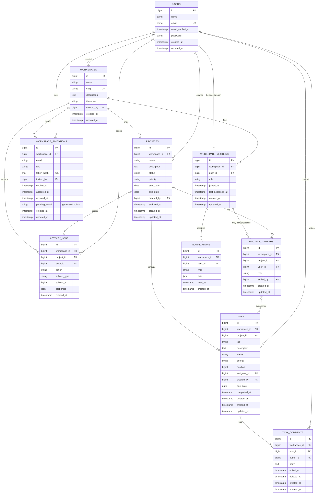

# 03 — Database Design

**Status:** Revised, awaiting final approval · **Date:** 2026-11-05 · **Engine:** MySQL 8.4, InnoDB, `utf8mb4`

---

## 1. Entity relationship diagram



Mermaid cannot display composite foreign keys, so the exact constraints are in section 3.

---

## 2. How workspace identifiers work

### Rule: every tenant-owned table has its own `workspace_id` column

`task_comments` could find its workspace through `task → project → workspace`. Storing `workspace_id` directly is a **deliberate, controlled denormalisation**, because it:

- allows one uniform scope across all tenant models,
- avoids chains of joins on the most common filter,
- lets indexes start with the tenant,
- makes a cross-tenant audit query trivial.

### The problem it creates, and the solution

A duplicated value can become inconsistent. A bug could insert a task with `workspace_id = 1` under a project that belongs to workspace 2. A plain foreign key on each column would accept that row, because both values exist individually.

**The solution is a composite foreign key.** `projects` gets a unique key on `(workspace_id, id)`, and `tasks` references that pair:

```sql
-- Illustrative only. Actual schema changes are made through migrations in later phases.
ALTER TABLE projects ADD UNIQUE KEY uq_projects_ws_id (workspace_id, id);

ALTER TABLE tasks ADD CONSTRAINT fk_tasks_project
  FOREIGN KEY (workspace_id, project_id)
  REFERENCES projects (workspace_id, id);
```

Now that bad row is **impossible at the database level**, even if the application has a bug. This is a strong feature to discuss in an interview, as many multi-tenant applications never add it.

### A MySQL limitation to remember

`ON DELETE SET NULL` on a composite foreign key tries to set *every* column to null. `workspace_id` cannot be null, so this action cannot work here. Composite keys on nullable references therefore use `RESTRICT`, and the application clears the value inside a transaction first. That's why `RemoveWorkspaceMember` must unassign tasks before removing memberships.

---

## 3. Tables

**Conventions**

- Primary keys are `BIGINT UNSIGNED AUTO_INCREMENT`.
- Status and role columns are `VARCHAR(32)` backed by PHP enums. MySQL `ENUM` columns require a table alteration to add a value.
- Calendar-only values use `DATE`. Moments in time use `TIMESTAMP` in UTC.

### `users` — global, not tenant-owned

| Column | Definition |
|---|---|
| `id` | PK |
| `name` | `VARCHAR(120)` |
| `email` | `VARCHAR(255)`, unique. The case-insensitive collation prevents `A@x.com` and `a@x.com` from both registering |
| `email_verified_at` | Nullable timestamp |
| `password` | `VARCHAR(255)`, hash only |
| `created_at`, `updated_at` | Timestamps |

**Indexes:** unique `email`. **Deletion:** not in V1 (D9). Comments and history reference users, so deletion later must anonymise the row rather than remove it.

### `workspaces` — the tenant root

| Column | Definition |
|---|---|
| `id` | PK |
| `name` | `VARCHAR(120)` |
| `slug` | `VARCHAR(64)`, unique. Generated at creation and unchanged in V1, so links stay stable |
| `description` | Nullable `TEXT` |
| `timezone` | `VARCHAR(64)`, default `UTC`. Used for "overdue" |
| `created_by` | FK `users.id`, RESTRICT |
| `created_at`, `updated_at` | Timestamps |

**Indexes:** unique `slug`. **Deletion:** not in V1. No soft delete column until the deletion feature exists.

### `workspace_members` — many-to-many between users and workspaces

| Column | Definition |
|---|---|
| `id` | PK |
| `workspace_id` | FK `workspaces.id`, RESTRICT |
| `user_id` | FK `users.id`, RESTRICT |
| `role` | `administrator`, `project_manager`, `member` |
| `joined_at` | Timestamp |
| `last_accessed_at` | Nullable. Chooses the workspace to open after login. Updated at most every 5 minutes to avoid a write on every request |
| `created_at`, `updated_at` | Timestamps |

**Unique:** `(workspace_id, user_id)`, which prevents duplicate membership and is also the target of composite FKs.
**Indexes:** `(user_id, last_accessed_at)`, `(workspace_id, role)`.
**Deletion:** hard delete. The activity log keeps the history. Re-joining creates a fresh row with a new role.

### `workspace_invitations`

| Column | Definition |
|---|---|
| `id` | PK |
| `workspace_id` | FK `workspaces.id`, RESTRICT |
| `email` | `VARCHAR(255)` |
| `role` | The role granted on acceptance |
| `token_hash` | `CHAR(64)`, unique. SHA-256 of the token. **The raw token is never stored** |
| `invited_by` | FK `users.id`, RESTRICT |
| `expires_at` | Timestamp |
| `accepted_at`, `revoked_at` | Nullable timestamps |
| `pending_email` | Generated: `email` while neither accepted nor revoked, otherwise `NULL` |
| `created_at`, `updated_at` | Timestamps |

**Unique:** `token_hash`; `(workspace_id, pending_email)`.
**Indexes:** `(workspace_id, created_at)`, `(email)`.

**Why `pending_email` exists:** the rule is "one *open* invitation per email per workspace", while keeping past ones as history. MySQL has no partial unique indexes, but its unique indexes allow many `NULL` values, so a generated column provides the same behaviour. Re-inviting after expiry updates the existing row with a new token.

### `projects`

| Column | Definition |
|---|---|
| `id` | PK |
| `workspace_id` | FK `workspaces.id`, RESTRICT |
| `name` | `VARCHAR(160)` |
| `description` | Nullable `TEXT` |
| `status` | `planning`, `active`, `on_hold`, `completed` |
| `priority` | `low`, `medium`, `high`, `urgent` |
| `start_date`, `due_date` | Nullable `DATE`. `CHECK (due_date >= start_date)` |
| `created_by` | FK `users.id`, RESTRICT |
| `archived_at` | Nullable. Archiving is separate from status, so a project's status survives archiving and unarchiving |
| `created_at`, `updated_at` | Timestamps |

**Unique:** `(workspace_id, id)`, the target for composite FKs.
**Indexes:** `(workspace_id, archived_at, status)`, `(workspace_id, due_date)`.
**Deletion:** archive only.

### `project_members` — many-to-many between workspace members and projects

| Column | Definition |
|---|---|
| `id` | PK |
| `workspace_id` | Part of both composite FKs |
| `project_id` | Part of a composite FK |
| `user_id` | Part of a composite FK |
| `role` | `manager`, `contributor` |
| `added_by` | FK `users.id`, RESTRICT |
| `created_at`, `updated_at` | Timestamps |

**Foreign keys:**

- `(workspace_id, project_id)` → `projects (workspace_id, id)`, RESTRICT
- `(workspace_id, user_id)` → `workspace_members (workspace_id, user_id)`, RESTRICT. **A person cannot join a project unless they are a member of that workspace.**

**Unique:** `(project_id, user_id)`.
**Indexes:** `(workspace_id, user_id)` supports "which projects can I see?".
**Deletion:** hard delete, recorded in the activity log.

Administrators have implicit access to all projects and do **not** need a row here, unless they are also explicitly on the project.

### `tasks`

| Column | Definition |
|---|---|
| `id` | PK |
| `workspace_id`, `project_id` | Composite FK |
| `title` | `VARCHAR(200)` |
| `description` | Nullable `TEXT`, plain text |
| `status` | `todo`, `in_progress`, `in_review`, `completed` |
| `priority` | `low`, `medium`, `high`, `urgent` |
| `position` | `BIGINT`. Order within a column |
| `assignee_id` | Nullable. Part of a composite FK |
| `created_by` | FK `users.id`, RESTRICT |
| `due_date` | Nullable `DATE` |
| `completed_at` | Nullable. Set when entering Completed, cleared when leaving it |
| `deleted_at` | Soft delete |
| `created_at`, `updated_at` | Timestamps |

**Foreign keys:**

- `(workspace_id, project_id)` → `projects (workspace_id, id)`, RESTRICT
- `(project_id, assignee_id)` → `project_members (project_id, user_id)`, RESTRICT. **Only a member of this project can be assigned.** The database enforces D4 and FR-D3 directly.

**Unique:** `(workspace_id, id)`, the target for comment FKs.

**Indexes:**

| Index | Query it supports |
|---|---|
| `(project_id, status, position)` | Kanban board |
| `(workspace_id, assignee_id, status)` | My tasks |
| `(workspace_id, status, due_date)` | Overdue and pending counts |
| `(project_id, due_date)` | Project report |

**Soft deletion caution:** soft-deleted tasks still hold their foreign key. Removing a member must clear `assignee_id` on deleted tasks too (`withTrashed()`), or the `RESTRICT` blocks the removal.

**Search:** `LIKE` on title, always filtered by project or workspace first. A `FULLTEXT` index can follow if measurement shows a need.

**Kanban position:** new cards take the column's maximum + 65,536. Moving a card between two others takes the midpoint. When no integer gap remains, the server renumbers that column in a transaction. This means a normal move updates one row, not a whole column.

### `task_comments`

| Column | Definition |
|---|---|
| `id` | PK |
| `workspace_id`, `task_id` | Composite FK → `tasks (workspace_id, id)`, RESTRICT |
| `author_id` | FK `users.id`, RESTRICT. Deliberately not tied to membership, so comments survive the author leaving |
| `body` | `TEXT`, length limited at validation, plain text |
| `edited_at` | Nullable. Shows an "edited" label |
| `deleted_at` | Soft delete. Displayed as "comment removed" so threads stay coherent |
| `created_at`, `updated_at` | Timestamps |

**Indexes:** `(task_id, created_at)`.

### `activity_logs` — append-only

| Column | Definition |
|---|---|
| `id` | PK |
| `workspace_id` | FK `workspaces.id`, RESTRICT |
| `project_id` | Nullable. `NULL` means a workspace-level event, visible to Administrators only |
| `actor_id` | Nullable FK `users.id`. `NULL` means the system acted |
| `action` | For example `task.status_changed`, `member.removed` |
| `subject_type`, `subject_id` | Polymorphic reference to the affected record |
| `properties` | JSON: changed values plus a snapshot such as the task title |
| `created_at` | No `updated_at`, as rows never change |

**Foreign keys:** `(workspace_id, project_id)` → `projects (workspace_id, id)`, RESTRICT. MySQL skips the check when `project_id` is `NULL`.
**Indexes:** `(workspace_id, created_at)`, `(project_id, created_at)`, `(subject_type, subject_id, created_at)`.

**Why polymorphic here:** the log references many kinds of record, and new kinds will appear. The trade-off is that the subject has no foreign key. That's acceptable for a historical record: the snapshot in `properties` keeps entries readable after the subject changes, and `project_id` retains a real constraint where visibility depends on it.

### `notifications` — custom table

| Column | Definition |
|---|---|
| `id` | PK |
| `workspace_id`, `user_id` | Composite FK → `workspace_members (workspace_id, user_id)`, **CASCADE** |
| `type` | For example `task.assigned` |
| `data` | JSON: display text and link target |
| `read_at` | Nullable |
| `created_at` | Timestamp |

**Indexes:** `(user_id, workspace_id, read_at, created_at)`.

**Why not Laravel's default notifications table:** it has no `workspace_id`, so it can't participate in tenant scoping. Here the cascade also gives FR-G6 automatically: leaving a workspace removes that person's notifications, including text snapshots of task titles they should no longer see. Removal from a *project* deletes that project's notifications in the action.

### Framework tables

Standard Laravel tables, not tenant-owned and not exposed through the API: `sessions`, `password_reset_tokens`, `jobs`, `failed_jobs`, `job_batches`, `cache`, `cache_locks`, `migrations`.

**Queue job payloads contain tenant data**, so they get the same access control and backup treatment as the application's tables.

---

## 4. Tables evaluated and rejected for V1

| Table | Reason |
|---|---|
| `roles`, `permissions` | Fixed roles in code (D11) |
| `task_assignees` | Single assignee (D4) |
| `task_statuses` | Fixed statuses. Moves in with custom workflows |
| `attachments`, `labels` | Postponed |
| `notification_preferences` | Postponed with email notifications |

---

## 5. Deletion summary

| Entity | Strategy | Reason |
|---|---|---|
| Users, workspaces | No deletion in V1 | D9 |
| Projects | `archived_at` | Keeps history and reports |
| Tasks, comments | Soft delete | Allows recovery and preserves threads |
| Workspace and project memberships | Hard delete | Current state only. History is in the activity log |
| Invitations | Kept with `accepted_at` or `revoked_at` | History |
| Activity logs | Never through the application | Audit value |
| Notifications | Cascade on membership removal | Derived data. Prevents information lingering |

Soft deletion often conflicts with unique constraints, because a deleted row still occupies its unique value. That doesn't arise in V1: the only unique key on a soft-deleted table is `tasks (workspace_id, id)`, which contains the primary key.

---

## 6. Multi-step operation: removing a workspace member

This operation shows why the foreign key choices matter. All of it runs in one transaction.

1. Lock the workspace's Administrator rows with `SELECT ... FOR UPDATE`, and refuse if this would remove the last Administrator.
2. Set `assignee_id = NULL` on all this user's tasks in the workspace, **including soft-deleted ones**.
3. Delete their `project_members` rows. Projects left with no manager display a "No manager" badge, and Administrators retain access.
4. Delete the `workspace_members` row, which cascades to notifications.
5. Write `member.removed` to the activity log.
6. Commit, then dispatch any resulting notifications.

If a step is forgotten, the `RESTRICT` constraints make the transaction fail, not leave corrupt data. A bug surfaces as an error instead of silently damaging tenant data.

---

## 7. Hosting compatibility

**This schema doesn't change for free hosting (D7).** It requires real MySQL 8.4 behaviour, which is why MariaDB and other MySQL-compatible hosts were not accepted without testing.

| Requirement | Why it matters | How it is checked on Aiven |
|---|---|---|
| Composite foreign keys, `CHECK` and generated columns | Tenant integrity and invitation uniqueness | Phase 2 hosting validation runs the constraint tests against the host |
| `SELECT ... FOR UPDATE` | Last-Administrator and invitation race protection | Same validation |
| Primary key on every table | Aiven's default `sql_require_primary_key` setting requires it. All application tables comply. **Framework tables are verified by running migrations with the setting on**, and CI uses the same setting | Migrations in CI and on Aiven |
| Size within the 1 GB free disk | Demo seed data stays small. The larger 20,000-task performance dataset runs locally only | Checked after seeding |
| Under 76 connections | PHP-FPM workers and the queue worker stay well below this | Configuration review |

Application tables gain no demo-specific columns. Demo accounts are identified through configuration and `users.email`.
