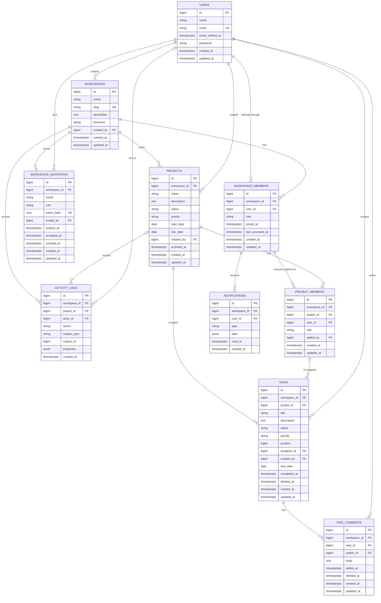

# 03 — Database Design

**Status:** Revised, awaiting final approval · **Date:** 2026-11-08 · **Engine:** PostgreSQL 18, UTF-8 (D12, proposed)

---

## 1. Entity relationship diagram



Mermaid cannot display composite foreign keys, so the exact constraints are in section 3.

---

## 2. How workspace identifiers work

### Rule: every tenant-owned table has its own `workspace_id` column

`task_comments` could find its workspace through `task → project → workspace`. Storing `workspace_id` directly is a **deliberate, controlled denormalisation**, because it:

- allows one uniform scope across all tenant models,
- avoids chains of joins on the most common filter,
- lets indexes start with the tenant,
- makes a cross-tenant audit query trivial.

### The problem it creates, and the solution

A duplicated value can become inconsistent. A bug could insert a task with `workspace_id = 1` under a project that belongs to workspace 2. A plain foreign key on each column would accept that row, because both values exist individually.

**The solution is a composite foreign key.** `projects` gets a unique key on `(workspace_id, id)`, and `tasks` references that pair:

```sql
-- Illustrative only. Actual schema changes are made through migrations in later phases.
ALTER TABLE projects ADD CONSTRAINT uq_projects_ws_id UNIQUE (workspace_id, id);

ALTER TABLE tasks ADD CONSTRAINT fk_tasks_project
  FOREIGN KEY (workspace_id, project_id)
  REFERENCES projects (workspace_id, id);
```

Now that bad row is **impossible at the database level**, even if the application has a bug. This is a strong feature to discuss in an interview, as many multi-tenant applications never add it.

### Why nullable composite references use `RESTRICT`

A plain `ON DELETE SET NULL` on a composite foreign key would null *every* column, including `workspace_id`, which can't be null. PostgreSQL 15 and later can null only named columns, for example `ON DELETE SET NULL (assignee_id)`. **We still choose `RESTRICT`**, and the application clears the value in a transaction first. Removing a member is a business operation that must also write activity records and handle soft-deleted tasks. `RESTRICT` makes any forgotten step fail loudly instead of being handled silently. That's why `RemoveWorkspaceMember` must unassign tasks before removing memberships.

### Foreign keys need their own indexes in PostgreSQL

MySQL automatically indexes the columns of a foreign key, but **PostgreSQL doesn't.** Without an index, deleting or locking a parent row has to scan the child table. Every foreign key below therefore has an explicit index whose leading columns match it, and a guard test fails if any foreign key lacks one.

---

## 3. Tables

**Conventions**

- Primary keys are 64-bit auto-incrementing integers, from Laravel's `id()`. PostgreSQL has no unsigned integers.
- Status and role columns are `VARCHAR` with a `CHECK` constraint listing the allowed values, backed by PHP enums. Adding a value means changing the constraint in a migration, which is deliberate.
- Calendar-only values use `DATE`. Moments in time use `TIMESTAMPTZ` (Laravel's `timestampsTz()`), stored in UTC.
- Structured values use `JSONB`, PostgreSQL's indexed binary JSON format.
- Text comparison is **case-sensitive** in PostgreSQL, unlike MySQL's default, so case-insensitive rules are explicit.

### `users` — global, not tenant-owned

| Column | Definition |
|---|---|
| `id` | PK |
| `name` | `VARCHAR(120)` |
| `email` | `VARCHAR(255)`, stored lowercase by the application. A unique index on `lower(email)` guarantees `A@x.com` and `a@x.com` can't both register, even if a code path forgets to lowercase |
| `email_verified_at` | Nullable timestamp |
| `password` | `VARCHAR(255)`, hash only |
| `created_at`, `updated_at` | Timestamps |

**Indexes:** unique `email`. **Deletion:** not in V1 (D9). Comments and history reference users, so deletion later must anonymise the row rather than remove it.

### `workspaces` — the tenant root

| Column | Definition |
|---|---|
| `id` | PK |
| `name` | `VARCHAR(120)` |
| `slug` | `VARCHAR(64)`, unique. Generated at creation and unchanged in V1, so links stay stable |
| `description` | Nullable `TEXT` |
| `timezone` | `VARCHAR(64)`, default `UTC`. Used for "overdue" |
| `created_by` | FK `users.id`, RESTRICT |
| `created_at`, `updated_at` | Timestamps |

**Indexes:** unique `slug`. **Deletion:** not in V1. No soft delete column until the deletion feature exists.

### `workspace_members` — many-to-many between users and workspaces

| Column | Definition |
|---|---|
| `id` | PK |
| `workspace_id` | FK `workspaces.id`, RESTRICT |
| `user_id` | FK `users.id`, RESTRICT |
| `role` | `administrator`, `project_manager`, `member` |
| `joined_at` | Timestamp |
| `last_accessed_at` | Nullable. Chooses the workspace to open after login. Updated at most every 5 minutes to avoid a write on every request |
| `created_at`, `updated_at` | Timestamps |

**Unique:** `(workspace_id, user_id)`, which prevents duplicate membership and is also the target of composite FKs.
**Indexes:** `(user_id, last_accessed_at)`, `(workspace_id, role)`.
**Deletion:** hard delete. The activity log keeps the history. Re-joining creates a fresh row with a new role.

### `workspace_invitations`

| Column | Definition |
|---|---|
| `id` | PK |
| `workspace_id` | FK `workspaces.id`, RESTRICT |
| `email` | `VARCHAR(255)` |
| `role` | The role granted on acceptance |
| `token_hash` | `CHAR(64)`, unique. SHA-256 of the token. **The raw token is never stored** |
| `invited_by` | FK `users.id`, RESTRICT |
| `expires_at` | Timestamp |
| `accepted_at`, `revoked_at` | Nullable timestamps |
| `created_at`, `updated_at` | Timestamps |

**Unique:** `token_hash`; a **partial unique index** on `(workspace_id, lower(email)) WHERE accepted_at IS NULL AND revoked_at IS NULL`.
**Indexes:** `(workspace_id, created_at)`, `(lower(email))`.

**Why a partial index:** the rule is "one *open* invitation per email per workspace", while keeping past ones as history. A partial index enforces uniqueness only for rows matching its `WHERE` clause, so accepted and revoked invitations don't count. This is simpler than MySQL's generated-column workaround, which is no longer needed. Laravel's schema builder doesn't document partial or expression indexes, so this index is created with a short raw SQL statement in its migration. Re-inviting after expiry updates the existing row with a new token.

### `projects`

| Column | Definition |
|---|---|
| `id` | PK |
| `workspace_id` | FK `workspaces.id`, RESTRICT |
| `name` | `VARCHAR(160)` |
| `description` | Nullable `TEXT` |
| `status` | `planning`, `active`, `on_hold`, `completed` |
| `priority` | `low`, `medium`, `high`, `urgent` |
| `start_date`, `due_date` | Nullable `DATE`. `CHECK (due_date >= start_date)` |
| `created_by` | FK `users.id`, RESTRICT |
| `archived_at` | Nullable. Archiving is separate from status, so a project's status survives archiving and unarchiving |
| `created_at`, `updated_at` | Timestamps |

**Unique:** `(workspace_id, id)`, the target for composite FKs.
**Indexes:** `(workspace_id, archived_at, status)`, `(workspace_id, due_date)`.
**Deletion:** archive only.

### `project_members` — many-to-many between workspace members and projects

| Column | Definition |
|---|---|
| `id` | PK |
| `workspace_id` | Part of both composite FKs |
| `project_id` | Part of a composite FK |
| `user_id` | Part of a composite FK |
| `role` | `manager`, `contributor` |
| `added_by` | FK `users.id`, RESTRICT |
| `created_at`, `updated_at` | Timestamps |

**Foreign keys:**

- `(workspace_id, project_id)` → `projects (workspace_id, id)`, RESTRICT
- `(workspace_id, user_id)` → `workspace_members (workspace_id, user_id)`, RESTRICT. **A person cannot join a project unless they are a member of that workspace.**

**Unique:** `(project_id, user_id)`.
**Indexes:** `(workspace_id, user_id)` supports "which projects can I see?".
**Deletion:** hard delete, recorded in the activity log.

Administrators have implicit access to all projects and do **not** need a row here, unless they are also explicitly on the project.

### `tasks`

| Column | Definition |
|---|---|
| `id` | PK |
| `workspace_id`, `project_id` | Composite FK |
| `title` | `VARCHAR(200)` |
| `description` | Nullable `TEXT`, plain text |
| `status` | `todo`, `in_progress`, `in_review`, `completed` |
| `priority` | `low`, `medium`, `high`, `urgent` |
| `position` | `BIGINT`. Order within a column |
| `assignee_id` | Nullable. Part of a composite FK |
| `created_by` | FK `users.id`, RESTRICT |
| `due_date` | Nullable `DATE` |
| `completed_at` | Nullable. Set when entering Completed, cleared when leaving it |
| `deleted_at` | Soft delete |
| `created_at`, `updated_at` | Timestamps |

**Foreign keys:**

- `(workspace_id, project_id)` → `projects (workspace_id, id)`, RESTRICT
- `(project_id, assignee_id)` → `project_members (project_id, user_id)`, RESTRICT. **Only a member of this project can be assigned.** The database enforces D4 and FR-D3 directly.

**Unique:** `(workspace_id, id)`, the target for comment FKs.

**Indexes:**

| Index | Query it supports |
|---|---|
| `(project_id, status, position)` | Kanban board |
| `(workspace_id, assignee_id, status)` | My tasks |
| `(workspace_id, status, due_date)` | Overdue and pending counts |
| `(project_id, due_date)` | Project report |

**Soft deletion caution:** soft-deleted tasks still hold their foreign key. Removing a member must clear `assignee_id` on deleted tasks too (`withTrashed()`), or the `RESTRICT` blocks the removal.

**Search:** case-insensitive `ILIKE` on title, always filtered by project or workspace first. PostgreSQL full-text search or a trigram index can follow if measurement shows a need.

**Kanban position:** new cards take the column's maximum + 65,536. Moving a card between two others takes the midpoint. When no integer gap remains, the server renumbers that column in a transaction. This means a normal move updates one row, not a whole column.

### `task_comments`

| Column | Definition |
|---|---|
| `id` | PK |
| `workspace_id`, `task_id` | Composite FK → `tasks (workspace_id, id)`, RESTRICT |
| `author_id` | FK `users.id`, RESTRICT. Deliberately not tied to membership, so comments survive the author leaving |
| `body` | `TEXT`, length limited at validation, plain text |
| `edited_at` | Nullable. Shows an "edited" label |
| `deleted_at` | Soft delete. Displayed as "comment removed" so threads stay coherent |
| `created_at`, `updated_at` | Timestamps |

**Indexes:** `(task_id, created_at)`.

### `activity_logs` — append-only

| Column | Definition |
|---|---|
| `id` | PK |
| `workspace_id` | FK `workspaces.id`, RESTRICT |
| `project_id` | Nullable. `NULL` means a workspace-level event, visible to Administrators only |
| `actor_id` | Nullable FK `users.id`. `NULL` means the system acted |
| `action` | For example `task.status_changed`, `member.removed` |
| `subject_type`, `subject_id` | Polymorphic reference to the affected record |
| `properties` | JSON: changed values plus a snapshot such as the task title |
| `created_at` | No `updated_at`, as rows never change |

**Foreign keys:** `(workspace_id, project_id)` → `projects (workspace_id, id)`, RESTRICT. The check is skipped when `project_id` is `NULL`, which is PostgreSQL's default `MATCH SIMPLE` behaviour.
**Indexes:** `(workspace_id, created_at)`, `(project_id, created_at)`, `(subject_type, subject_id, created_at)`.

**Why polymorphic here:** the log references many kinds of record, and new kinds will appear. The trade-off is that the subject has no foreign key. That's acceptable for a historical record: the snapshot in `properties` keeps entries readable after the subject changes, and `project_id` retains a real constraint where visibility depends on it.

### `notifications` — custom table

| Column | Definition |
|---|---|
| `id` | PK |
| `workspace_id`, `user_id` | Composite FK → `workspace_members (workspace_id, user_id)`, **CASCADE** |
| `type` | For example `task.assigned` |
| `data` | JSON: display text and link target |
| `read_at` | Nullable |
| `created_at` | Timestamp |

**Indexes:** `(user_id, workspace_id, read_at, created_at)`.

**Why not Laravel's default notifications table:** it has no `workspace_id`, so it can't participate in tenant scoping. Here the cascade also gives FR-G6 automatically: leaving a workspace removes that person's notifications, including text snapshots of task titles they should no longer see. Removal from a *project* deletes that project's notifications in the action.

### Framework tables

Standard Laravel tables, not tenant-owned and not exposed through the API: `sessions`, `password_reset_tokens`, `jobs`, `failed_jobs`, `job_batches`, `cache`, `cache_locks`, `migrations`.

**Queue job payloads contain tenant data**, so they get the same access control and backup treatment as the application's tables.

### `demo_mail_messages` — demo mode only, not tenant-owned

| Column | Definition |
|---|---|
| `id` | PK |
| `to_email` | `VARCHAR(255)`. Always an `@workflow.test` address |
| `subject` | `VARCHAR(255)` |
| `body_text` | `TEXT`. Plain text only, displayed as text, so links are visible but no HTML is rendered |
| `created_at` | Timestamp |

**Indexes:** `(created_at)`. Written only by the demo mail driver (D13), emptied by the nightly reset, and listed on the guard test's allow-list of non-tenant tables. Outside demo mode it stays empty, and no route reads it.

---

## 4. Tables evaluated and rejected for V1

| Table | Reason |
|---|---|
| `roles`, `permissions` | Fixed roles in code (D11) |
| `task_assignees` | Single assignee (D4) |
| `task_statuses` | Fixed statuses. Moves in with custom workflows |
| `attachments`, `labels` | Postponed |
| `notification_preferences` | Postponed with email notifications |

---

## 5. Deletion summary

| Entity | Strategy | Reason |
|---|---|---|
| Users, workspaces | No deletion in V1 | D9 |
| Projects | `archived_at` | Keeps history and reports |
| Tasks, comments | Soft delete | Allows recovery and preserves threads |
| Workspace and project memberships | Hard delete | Current state only. History is in the activity log |
| Invitations | Kept with `accepted_at` or `revoked_at` | History |
| Activity logs | Never through the application | Audit value |
| Notifications | Cascade on membership removal | Derived data. Prevents information lingering |

Soft deletion often conflicts with unique constraints, because a deleted row still occupies its unique value. That doesn't arise in V1: the only unique key on a soft-deleted table is `tasks (workspace_id, id)`, which contains the primary key.

---

## 6. Multi-step operation: removing a workspace member

This operation shows why the foreign key choices matter. All of it runs in one transaction.

1. Lock the workspace's Administrator rows with `SELECT ... FOR UPDATE`, and refuse if this would remove the last Administrator.
2. Set `assignee_id = NULL` on all this user's tasks in the workspace, **including soft-deleted ones**.
3. Delete their `project_members` rows. Projects left with no manager display a "No manager" badge, and Administrators retain access.
4. Delete the `workspace_members` row, which cascades to notifications.
5. Write `member.removed` to the activity log.
6. Commit, then dispatch any resulting notifications.

If a step is forgotten, the `RESTRICT` constraints make the transaction fail, not leave corrupt data. A bug surfaces as an error instead of silently damaging tenant data.

---

## 7. PostgreSQL design notes

D12 proposes PostgreSQL 18 instead of MySQL. **This is a reviewed conversion, not a rename:** every rule from the MySQL design was checked against PostgreSQL, and nothing protecting tenants was removed.

### Evaluation summary

| Question | Answer |
|---|---|
| Does PostgreSQL support the composite tenant foreign keys? | **Yes.** The referenced columns must form a primary key or unique constraint, and `(workspace_id, id)` already has one on each parent table |
| How must the schema change? | See the next table. Six changes. The tenant model, tables and relationships are unchanged |
| Do generated columns, indexes, constraints and locking need adjusting? | The generated column is replaced by a partial index. Foreign keys need explicit indexes. Locking works, with two coding rules. `CHECK` constraints are unchanged |
| Does Laravel support it cleanly? | Yes, as a first-class database. Two index types need a short raw SQL statement in their migrations |
| Does testing change? | Same approach, on PostgreSQL 18, plus tests for PostgreSQL-specific behaviour ([testing strategy](06-testing-strategy.md#postgresql-specific-tests)) |
| How is it set up on Windows, and kept in step with the deployed database? | See [environment parity](02-system-architecture.md#environment-parity) |

### What changes from the MySQL design

| Area | MySQL design | PostgreSQL design | Why |
|---|---|---|---|
| Composite tenant foreign keys | Supported | **Unchanged** | Supported natively |
| Indexes on foreign key columns | Created automatically | **Created explicitly**, checked by a guard test | PostgreSQL doesn't create them automatically |
| One open invitation per email | Generated `pending_email` column with a unique index | **Partial unique index** with a `WHERE` clause | A partial index expresses the rule directly |
| Case-insensitive email | Case-insensitive collation | Lowercased by the application, **plus a unique index on `lower(email)`** | PostgreSQL text comparison is case-sensitive |
| Title search | `LIKE`, case-insensitive by default | `ILIKE` | Same reason |
| Status and role values | `VARCHAR` | `VARCHAR` plus `CHECK` | The database rejects invalid values, matching the PHP enums |
| JSON columns | `JSON` | `JSONB` | Binary format, can be indexed |
| Timestamps | `TIMESTAMP` | `TIMESTAMPTZ` | Unambiguous moments in time |
| ID columns | `BIGINT UNSIGNED` | `BIGINT` | PostgreSQL has no unsigned integers. The range is still enormous |
| Failed migrations | Partly applied changes can remain | **Rolled back as a whole** | PostgreSQL schema changes are transactional |

### Locking and transactions

- **Row locks work the same way.** `SELECT ... FOR UPDATE` locks the selected rows until the transaction ends, which protects the last-Administrator rule and invitation acceptance.
- **Coding rule 1:** PostgreSQL rejects `FOR UPDATE` combined with an aggregate such as `COUNT(*)`. The code locks the Administrator rows first, then counts them in PHP.
- **Coding rule 2:** after any error inside a transaction, PostgreSQL rejects every further statement until the transaction is rolled back. So an expected unique violation (error code `23505`) is caught at the transaction boundary, or inside a savepoint. Laravel's nested transactions use savepoints. Where a conflict is normal, `INSERT ... ON CONFLICT DO NOTHING` avoids the error entirely.
- **Isolation level:** PostgreSQL defaults to *Read Committed*, MySQL to *Repeatable Read*. The design never depends on the isolation level. Correctness comes from explicit locks and unique constraints, which behave the same under both.
- **Deadlocks** (error code `40P01`) are retried by running the transaction with `attempts: 3`.
- **Queue:** Laravel's database queue driver claims jobs with row locks. Tests confirm two workers never take the same job.

### Laravel support

| Feature | Laravel support | Approach |
|---|---|---|
| Composite foreign keys | The schema builder accepts arrays of columns. Not shown in the docs | Schema builder. Raw SQL fallback. Proven by constraint tests |
| Partial and expression indexes | Not documented in the schema builder | One short `DB::statement` in the relevant migration |
| `CHECK` constraints for status values | Not documented for PostgreSQL | Explicit `CHECK` through `DB::statement`, so the result is certain |
| `timestampsTz`, `softDeletesTz`, `jsonb` | Documented | Schema builder |
| TLS options | `sslmode` and `sslrootcert` passed to the driver, confirmed in Laravel's source | Configuration |
| Queries | Eloquent and the query builder, unchanged | **No extra database abstraction layer.** Raw SQL appears only in migrations |

### Hosting compatibility

| Requirement | Neon Free | Checked by |
|---|---|---|
| Composite foreign keys, partial and expression indexes, `CHECK`, row locks | Standard PostgreSQL 18. No extensions needed | Hosting validation check 3 |
| Storage | 1 GB. Demo seed data stays small, and the 20,000-task performance dataset runs locally only | Size checked after seeding |
| Connections | Direct endpoint. About three PHP-FPM workers, one queue worker, and short-lived GitHub Actions connections | Configuration review |
| Permissions | No superuser. Migrations need only table-owner rights | Migrations on Neon |
| TLS | `verify-full` with the system CA bundle | Hosting validation check 2 |

**Aiven fallback differences:** a 20-connection limit and a private CA certificate. Neither changes the schema.
