# 07 — Development Roadmap

**Status:** Approved plan (Phase 1, 2026-11-10). Phase status is maintained in section 1 · **Last reviewed:** 2026-11-10

Each phase ends with something working and tested, merged into a stable `main`. Sizes are relative: **S** small, **M** medium, **L** large. I've left out calendar estimates, as they depend on the time I can give the project. The detailed history behind each phase is in the [development journal](08-development-journal.md).

---

## 1. Current status

As of 2026-11-10:

| Phase | Status | Evidence |
|---|---|---|
| 1. Planning | **Complete.** Approved 2026-11-10 and merged into `main` | `docs/01`–`07` |
| 2. Foundation and hosting validation | **In progress.** The forwarding experiment is built and checked locally. Render deployment, the Docker image build and the application scaffolding haven't started | [Render forwarding experiment](https://github.com/Martins-Code/workflow/tree/spike/render-proxy-test/experiments/render-proxy), on `spike/render-proxy-test` |
| 3–12 | Not started | — |

**No WorkFlow application code exists yet.** Nothing has been deployed.

---

## 2. Delivery order and why



```mermaid
flowchart LR
    P1["1 Planning<br/>docs"] --> P2["2 Foundation and<br/>hosting validation"]
    P2 --> P3["3 Authentication<br/>+ first deployment"]
    P3 --> P4["4 Tenancy core"]
    P4 --> P5["5 Members and<br/>invitations"]
    P5 --> P6["6 Projects"]
    P6 --> P7["7 Tasks and<br/>Kanban"]
    P7 --> P8["8 Comments and<br/>activity"]
    P8 --> P9["9 Notifications"]
    P9 --> P10["10 Dashboard<br/>and reports"]
    P10 --> P11["11 Hardening"]
    P11 --> P12["12 Release"]
```

Two choices in this order are deliberate:

- **Hosting is validated in Phase 2, and the first deployment happens in Phase 3, not at the end.** Session cookies, CSRF and proxies behave differently on real HTTPS hosting, and free plans have limits that only show on real accounts. Finding problems early is far cheaper.
- **Tenancy comes before any business feature.** Adding tenant isolation to existing features is where leaks are born. The isolation test harness exists before the first project is created.

---

## 3. Phases

### Phase 1: Planning (complete)

Requirements, architecture, database design, permissions, API contract, testing strategy and this roadmap: documents 01–07. Approved on 2026-11-10, including decisions D1–D13.

### Phase 2: Foundation and hosting validation (M) — in progress

**Branches:** `spike/render-proxy-test` (experiment, never merged), `chore/project-foundation`, then `chore/hosting-validation`

| Item | Status |
|---|---|
| Forwarding experiment, checks P1–P7 ([architecture, section 10](02-system-architecture.md#what-isnt-verified-yet)): a plain-PHP echo service behind a Render static site | Built. Checked locally against a Node.js stand-in for Render on 2026-11-10. **Not yet deployed to Render** |
| The experiment's Docker image | **Not yet built.** Docker isn't installed on my development machine, so Render's build will be the first |
| Decision on D7 from the experiment's Render results | Pending. If the forwarding fails, choosing a fallback is a recorded decision before Phase 3 |
| Root README rewritten in UTF-8 (it was UTF-16, so Git treated it as binary) | Done in the 2026-11-10 documentation review |
| Laravel API scaffold with Sanctum, and React/Vite/Tailwind scaffold | Not started |
| Local environment, following [environment parity](02-system-architecture.md#local-development-on-windows): PHP 8.3 from Laragon with `pdo_pgsql` and `pgsql` enabled, and PostgreSQL 18 from the EDB Windows installer. `php` isn't yet on my terminal's PATH | Not started |
| `.env.example` files, health endpoint, error format, request ID, Pint, ESLint and Prettier | Not started |
| Vite proxy, so local development is same-origin | Not started |
| CI: backend on PostgreSQL 18, and frontend jobs | Not started |
| `backend/Dockerfile`, Render static site configuration, and GitHub Actions workflows with a deploy hook for each service | Not started |
| Free Render and Neon accounts, in the same region. Secrets go only into provider settings, never into the repository | Not started |
| Remaining [hosting validation](02-system-architecture.md#phase-2-hosting-validation) checks that don't need authentication | Not started |

**Exit:** a fresh clone runs by following the README, the SPA shows the API health status on the live platform URL, CI is green, and each validation result is recorded.

**Concepts:** monorepo structure, `.env` handling, GitHub Actions, Docker, reverse proxies, origins and the Public Suffix List, PostgreSQL basics, TLS certificate verification.

### Phase 3: Authentication and first deployment (M)

**Branches:** `feature/authentication`, then `chore/first-deployment`

- Register, verify email, login, logout, reset password, profile.
- CSRF and session cookie flow, rate limits, frontend authentication pages and protected routes.
- Deploy both services (D7): the frontend forwards to the backend, and migrations run from GitHub Actions before the backend deploys.
- Demo mode: reserved-domain rule and demo mailbox (D13).
- Complete the remaining hosting validation: real cookie flow, client IP and the demo mailbox.

**Exit:** all authentication tests pass, including the real cookie flow. Login works on the live URL, and registration with verification works through the demo mailbox.

**Concepts:** sessions versus tokens, cookies, CSRF, CORS and why the proxy avoids it, `SameSite`, the Public Suffix List, trusted proxies, signed URLs, HTTPS deployment.

### Phase 4: Tenancy core (M) — the most important phase

**Branch:** `feature/workspace-tenancy`

- `workspaces` and `workspace_members`.
- `TenantContext`, `ResolveWorkspace`, `BelongsToWorkspace`, the fail-closed scope, and middleware priority.
- Create, list and view workspaces; workspace switcher; onboarding.
- Isolation harness and guard tests, `TwoTenantWorld` fixture, architecture tests.

**Exit:** Parts B and D of the isolation suite are active. A temporary test model demonstrates the 404 behaviour across tenants.

**Concepts:** global scopes, middleware order, route model binding, failing closed.

### Phase 5: Members and invitations (M)

**Branch:** `feature/workspace-members-invitations`

- Member list, role changes, removal, leaving, last-Administrator protection.
- Invitation lifecycle, emails through Laravel's mail system (the demo mailbox on the demo), and the accept flow for new and existing users.
- Team pages.

**Exit:** two real browser sessions complete the invitation flow, and all invitation security tests pass.

**Concepts:** token hashing, transactions, row locks, queues, partial unique indexes, PostgreSQL transaction errors.

### Phase 6: Projects (M)

**Branch:** `feature/projects`

- Project CRUD, archive, project members, composite foreign keys.
- `ProjectPolicy`, `ProjectAccess`, the `can` object.
- Project list and detail pages.

**Exit:** the project rows of the permissions matrix have passing tests, and project routes are in the isolation table.

**Concepts:** composite foreign keys, policies, API resources.

### Phase 7: Tasks and Kanban (L)

Split into two branches, so each pull request stays reviewable.

**Branch:** `feature/tasks`: task CRUD, assignment, list view, filters, search, my tasks.
**Branch:** `feature/kanban-board`: move endpoint, positions, board with dnd-kit, keyboard alternative, optimistic updates, mobile view.

**Exit:** a task can be taken through the complete workflow under D3's rules, using only the keyboard if needed.

**Concepts:** query optimisation with composite indexes, optimistic UI, accessible drag and drop.

### Phase 8: Comments and activity (M)

**Branches:** `feature/task-comments`, `feature/activity-history`

- Comments with edit and soft delete, and the XSS tests.
- `ActivityLogger` wired into existing actions, including those from earlier phases.
- History on tasks and projects, and the workspace feed.

**Exit:** every action listed in FR-G1 records an entry in the same transaction, with no feed leaks.

**Concepts:** audit design, polymorphic relations, transaction boundaries.

### Phase 9: Notifications (S–M)

**Branch:** `feature/notifications`

- Custom notification storage, created after commit without a queue worker (ADR-11), for the events in FR-G4.
- Bell, list, mark-read, per-workspace unread count, polling.

**Exit:** the right people are notified, and removed members lose access to old notifications.

**Concepts:** after-commit events, queues and why V1 doesn't need a worker, polling.

### Phase 10: Dashboard and reports (M)

**Branch:** `feature/dashboard-reports`

- Metric queries, time zone handling, workspace dashboard and project report, seed data for performance checks.

**Exit:** values match hand-calculated test fixtures, the performance targets are met on the seeded dataset, and data is limited to visible projects.

**Concepts:** aggregate queries, `EXPLAIN`, indexes.

### Phase 11: Hardening (M)

**Branch:** `chore/release-hardening`

- Accessibility pass, responsive review, Playwright flows.
- Security checklist review, headers and CSP, dependency audit.
- **Rebuild rehearsal** from empty, a dump restored to a separate database, and a log review.
- Hosting runbook: wake-up, Neon compute-hour usage, re-enabling scheduled workflows, rebuilding data, switching to the fallback database.

**Exit:** every criterion in [requirements, section 7](01-product-requirements.md#7-acceptance-criteria-for-the-first-release) passes.

### Phase 12: Release (S)

**Branch:** `chore/v1-release`

- Demo accounts and seed data, nightly reset through GitHub Actions, demo banner, and mail disabled for demo accounts.
- README updated for the release: screenshots or a short video, the live link, demo logins, limitations, architecture summary, and how to run the tests.
- Tag `v1.0.0`.

### After V1: only if commercial use becomes likely

Move to a custom domain and paid hosting, split the worker, add real backups and monitoring, and build the V1.1 deletion features. See the [upgrade path](02-system-architecture.md#moving-to-a-custom-domain-later). **Nothing here is committed or budgeted.**

---

## 4. Git and GitHub workflow

I perform every Git operation that changes the repository or GitHub myself: creating, switching and deleting branches, commits, pushes, pulls, merges and pull requests. I use an AI assistant for drafting and review. It's limited to read-only Git commands, such as `git status`, `git log` and `git diff`, unless I explicitly authorise a specific operation.

### Branch names

| Prefix | Use | Example |
|---|---|---|
| `feature/` | New functionality | `feature/kanban-board` |
| `fix/` | Bug fix | `fix/overdue-timezone` |
| `chore/` | Tooling, setup, deployment | `chore/project-foundation` |
| `docs/` | Documentation only | `docs/phase-1-architecture` |
| `spike/` | A time-boxed experiment that answers one question. **Never merged into `main`.** Its findings are copied into `docs/` | `spike/render-proxy-test` |

### Standard cycle for a feature

```powershell
# 1. Move to main and update it from GitHub, so the branch starts from the latest code
git switch main
git pull origin main

# 2. Create the branch and move onto it
git switch -c feature/projects

# 3. See what changed, and review the actual differences before staging
git status
git diff

# 4. Stage specific paths. Reviewing what's staged helps keep secrets out of commits
git add backend/app/Models/Project.php

# 5. Save a snapshot on the local branch
git commit -m "feat(projects): add project model and policy"

# 6. Publish the branch. -u links it to GitHub, so later a plain git push works
git push -u origin feature/projects
```

Then I open a pull request on GitHub, or use `gh pr create`. I check that CI has passed, review the diff, and merge.

```powershell
# 7. After merging on GitHub, update main and delete the finished local branch
git switch main
git pull origin main
git branch -d feature/projects
```

`-d` refuses to delete unmerged work, which makes it safer than `-D`. Squash merges can make Git consider a branch unmerged, so I confirm the pull request merged on GitHub before using `-D` in that case.

### Commit messages

Conventional Commits: `feat`, `fix`, `test`, `docs`, `refactor`, `chore`, with an optional area. Example: `fix(tasks): compute overdue in workspace time zone`. I keep commits small, each with one purpose.

### Protecting `main`

Once CI exists in Phase 2, I'll set up branch protection under **Settings → Branches** on GitHub:

- Require a pull request before merging.
- Require CI status checks to pass.
- Block force pushes.

**Merge method:** squash and merge, which gives `main` one clear commit per feature. GitHub's secret scanning and Dependabot alerts stay enabled.

---

## 5. Definition of done

A pull request can merge when:

1. Its scope matches one branch purpose and is small enough to review.
2. Tests from [the testing strategy, section 9](06-testing-strategy.md#9-acceptance-criteria-for-tests) are in place and CI passes.
3. The documentation review in [the documentation guide](00-documentation-guide.md#5-updating-documentation-when-something-changes) is done: affected documents are updated, and a journal entry is added for meaningful milestones.
4. No secrets, debug output or commented-out code are in the diff.
5. I can explain what changed and why.

---

## 6. How I record what I learn

This project is also how I'm deepening my engineering knowledge, so a feature I can't explain doesn't count as finished. When an important concept, technology, decision or pattern enters the project, I record:

1. What it is.
2. What problem it solves.
3. Why WorkFlow uses it.
4. What alternatives exist.
5. The advantages and disadvantages of those alternatives.
6. A practical example from WorkFlow.
7. A short summary of the reasoning I'd give another engineer.

Architectural decisions carry this in their ADR in [the architecture document](02-system-architecture.md). Everything else goes in the "What I learned" part of the relevant [journal](08-development-journal.md) entry.

| Area | Topics to cover as they arise |
|---|---|
| Database | Foreign keys, one-to-many and many-to-many relationships, composite keys, indexes including partial and expression indexes, transactions, locks, PostgreSQL versus MySQL |
| API | REST, HTTP methods, status codes, request validation, response design, authentication |
| Authentication | Sessions, cookies, CSRF, CORS, origins and sites, how Sanctum works |
| Tenant isolation | The security risks, and how the protection layers work together |
| Authorisation | Roles, policies, and two-layer permissions |
| Testing | What each test proves, feature versus unit tests, reading failures |
| Frontend | Routing, server state, forms, accessibility |
| Deployment | Docker, reverse proxies, environment variables, migrations, free-tier limitations |

---

## 7. Next steps

1. Commit the experiment on `spike/render-proxy-test` and push it, so Render can build from it.
2. Decide whether to apply the small test-harness corrections proposed in the [experiment README](https://github.com/Martins-Code/workflow/tree/spike/render-proxy-test/experiments/render-proxy) before deploying.
3. Deploy the experiment to Render: a free static site and a free Docker web service. This is also the first build of its Docker image.
4. Run P1–P7 against Render in two browsers, and run P6 after at least 16 minutes idle. Record the results in the experiment README, [architecture, section 10](02-system-architecture.md#what-isnt-verified-yet) and the journal.
5. Confirm D7, or record a fallback decision.
6. Start `chore/project-foundation`.
