# 07 — Development Roadmap

**Status:** Draft for review · **Date:** 2026-11-05

Each phase ends with something working and tested, merged into a stable `main`. Sizes are relative: **S** small, **M** medium, **L** large. Calendar estimates are left out, as they depend on your available time.

---

## 1. Delivery order and why

```mermaid
flowchart LR
    P1["1 Planning<br/>docs"] --> P2["2 Foundation"]
    P2 --> P3["3 Authentication<br/>+ first deployment"]
    P3 --> P4["4 Tenancy core"]
    P4 --> P5["5 Members and<br/>invitations"]
    P5 --> P6["6 Projects"]
    P6 --> P7["7 Tasks and<br/>Kanban"]
    P7 --> P8["8 Comments and<br/>activity"]
    P8 --> P9["9 Notifications"]
    P9 --> P10["10 Dashboard<br/>and reports"]
    P10 --> P11["11 Hardening"]
    P11 --> P12["12 Release"]
```



Two choices in this order are deliberate:

- **Deployment happens at Phase 3, not at the end.** Session cookies, CSRF and CORS behave differently on real HTTPS domains, and finding that early is far cheaper.
- **Tenancy comes before any business feature.** Adding tenant isolation to existing features is where leaks are born. The isolation test harness exists before the first project is created.

---

## 2. Phases

### Phase 2: Foundation (S)

**Branch:** `chore/project-foundation`

- Repository layout, `.gitignore`, and a corrected README. *The current README is UTF-16 encoded, so Git treats it as binary. It needs re-saving as UTF-8 so it displays and diffs properly.*
- Laravel API scaffold with Sanctum, and React/Vite/Tailwind scaffold.
- Local environment: PHP 8.3 and MySQL 8.4 from Laragon. **`php` isn't currently on your terminal's PATH, so that needs fixing first.**
- `.env.example` files, health endpoint, error format, request ID, Pint, ESLint and Prettier.
- CI: backend on MySQL and frontend jobs.

**Exit:** a fresh clone runs by following the README, the SPA shows the API health status, and CI is green.

**Learning:** monorepo structure, `.env` handling, GitHub Actions.

### Phase 3: Authentication and first deployment (M)

**Branches:** `feature/authentication`, then `chore/first-deployment`

- Register, verify email, login, logout, reset password, profile.
- CSRF and session cookie flow, rate limits, frontend auth pages and protected routes.
- Provision the server and domain (D7). Deploy both apps over HTTPS.

**Exit:** all authentication tests pass, including the real cookie flow, and login works on the live domains.

**Learning:** sessions versus tokens, CSRF, CORS, `SameSite`, HTTPS deployment.

### Phase 4: Tenancy core (M) — the most important phase

**Branch:** `feature/workspace-tenancy`

- `workspaces` and `workspace_members`.
- `TenantContext`, `ResolveWorkspace`, `BelongsToWorkspace`, the fail-closed scope, and middleware priority.
- Create, list and view workspaces; workspace switcher; onboarding.
- Isolation harness and guard tests, `TwoTenantWorld` fixture, architecture tests.

**Exit:** Part B and Part D of the isolation suite are active. A temporary test model demonstrates the 404 behaviour across tenants.

**Learning:** global scopes, middleware order, route model binding, failing closed.

### Phase 5: Members and invitations (M)

**Branch:** `feature/workspace-members-invitations`

- Member list, role changes, removal, leaving, last-Administrator protection.
- Invitation lifecycle, email delivery through a queue, accept flow for new and existing users.
- Team pages.

**Exit:** two real browser sessions complete the invite flow, and all invitation security tests pass.

**Learning:** token hashing, transactions, row locks, queues, generated columns.

### Phase 6: Projects (M)

**Branch:** `feature/projects`

- Project CRUD, archive, project members, composite FKs.
- `ProjectPolicy`, `ProjectAccess`, the `can` object.
- Project list and detail pages.

**Exit:** the project rows of the matrix have passing tests, and project routes are in the isolation table.

**Learning:** composite foreign keys, policies, API resources.

### Phase 7: Tasks and Kanban (L)

Split into two branches, so each pull request stays reviewable.

**Branch:** `feature/tasks`: task CRUD, assignment, list view, filters, search, my tasks.
**Branch:** `feature/kanban-board`: move endpoint, positions, board with dnd-kit, keyboard alternative, optimistic updates, mobile view.

**Exit:** a task can be taken through the complete workflow under D3's rules, using only the keyboard if needed.

**Learning:** query optimisation with composite indexes, optimistic UI, accessible drag and drop.

### Phase 8: Comments and activity (M)

**Branches:** `feature/task-comments`, `feature/activity-history`

- Comments with edit and soft delete, and the XSS tests.
- `ActivityLogger` wired into existing actions, including those from earlier phases.
- History on tasks and projects, and the workspace feed.

**Exit:** every action listed in FR-G1 records an entry in the same transaction, with no feed leaks.

**Learning:** audit design, polymorphic relations, transaction boundaries.

### Phase 9: Notifications (S–M)

**Branch:** `feature/notifications`

- Custom notification storage, queued after commit, the events in FR-G4.
- Bell, list, mark-read, per-workspace unread count, polling.

**Exit:** the right people are notified, and removed members lose access to old notifications.

**Learning:** queues, after-commit events, polling.

### Phase 10: Dashboard and reports (M)

**Branch:** `feature/dashboard-reports`

- Metric queries, time zone handling, workspace dashboard and project report, seed data for performance checks.

**Exit:** values match hand-calculated test fixtures, the performance targets are met on the seeded dataset, and data is limited to visible projects.

**Learning:** aggregate queries, `EXPLAIN`, indexes.

### Phase 11: Hardening (M)

**Branch:** `chore/release-hardening`

- Accessibility pass, responsive review, Playwright flows.
- Security checklist review, headers and CSP, dependency audit.
- Backups, **restore rehearsal**, log review.

**Exit:** every criterion in [requirements, section 7](01-product-requirements.md#7-acceptance-criteria-for-the-first-release) passes.

### Phase 12: Release (S)

**Branch:** `chore/v1-release`

- Demo workspace with seed data, nightly reset, and mail disabled for demo accounts.
- README for recruiters: screenshots, live link, architecture summary, how to run the tests.
- Tag `v1.0.0`.

---

## 3. Git and GitHub workflow

**I will not run commands that change branches, commits or the remote.** At each point where one is needed, I'll give you the exact command and its purpose, then wait for you to confirm it has been done. I may run read-only commands such as `git status`, `git log` and `git diff`.

### Branch names

| Prefix | Use | Example |
|---|---|---|
| `feature/` | New functionality | `feature/kanban-board` |
| `fix/` | Bug fix | `fix/overdue-timezone` |
| `chore/` | Tooling, setup, deployment | `chore/project-foundation` |
| `docs/` | Documentation only | `docs/phase-1-architecture` |

### Standard cycle for a feature

```powershell
# 1. Move to main and update it from GitHub, so the branch starts from the latest code
git switch main
git pull origin main

# 2. Create the branch and move onto it
git switch -c feature/projects

# 3. See what changed, and review the actual differences before staging
git status
git diff

# 4. Stage specific paths. Reviewing what you stage helps keep secrets out of commits
git add backend/app/Models/Project.php

# 5. Save a snapshot on your local branch
git commit -m "feat(projects): add project model and policy"

# 6. Publish the branch. -u links it to GitHub, so later a plain git push works
git push -u origin feature/projects
```

Then open a pull request on GitHub, or use `gh pr create`. Check that CI has passed, review your own diff, and merge.

```powershell
# 7. After merging on GitHub, update main and delete the finished local branch
git switch main
git pull origin main
git branch -d feature/projects
```

`-d` refuses to delete unmerged work, which makes it safer than `-D`. Squash merges can make Git consider a branch unmerged, so confirm the pull request merged on GitHub before using `-D` in that case.

### Commit messages

Conventional Commits: `feat`, `fix`, `test`, `docs`, `refactor`, `chore`, with an optional area. Example: `fix(tasks): compute overdue in workspace time zone`. Make small commits, each with one purpose.

### Protecting `main`

Set this up yourself on GitHub, under **Settings → Branches**, once CI exists at Phase 2:

- Require a pull request before merging.
- Require CI status checks to pass.
- Block force pushes.

**Merge method:** I recommend **Squash and merge**, which gives `main` one clear commit per feature, and is easy for a recruiter to read. Enable GitHub's secret scanning and Dependabot alerts too, particularly if the repository is public.

---

## 4. Definition of done

A pull request can merge when:

1. Its scope matches one branch purpose and is small enough to review.
2. Tests from [the testing strategy, section 9](06-testing-strategy.md#9-acceptance-criteria-for-tests) are in place and CI passes.
3. Documentation is updated if behaviour or a decision changed.
4. No secrets, debug output or commented-out code are in the diff.
5. **You can explain what changed and why.**

---

## 5. Immediately after Phase 1 approval

1. You confirm or change decisions D1–D11.
2. I update these documents with any changes.
3. You commit the documents on a `docs/` branch and merge them.
4. You create the Phase 2 branch, using the command I provide, and confirm.
5. Phase 2 begins.
