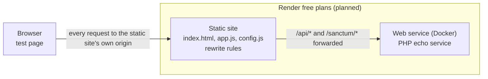
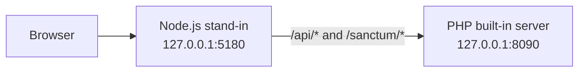

# Render forwarding experiment

> **Status (2026-11-10):** built, with test-harness corrections C1–C6 applied, and checked locally against a Node.js stand-in for Render. **Not deployed to Render.** **The Docker image has never been built**, because Docker isn't installed on my development machine. Nothing here shows yet whether Render's forwarding works.
>
> | Proven locally | Still unverified |
> |---|---|
> | The test page and PHP backend measure what they claim: methods, bodies, cookie storage and receipt, headers and error responses, through a forwarding proxy | Everything about **Render**: forwarding, cookies, headers, client IP, sleeping and latency |
> | The harness reports INCONCLUSIVE, not PASS, when its environment can't produce the condition under test (loopback IPs, a backend that never sleeps) | Whether the **Docker image builds**, and whether it fits Render's free 512 MB instance |
> | A misconfigured rewrite is reported within a second, and an unreachable backend within 120 s | Browser behaviour beyond the Chromium-based browser used locally |

This is a small, throwaway experiment that answers one question before I build WorkFlow's authentication:

**Can a free Render static site forward browser requests to a separate Render Docker web service, while preserving the HTTP behaviour that Laravel Sanctum's cookie-based SPA authentication needs?**

It isn't part of the WorkFlow application. It has no database, no authentication and no real data. It lives on the `spike/render-proxy-test` branch, which is never merged into `main`. Its findings will be copied into [`docs/02-system-architecture.md`](../../docs/02-system-architecture.md) and the [development journal](https://github.com/Martins-Code/workflow/blob/main/docs/00-development-journal.md) once it has run on Render. The journal link points at `main`, because the journal doesn't exist on this branch. It works once the documentation branch is merged.

---

## 1. Why I'm running it

WorkFlow is a React single-page app with a separate Laravel API. I want them as **separately deployed services** on Render's free plans, with no purchased domain (decision D7). For authentication I chose **Sanctum's cookie-based SPA mode**, not bearer tokens. Tokens would sit in JavaScript-readable storage, where any XSS bug could steal them. Session cookies can be `HttpOnly`.

### The problem with two free Render domains

The services would get addresses like `workflow.onrender.com` and `workflow-api.onrender.com`. Both end in `onrender.com`, which is on the [Public Suffix List](https://publicsuffix.org/), so browsers treat them as **unrelated sites**. If the React app called the API's address directly:

1. Sanctum's requirement that the SPA and API "share the same top-level domain" isn't met.
2. The session cookie becomes a third-party cookie. Safari blocks those by default and Firefox isolates them.
3. The `XSRF-TOKEN` cookie belongs to the API's host. JavaScript on the frontend's host can't read it, so every write would fail with 419.
4. A cookie for `.onrender.com` is impossible, because browsers reject cookies for a public suffix.

### The idea under test

Render static sites support **rewrite rules**. If the frontend forwards `/api/*` and `/sanctum/*` to the backend, the browser only ever talks to the frontend's origin, every cookie is first-party, and no CORS is needed. Render's documentation allows a rewrite to "a full, publicly accessible URL", but doesn't describe how requests are proxied. Community threads report it working for API calls, and one reports roughly 10× slower responses. **Nothing I found confirms that cookies, request bodies and headers survive**, so this experiment tests it.

---

## 2. Architecture under test



Locally, `local/dev-proxy.mjs` takes the static site's place:



The local stand-in shows that the test page and backend behave as designed. **It doesn't reproduce Render's CDN, proxy headers, timeouts, sleeping or loading page**, so passing locally proves nothing about Render.

---

## 3. Components

### `backend/index.php`: echo service

- **What it does:** reports exactly what reached it, so the browser can compare that with what it sent.
- **How it works:** a single router script for PHP's built-in server.

| Route | Behaviour |
|---|---|
| `GET /` and `GET /up` | Health JSON, including `booted_at` and `uptime_seconds` |
| `GET /sanctum/csrf-cookie` | **204** with **two `Set-Cookie` headers**, as Laravel sends: `wf_experiment_session` (`HttpOnly`) and `XSRF-TOKEN` (readable). Both are host-only (no `Domain`), `Path=/`, `SameSite=Lax`, and `Secure` when `COOKIE_SECURE=true` or the request arrived over HTTPS |
| `POST /api/clear-cookies` | Expires both cookies |
| `GET /api/ping` | Small JSON with uptime and server processing time, for latency |
| `GET /api/status/{419,422,429}` | Laravel-shaped error bodies. 429 adds `Retry-After: 30` and rate-limit headers |
| `GET, POST, PUT, PATCH, DELETE /api/echo` | Echoes method, path, query, all request headers (lower-cased), cookies, body length, SHA-256 of the raw body, parsed JSON, whether `X-XSRF-TOKEN` equals the `XSRF-TOKEN` cookie (constant-time comparison), every IP source separately, `Host` and `X-Forwarded-*` |
| Anything else | 404 JSON including the path the backend actually received |

- **Connections:** every response carries `X-Experiment-Service: render-proxy-experiment-backend`, so the page can tell a real backend response from a Render error page or the static site's `index.html`. All responses are `Cache-Control: no-store`, so a cache in the path can't replay an old answer.
- **Assumptions:**
  - Request bodies are at most 1 MB (413 above that).
  - The container start time is written to `/tmp/render-proxy-booted-at` by the Docker start command.
- **Limitations:**
  - PHP's built-in server isn't a production server. WorkFlow will use Nginx and PHP-FPM, but the forwarding question doesn't depend on that.
  - If the start-time file is missing, the first request creates it. A missing file on Render would therefore make a warm container look freshly started. The Docker start command prevents this, unless that command itself fails.
  - The echo deliberately reflects headers and cookies. That's harmless here, because the only cookies are test cookies on an experiment host.

### `backend/Dockerfile`

- **What it does:** builds `php:8.3-cli-alpine` with the echo script.
- **How it works:**
  - It runs as an unprivileged `experiment` user.
  - The start command writes the boot timestamp, then runs `php -S 0.0.0.0:$PORT`. Render sets `PORT`, and 10000 is the default.
  - `PHP_CLI_SERVER_WORKERS=4` lets the built-in server handle concurrent requests on Linux.
- **Limitations:** **never built.** The tag `php:8.3-cli-alpine` follows the latest 8.3 patch release, which is acceptable for a short-lived experiment.

### `frontend/index.html`, `frontend/app.js`: the test page

- **What it does:** runs P1–P7 from the browser and shows PASS, FAIL or INCONCLUSIVE with expandable diagnostics. It can export everything as JSON.
- **How it works:**
  - Every request uses a relative path, so it goes to the page's own origin. `redirect: 'manual'` makes a Render *redirect* (as opposed to a rewrite) visible instead of silently followed.
  - Responses are rendered with `textContent`, never as HTML.
  - The page sets `Referrer-Policy: same-origin`, the same policy WorkFlow will use. Its Content Security Policy only allows scripts from its own origin.
  - **Timeouts and early failure:** the full run waits at most 120 seconds for the backend, retrying every 5 seconds, because a timeout or error page may just mean the backend is waking. It stops at once if the static site answers `/api/*` with a redirect or with its own `index.html`, because waiting can't fix a misconfigured rule. If the backend is never reached, P1 is reported as FAIL with every attempt in its diagnostics, and the checks that need the backend are marked "not run". The separate wake test allows 4 minutes.
- **Limitations:**
  - `connect-src` allows any `https:` destination, so P7 can reach the backend directly.
  - Diagnostics show up to 400 characters of each response body.

### `frontend/build.sh`

- **What it does:** Render's static-site build step. It writes `config.js` from the `DIRECT_BACKEND_URL` environment variable.
- **Limitations:**
  - The value is inserted into a JavaScript string without escaping. It's set by me in Render's settings and is public anyway, but a value containing `"` would break the page.
  - The publish directory is `.`, so `build.sh` itself is also served. That's harmless.

### `local/dev-proxy.mjs`: local stand-in, not Render

- **What it does:** serves `frontend/`, generates `config.js`, and forwards `/api/*` and `/sanctum/*` to the PHP server.
- **How it works:**
  - It rewrites `Host` to the backend's, appends the socket address to `X-Forwarded-For`, and sets `X-Forwarded-Proto: http` and `X-Forwarded-Host`.
  - Unknown paths get `index.html`, like Render's `/* → /index.html` rule.
  - `SIMULATE=missing-rewrite` makes it serve `index.html` for `/api/*` too, imitating a missing or misordered rewrite rule. That's the only way to exercise the early-failure path locally.
  - It blocks path traversal and binds only to 127.0.0.1.
- **What it doesn't imitate:** Render's real headers, HTTP/2, CDN behaviour, timeouts, sleeping or loading page. Those are exactly what the Render run has to establish.

### `.gitignore`

Ignores the generated `frontend/config.js`.

---

## 4. What each check establishes, and what it doesn't

A check never passes just because a request returned HTTP 200. Each PASS requires the backend's own report to match what the page sent.

| Check | What it verifies | What it doesn't establish |
|---|---|---|
| **P1** Methods and bodies | `GET` with a query string (decoded values compared). `POST`, `PUT`, `PATCH` and `DELETE` with a 64 KB JSON body containing non-ASCII text: method, path, byte length, SHA-256 and field-by-field JSON equality. Also the rule order: `/api/does-not-exist` must return the backend's 404, and a client route must return `index.html` | Bodies larger than 64 KB, streaming, concurrency. **A `DELETE` body failure alone isn't blocking**: WorkFlow's `DELETE` endpoints send no body ([API specification](../../docs/05-api-specification.md)) |
| **P2** Cookies | **Set, clear, set again**, so it's meaningful on every run. First it sets cookies, then an expiring `Set-Cookie` must remove `XSRF-TOKEN` from `document.cookie`, and the next request must reach the backend without either cookie, including the `HttpOnly` one. Then fresh cookies are set: the new token must differ from the old one. It separates **browser storage** (readable `XSRF-TOKEN` is in `document.cookie`, and the session cookie isn't) from **backend receipt** (the next `/api/echo` reports both, with `XSRF-TOKEN` unchanged). On HTTPS, checks that the backend *intended* `Secure` | **Cookie attributes aren't verified automatically**: JavaScript can't read `Domain`, `Secure`, `HttpOnly` or `SameSite`. They need the manual DevTools check in section 6. `SameSite` enforcement isn't exercised at all |
| **P3** Headers | On a `POST`, the headers this page sends: `Cookie` contains both test cookies, `X-XSRF-TOKEN` equals the cookie the backend received, and `Accept` and `X-Requested-With` are preserved. **`Origin` and `Referer` are added by the browser, so each is judged only if it arrived**: it must then carry the page's origin, not the backend's. The check fails only if neither arrived, because Sanctum needs one of them. The same rule applies to a `GET`. The PASS summary lists only headers that actually arrived | Laravel's own Sanctum check. That's re-tested with real Laravel in Phase 3. `Host` and `X-Forwarded-Host` are reported but not judged |
| **P4** Error responses | 419, 422 and 429: backend marker header, exact status, JSON `Content-Type`, field-by-field body, and `Retry-After: 30` on 429 | Other statuses, and errors produced by Render itself |
| **P5** Visitor IP | Sends one normal request and one with fake documentation-range addresses (`203.0.113.x`) in `X-Forwarded-For`, `X-Real-IP`, `True-Client-IP`, `CF-Connecting-IP` and `Forwarded`. A source is trustworthy only if it shows the **real public IP I enter** in both requests: a single-value header the platform overwrites, or an `X-Forwarded-For` entry at a fixed position from the right. All comparisons are **exact, normalised addresses**, never substrings. Ports, brackets and IPv4-mapped IPv6 are stripped, and `Forwarded: for=` values are parsed. P5 is INCONCLUSIVE when no IP is entered, when the input isn't an IP address, or when it's a loopback or private address | **Meaningful only on Render with my real public IP.** Locally everything shares 127.0.0.1, so P5 reports INCONCLUSIVE there and only shows that the analysis runs. It doesn't check that the hop count is stable over time |
| **P6** Sleep and wake | Uses the container's start time to detect a fresh boot. **PASS needs evidence of a real wake:** a fresh container (uptime of at most 300 s) **and** a first request that waited over 3 s, or responses that weren't from the backend before it became ready. A fresh container that answers at once is reported as a recent restart or deploy, which is INCONCLUSIVE. The page records whether requests waited, failed, or received a non-API page such as Render's loading page | **Only possible on Render, after at least 16 minutes without traffic.** A local backend never sleeps, so locally P6 can only be INCONCLUSIVE |
| **P7** Latency | 15 forwarded pings after a warm-up, compared with 15 direct `no-cors` pings to the backend's own URL. Reports median and 95th percentile | **Local numbers are loopback timings and say nothing about Render.** On Render, results depend on my distance from the region. Thresholds are my own targets for an interactive app, not an external standard |

---

## 5. Running it locally

This checks the test page and backend. **It proves nothing about Render.** I used Laragon's PHP 8.3 and Node 22, in two PowerShell windows from the repository root:

```powershell
# Window 1: the backend on port 8090
& 'C:\laragon\bin\php\php-8.3.33-Win32-vs16-x64\php.exe' -S 127.0.0.1:8090 experiments\render-proxy\backend\index.php

# Window 2: the Node.js stand-in on port 5180
node experiments\render-proxy\local\dev-proxy.mjs
```

Then I open `http://127.0.0.1:5180`, enter `127.0.0.1` as the public IP, and click **Run P1–P7**.

Both local runs used the same environment: Windows, PHP 8.3 built-in server, Node.js 22 stand-in, and a Playwright-controlled Chromium-based browser. **Neither run says anything about Render.**

### Local run 1: 2026-11-10, original harness

This run is kept as it happened. Issues C1–C5 were found by reviewing the code afterwards.

**HTTP checks with `curl` through the stand-in:**
- `/sanctum/csrf-cookie` returned 204 with two separate `Set-Cookie` headers.
- The 429 kept `Retry-After: 30` and its JSON content type.
- A `PATCH` with a JSON body was echoed with method, length and valid JSON.
- A faked `X-Forwarded-For` appeared to the left of the real address.
- A client route returned `index.html`.
- Unknown `/api` paths returned 404, and a wrong method returned 405.

**Browser run:**

| Check | Reported | What this actually means |
|---|---|---|
| P1 | PASS | Methods, query, 64 KB bodies and routing order are handled correctly by the backend and stand-in |
| P2 | PASS | Storage and receipt are separated correctly. Cookie attributes weren't inspected manually in this run |
| P3 | PASS | Header checks work against the stand-in |
| P4 | PASS | Error statuses, bodies and `Retry-After` are compared correctly |
| P5 | PASS | **Not established.** Client, stand-in and backend all used 127.0.0.1. This only shows the analysis code runs. It correctly flagged every faked header as untrusted |
| P6 | INCONCLUSIVE | Expected. The local backend had been running for 17 s and never sleeps |
| P7 | PASS | **Local loopback only:** median 20 ms forwarded against 13 ms direct (+7 ms), 95th percentile 28 ms. Says nothing about Render |

The browser console showed four errors. They were the deliberate 404, 419, 422 and 429 responses, which browsers always log.

### Local run 2: 2026-11-10, after corrections C1–C6

The backend code hasn't changed since run 1, so its `curl` checks still apply. I ran the full set twice in a row, so P2's set-clear-set sequence ran on a browser that already held cookies.

| Check | Reported | What this actually means |
|---|---|---|
| P1 | PASS | `GET` with query, and `POST`, `PUT`, `PATCH`, `DELETE` with a 65,701-byte JSON body: method, length, SHA-256 and content matched. Routing order is correct |
| P2 | PASS | On both runs: cookies set, then removed from `document.cookie`, and the backend then received neither cookie, including the `HttpOnly` one. Fresh cookies replaced the old token, were stored and were returned. **Cookie attributes not inspected manually** |
| P3 | PASS | `Cookie`, `X-XSRF-TOKEN` (matching), `Accept`, `X-Requested-With`, `Origin` and `Referer` arrived on the `POST`. On the `GET` the browser sent no `Origin`, which is noted and not failed, and `Referer` was correct |
| P4 | PASS | 419, 422 and 429: status, JSON content type, body and `Retry-After: 30` unchanged |
| P5 | INCONCLUSIVE | Correct for `127.0.0.1`, a loopback address. The analysis listed the fields that accepted fake values: `x_real_ip`, `true_client_ip`, `cf_connecting_ip`, `x_forwarded_for` and `forwarded` |
| P6 | INCONCLUSIVE | The backend started 11 s before but answered in 34 ms: reported as a restart, not a wake-up |
| P7 | PASS | **Local loopback only:** medians of 27 ms and 18 ms forwarded against 10 ms and 12 ms direct, across the two runs. Says nothing about Render |

**Targeted checks of the corrections:**

| Correction | Test | Result |
|---|---|---|
| C1 | Wake test run first against a backend that started 0 s earlier and answered in 133 ms | **INCONCLUSIVE** ("a recent restart or deploy, not a wake-up from sleep"). The original code would have reported PASS |
| C2 | Two full runs in a row | Both runs exercised removal: the cookie existed before clearing, was removed, and the backend received none |
| C3 | P3 on `POST` and `GET` | `Origin` judged on the `POST`, where it arrived. Absent on the `GET` and noted, not failed. The summary lists only headers that arrived |
| C4 | Helper functions called directly in the page | `1.2.3.4` doesn't match `11.2.3.45`. `for="[2001:db8::1]:4711", for=198.51.100.7` parsed to `2001:db8::1` and `198.51.100.7`. `198.51.100.7:443` normalised to `198.51.100.7` |
| C5 | Stand-in with `SIMULATE=missing-rewrite` | Stopped in **0.1 s**. P1 FAIL ("returned this page's own index.html, so the /api/* rewrite rule is missing or ordered after the /* rule"). Other checks "not run" |
| C5 | Normal stand-in, backend stopped | Stopped after **121.5 s and 25 attempts**, which is the 120 s cap. P1 FAIL with every attempt (502, "connect ECONNREFUSED") in diagnostics. Other checks "not run" |

**Additional defect found during this run (C6):** several *passing* checks displayed the detail "JSON without the backend marker", because the failure description was attached whether or not the check passed. The results were correct, but the diagnostics were misleading. I fixed it in `describeNonBackend`, which now returns nothing for a real backend response, and the second run showed no misleading details.

---

## 6. Deploying and running it on Render (outstanding)

**Not done yet.** Both services use free instance types and default `onrender.com` addresses, in the same region.

### Backend: Docker web service

| Setting | Value |
|---|---|
| Type | **New → Web Service**, this repository |
| Branch | `spike/render-proxy-test` |
| Root Directory | `experiments/render-proxy/backend` |
| Language | **Docker** |
| Dockerfile Path | `./Dockerfile`. If Render expects a path from the repository root: `experiments/render-proxy/backend/Dockerfile` |
| Instance Type | **Free** |
| Environment variable | `COOKIE_SECURE` = `true` |
| Health Check Path | `/up` |

`https://<backend>.onrender.com/up` should then return `"status": "ok"`. **This is also the first build of the Docker image**, which is outstanding validation in its own right.

### Frontend: static site

| Setting | Value |
|---|---|
| Type | **New → Static Site**, this repository |
| Branch | `spike/render-proxy-test` |
| Root Directory | `experiments/render-proxy/frontend` |
| Build Command | `sh build.sh` |
| Publish Directory | `.` |
| Environment variable | `DIRECT_BACKEND_URL` = `https://<backend>.onrender.com`. Public, and used only for P7 |

**Rewrite rules**, in this order:

| # | Source | Destination | Action |
|---|---|---|---|
| 1 | `/api/*` | `https://<backend>.onrender.com/api/*` | Rewrite |
| 2 | `/sanctum/*` | `https://<backend>.onrender.com/sanctum/*` | Rewrite |
| 3 | `/*` | `/index.html` | Rewrite |

### Running the checks on Render

1. Open the static site in Chrome, enter my public IP from a "what is my IP" search, and run P1–P7. If P5 can't find the address, I retry with the other IP version (IPv4 or IPv6).
2. **Manual cookie check** in DevTools → Application → Cookies, for the static site's host:

   | Cookie | Domain | Secure | HttpOnly | SameSite |
   |---|---|---|---|---|
   | `XSRF-TOKEN` | The static site's host | ✓ | ✗ | Lax |
   | `wf_experiment_session` | The static site's host | ✓ | ✓ | Lax |

3. Copy the results as JSON and save them with the date, region, my location and browser version.
4. **P6:** close every tab using either service, wait at least 16 minutes, reopen the static site, and click **Run wake test (P6)** first.
5. Repeat steps 1–3 in Firefox or Safari.
6. Record the results in section 9.

---

## 7. Corrections to the test harness

I found C1–C5 by reviewing the code after local run 1, and C6 during local run 2. **All six have been applied**, all in `frontend/app.js` apart from the stand-in option used to test C5. The backend didn't change. Each fix is the smallest change that makes the check report only what it can actually establish.

| # | Issue | Effect before the fix | Correction applied |
|---|---|---|---|
| C1 | The separate wake test passed whenever the container's uptime was at most 300 s, even if the first response was fast | A recently deployed or restarted backend gave a false PASS on P6 | A PASS now also needs a first attempt slower than 3 s, or at least one response that wasn't from the backend. Otherwise the result is INCONCLUSIVE, described as a restart |
| C2 | P2's cookie-removal check passed trivially when no cookie existed before | P2 claimed more than it tested on a first run | P2 sets cookies first, then clears them, checking both browser storage and backend receipt, then sets them again and confirms a new token |
| C3 | P3's PASS summary always mentioned `Origin`, even when the browser didn't send it | Misleading summary | `Origin` and `Referer` are each judged only if they arrived, and fail only if both are missing. The summary lists the headers that arrived |
| C4 | P5's visibility check used substring matching | `1.2.3.4` could match inside `11.2.3.45` | Exact comparisons of normalised addresses, including parsed `Forwarded: for=` values. Loopback and private addresses, and inputs that aren't IP addresses, are INCONCLUSIVE |
| C5 | A completely broken forwarding setup kept the full run in the wake loop for up to 4 minutes | Slow feedback | The full run waits at most 120 s and stops at once on a redirect, or on `index.html` returned for `/api/*`. If the backend is never reached, P1 fails with diagnostics and the rest are "not run". `local/dev-proxy.mjs` gained `SIMULATE=missing-rewrite` to test this |
| C6 | Passing checks could show the failure text "JSON without the backend marker" | Misleading diagnostics, though results were correct | `describeNonBackend` returns nothing for a real backend response |

---

## 8. Decision criteria

| Check | PASS | FAIL |
|---|---|---|
| P1 | All methods arrive with method, path, query and a byte-identical body. Routing order is correct | Any method is rejected, redirected, altered or truncated. A `DELETE`-body-only failure is recorded but isn't blocking |
| P2 | Both cookies are stored for the frontend's host and returned. The manual attribute check matches the table above | A cookie is missing, stored for the wrong host, or not sent back |
| P3 | All listed headers arrive unchanged. `Origin` and `Referer` remain the frontend's origin | A header is dropped, or `Origin` or `Referer` is rewritten |
| P4 | 419, 422 and 429 keep their status, body and `Retry-After` | A response is replaced, re-coded, or loses its body or headers |
| P5 | A source shows my real public IP and ignores the fakes | My address is invisible, or every source can be overridden by the client |
| P6 | A real wake-up is observed, and every response before readiness can be told apart from a real API response | No recovery within 4 minutes |
| P7 | Forwarding adds at most 250 ms to the median, and the 95th percentile is at most 1.5 s. Without the direct comparison: median at most 400 ms, 95th percentile at most 1 s | Over 600 ms added, or a median over 1.5 s. Without the comparison: median over 1 s |

Results between those thresholds are INCONCLUSIVE and need a judgement, which I record.

| Overall outcome | What I'll do |
|---|---|
| All checks pass on Render | Confirm D7 and start the Phase 2 scaffolding |
| Only P5, P6 or P7 fails or is inconclusive | D7 probably survives with adjustments: a different rate-limit key, a waking-state retry in the SPA, or accepting the latency. Each adjustment is recorded as a decision |
| P1–P4 fails (other than a `DELETE` body) | Cookie authentication can't rely on this forwarding. I choose a documented fallback and record it as a new ADR: (A) one container serving both apps, which is free; (B) a purchased domain with `app.` and `api.` subdomains, which is paid; or (C) a Vercel or Netlify frontend proxy, which also needs this experiment. Bearer tokens and cross-site cookies stay ruled out on security grounds |

---

## 9. Results on Render

*Not run yet.*

| Check | Chrome | Second browser | Notes |
|---|---|---|---|
| P1 | | | |
| P2 | | | |
| P3 | | | |
| P4 | | | |
| P5 | | | |
| P6 | | | |
| P7 | | | |

**Run details:** date, Render region, my location, browser versions, and whether any correction from section 7 was applied first.

## 10. Cleaning up

Once the results are recorded, I'll delete both Render services and copy the conclusion into `docs/` on `main`. This branch stays out of `main`.
